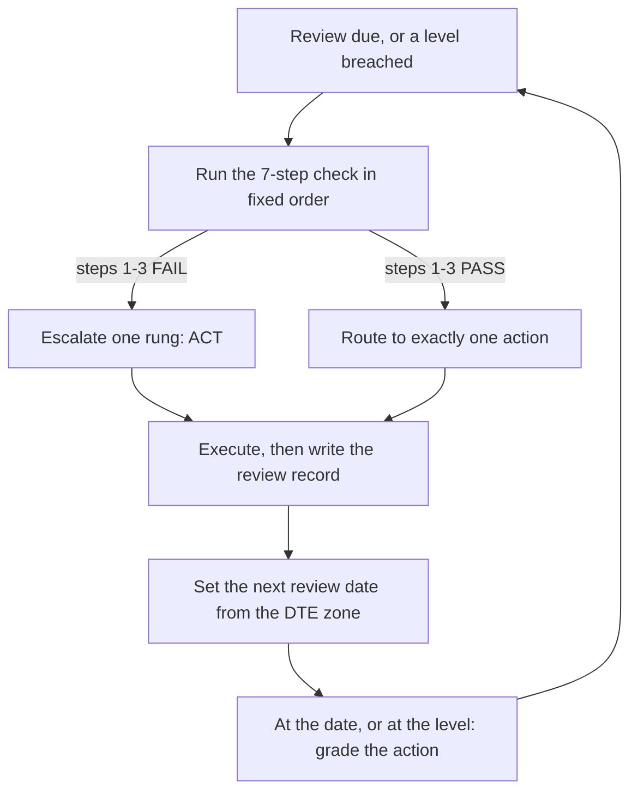

# Options Position Lifecycle

> **Portability target:** spec-level; broker examples are illustrative. Every action here is a decision plus the numbers that decision needs — never a broker-specific command sequence.

<!-- QUICK: 30s -->
The whole skill is one loop: check in a fixed order, route to exactly one action, write the date you will revisit it. If you read nothing else, read the Action Router.

This skill owns **three things and only three things** for a position that is already open: **DECISIONS**, **ORDER**, and **SCHEDULE**. What it refuses to let happen is a position that is open, unexamined and undeclared — the state in which every avoidable options loss is born.

---

## Route the Request

### Auto-Route (no user input needed)

| Detected condition | Route |
|--------------------|-------|
| A named open position whose DTE is inside 45 days | Phase 1 health check, then the Action Router |
| "Should I hold / add / roll / cut this?" | Action Router → priority order |
| "How often should I check this?" | Review Cadence by DTE zone |
| "My TP and my stop both fired, or two playbooks disagree" | TP/SL Precedence and Arbitration |
| Price closed beyond the written invalidation level | Escalate one rung immediately, then re-run Phase 1 from step 1 |
| Expiry inside 3 days | Expiry protocol; decide by 15:45 ET on expiry day |
| An open position with no written exit contract | Freeze: no adds, no new risk in that name, until the contract exists |
| A winner sitting above rung 2 with no trim executed | TRIM review before any new entry is discussed |

### Intent Route (ask only when the auto-route does not fire)

1. Is the position open, or still planned? Planned → `options-strategist` for the structure, `trade-sizing-recovery` for the size.
2. Do you want the **decision** or the **mechanics** of one structure edit? Mechanics of a single leg → `options-leg-management`.
3. Is the problem this position, or the book behind it (aggregate Greeks, margin, capital floors, DTE calendar)? Book → `options-risk-engineer`.
4. What is the written invalidation level, and when was it last checked? No level → Phase 1 step 1 fails; fix that before anything else.

---

## Anti-Rationalization

**AR-01 "It's only down on paper":** You CANNOT treat an unrealized loss as unreal. The mark is the price at which the position closes today; if the market is open and the exit fills, the loss is real. "On paper" is a description of the settlement date, not of the risk.

**AR-02 "I'll average down and fix the basis":** You CANNOT average down as such. The only legal form is the defined-risk restructure that passes the written gate in `(references/average-down-restructure-gate.md)`. "Just one more contract" is not a form of it.

**AR-03 "I'll decide when the DTE alarm goes off":** You CANNOT wait for the calendar. A level breach re-arms the review clock in the same session, at any DTE. The calendar is a floor on attention, not a substitute for it.

**AR-04 "The resting stop order will handle it":** You CANNOT delegate the stop to an order. Thin books gap through stops; the stop is a level plus an action, and the action belongs to a human or an explicit rule, not to the exchange's matching engine.

**AR-05 "Rolling for credit always helps":** You CANNOT roll to repair a thesis that broke. A roll buys time; it does not buy back a level. Rolls are credit-or-flat and capped at two per position.

---

## Ground Rules

Read these before anything else in this skill. They are mechanical, not aspirational: each has a trigger that can be detected and a response that can be enforced.

| # | Rule | Mechanical Trigger | Violation Response |
|---|------|--------------------|--------------------|
| R1 | The health check runs in fixed order 1→7 and stops early | Any position review | Restart at step 1. A review that starts at P&L is not a review |
| R2 | Steps 1–3 are gates: any FAIL escalates the position to ACT | FAIL on thesis, structure integrity, or DTE bucket | Write the ACT disposition before any other position is discussed |
| R3 | Every open position carries a written exit contract (level, target, date, events) | Position opened, inherited, or found undocumented | Position frozen: no adds, no new risk in that name, until the contract exists |
| R4 | One action per review, chosen by the router's priority order | Two or more actions qualify | Higher-priority action wins; the loser is recorded as a standing queued action |
| R5 | HOLD requires a date and a level | Any HOLD on a losing or stalled position | The HOLD is invalid; apply the next action down the router |
| R6 | TP/SL precedence resolves family → rung → calendar → breaker | Two thresholds disagree | Do not average the two. Apply the precedence table and record which rule won |
| R7 | Cuts happen into strength or in the first 30 minutes of RTH, never into a gap | Loss band reached | If the book gapped, queue the cut for the next RTH open window, not the opening print |
| R8 | Every action above HOLD writes its expected outcome and its grading date | Any TRIM / CUT / ROLL / CONVERT / CLOSE | Incomplete review record → the position counts as unmanaged at the next book review |

---

## Anti-Hallucination

- **Admit uncertainty** — if the current mark, the account's DTE calendar, or the remaining max loss is not in front of you, say so and fetch it. Never route an action off a guessed number.
- **Flag your knowledge cutoff** — quotes, Greeks and margin schedules decay within a session. State the timestamp and source of every figure used, and re-pull it before acting on it.
- **Never guess security** — if an action touches order authority, account permissions, or *which contract is actually held*, stop and confirm. A roll executed on the wrong expiry is worse than no roll, and a "should be fine" assumption about a naked leg is how an account loses its capital floor.
- **[VERIFIED]** — rules attributed to an exchange or regulator name their source (OCC, Cboe, FINRA). Everything else is labelled `[COMPUTED]`, `[ESTIMATED]`, `[BROKER-VERIFIED]` or `[COMMON-PRACTICE]`. Past performance is not a guarantee; these are operating bands, approximate by construction, not predictions.

---

## The Expert's Mindset

A position is not an opinion, it is a commitment with a clock attached. The professional's first question about an open position is never "am I up or down" — it is "is the reason I put this on still true, and does the clock still allow the plan". P&L is an output. The level and the calendar are inputs. Reviewing the output before the inputs is exactly how a −12% position becomes a −70% position: nothing about it changed except that nobody looked at the level.

The second habit is that a position is a **contract with a counterparty who is also reading the clock**. Time is not neutral for options: for a long-premium position, time is a cost that accrues every session; for a short-premium position, time is income that arrives only if the level holds. Both sides are therefore always deciding whether the *remaining* premium is worth the *remaining* risk. The question "is this still a good use of the capital it occupies" is the only question that matters, and it is a fresh question every review — never inherited from the review before.

The third habit is that the decision set is small and ordered. Amateurs invent actions under pressure ("I'll add and get it back", "I'll move the stop"). Professionals pick from eight, in a fixed priority, and the priority is what makes the choice reproducible on a bad day. When two actions qualify, the router already knows which one wins — that is the entire point of writing it down before the loss.

The fourth habit is **arithmetic over narrative**. Every action this skill routes carries a number that must be computed before the action is taken: the new max loss, the new break-even, the blended cost, the credit received, the remaining extrinsic. If the number cannot be produced, the action cannot be taken. This is not pedantry; it is the mechanism that converts a story about a chart into a bounded bet.

### What Position Managers Know That Others Don't

- **The level, not the P&L, is the trigger.** A position can be down 30% with an intact thesis and up 40% with a broken one. Rank them by thesis state first, then by money.
- **Defined risk is a form of exit.** A structure whose worst case is known has already answered the most important question about it.
- **Rolls are purchases of time, priced in risk.** A roll for credit that moves the strike closer to the money is not free money; it is a larger bet bought with the illusion of a credit.
- **Liquidity is a property of the exit, not of the entry.** You learn the real spread when you need to leave. Assume the exit costs more than the quote suggests.
- **The cheapest loss is the one taken at the level you wrote down.** Every dollar past that line is paid to the story you told yourself while the level broke.

### When to Break Your Own Rules

<!-- DEEP: 10+min -->
Read this subsection fully before granting yourself the first exception.

Breaking a rule is allowed only with all three of: a written reason, a bounded worst case, and a date by which the exception is graded. Without all three it is not an exception, it is drift.

- **Expiry-week assignments on purpose.** A short ITM option you intend to take assignment on (for stock you wanted anyway) may skip the CUT band — but the stock leg then needs a new exit contract before the assignment settles.
- **Event-driven holds.** A pre-earnings structure held deliberately through the event is a bet on the event, so it must be sized as one and it must state the post-event action for both outcomes.
- **Circuit-breaker days.** When the desk breaker is on, "the rules say hold" is not a defence. The breaker exists precisely to override locally reasonable holds during a correlated unwind.
- **Deep-value long-dated positions.** A LEAPS thesis may legitimately sit through a correction without action — but it is still re-underwritten monthly and the DTE headroom must still be real.

---

## Deliberate Practice

<!-- STANDARD: 3min -->
The loop is only as good as the grading step. Practise the review *and* the grade on a closed position before doing it live.



| Level | Routine | Time | Success Metric |
|-------|---------|------|----------------|
| Novice | Run the 7 steps in order on one position; never look at P&L first | per position, 2 min | zero reviews that start at P&L |
| Intermediate | Apply the router priority; write the exit contract (level, target, date, events) | per review, 5 min | 100% of open positions carry a dated contract |
| Advanced | Run the whole book on the DTE cadence; arbitrate TP/SL conflicts explicitly | daily/weekly, 20 min | zero unresolved threshold conflicts; zero overdue reviews |
| Expert | Tune cadence by regime; audit which rule won each conflict and whether the winner was right | weekly + monthly, 60 min | precedence table refined from graded outcomes, not opinion |

---

## Operating at Different Levels

### L1: Apprentice
- **Scope:** One position, one decision, one action from the router.
- **Autonomy:** Applies the seven steps and the priority order mechanically; asks before any exception.
- **Impact:** Stops the single largest avoidable loss class — the unexamined position.
- **Craft:** Can state the invalidation level, the DTE and the next review date in one sentence.

### L2: Practitioner
- **Scope:** A handful of positions across families (credit spreads, debit verticals, long premium).
- **Autonomy:** Runs the router unaided; writes exit contracts; escalates correctly under a breach.
- **Impact:** Consistent disposition of every loser; no orphan positions; trims booked on schedule.
- **Craft:** Distinguishes a level-based stop from a premium-based stop and knows which family it is holding.

### L3: Senior
- **Scope:** The whole book's review schedule; conflict arbitration across sources.
- **Autonomy:** Sets the cadence, owns the precedence resolution, runs the escalation ladder.
- **Impact:** The book's attention budget matches its risk budget; nothing important is stale.
- **Craft:** Reads liquidity and event calendars as inputs to the decision, not as footnotes.

### L4: Staff / Principal
- **Scope:** Design of the review system — cadence, records, grading, breaker definitions.
- **Autonomy:** Defines what "in plan" means per family; owns the desk circuit breaker conditions.
- **Impact:** Drawdowns from position mismanagement are bounded by process, not by temperament.
- **Craft:** Can show, from the review record, which rule won each historical conflict and whether it was right.

### L5: Transformative
- **Scope:** The culture and tooling that make the loop survive a bad week.
- **Autonomy:** Codifies the cadence and the gates so the operator's worst day cannot skip them.
- **Impact:** The process, not willpower, governs the book; every graded loss becomes a permanent rule change.
- **Craft:** Measures itself with the grading scorecard and prunes rules that do not earn their keep.

---

## When to Use

**Use this skill when:**

1. **A position is open and its next move is undecided** — you need one action, chosen in a fixed order, not a menu.
2. **A level broke** — you need the escalation rules and the cut discipline before the next tick.
3. **Two thresholds disagree** — your TP says hold, your stop says leave, and the calendar says neither.
4. **A loser needs a plan rather than a hope** — you need the hold-and-revisit contract with a hard improve-by date.
5. **A winner is running past its rung** — you need the trim ladder and the whole-unit rule.
6. **The review schedule itself is the problem** — positions are drifting between quarterly glances and daily obsession.

---

## When NOT to Use

**Do NOT use this skill when:**

1. **The position does not exist yet** — strategy and strike selection belong to `options-strategist`; sizing and TP/SL levels at entry belong to `trade-sizing-recovery`.
2. **You need a number, not a decision** — contract counts, dollar risk bands and expectancy arithmetic live in `trade-sizing-recovery`; this skill consumes them and never invents them.
3. **You need one leg surgically edited** — rolling a single leg, legging into a fill, or repairing a ratio belongs to `options-leg-management`.
4. **The problem is portfolio-level** — aggregate Greeks, pin risk, margin stress, the DTE calendar and capital floors belong to `options-risk-engineer`.
5. **You want a new strategy for the same thesis** — that is re-entry, and re-entry has its own gate (`references/hold-and-revisit-protocol.md`).

---

## Decision Trees

<!-- QUICK: 30s — DT2 is the router. When two actions qualify, the higher rung wins; the rest of this section explains why each rung sits where it does. -->

### DT1: Is this still the position I bought? (the seven-step gate)

```text
Review due, or a level breached
├─ 1. Thesis: is the level / invalidation still intact?
│   ├─ NO  → ACT. The level is the position. Route to CUT, or ROLL if credit-or-flat.
│   └─ YES → continue
├─ 2. Structure integrity: legs, widths, ratios, any naked exposure?
│   ├─ NO (a leg closed, ratio drifted, assignment left stock) → ACT. CONVERT or RESTRUCTURE.
│   └─ YES → continue
├─ 3. Clock: what does the DTE bucket force right now?
│   ├─ 0-2 DTE   → ACT. Expiry protocol; decide by 15:45 ET on expiry day.
│   ├─ 3-7 DTE   → ACT. Gamma watch; pay no new extrinsic.
│   └─ 8+ DTE    → continue
├─ 4. P&L vs the plan band (band, not emotion)
│   ├─ at or above TP rung 1 → TRIM (whole units, ladder)
│   ├─ inside the band       → continue
│   └─ through the SL band   → CUT, or RESTRUCTURE only if the written gate passes
├─ 5. Liquidity: does the exit still fill at size?
│   ├─ NO  → reclassify as a WRITE-OFF candidate; stop paying attention, not money
│   └─ YES → continue
├─ 6. Events before expiry: earnings, FOMC, ex-dividend, index rebalance?
│   ├─ YES → PREPARE: pre-event exit or hedge, decided before the event
│   └─ NO  → continue
└─ 7. Are the TP/SL brackets live and correctly priced for the structure you now hold?
    ├─ NO  → re-place or re-spec them today
    └─ YES → HOLD with a written revisit date and the level that re-arms it early
```

### DT2: Which action wins when several qualify?

```text
Two or more actions qualify — which one?
▼
1. DESK CIRCUIT BREAKER active?
   ├─ YES → CLOSE / reduce only. Everything below is deferred.
   └─ NO  → continue
▼
2. CALENDAR FORCE active? (0-2 DTE, assignment or pin risk, margin call)
   ├─ YES → CLOSE or ROLL now, inside the window given by options-risk-engineer.
   └─ NO  → continue
▼
3. THESIS BROKEN at the level?
   ├─ YES → CUT into strength, or CONVERT if a defined structure is strictly better.
   └─ NO  → continue
▼
4. LOSS BAND BREACHED, and the plan says cut?
   ├─ YES → CUT. RESTRUCTURE only if the written gate in the average-down reference passes.
   └─ NO  → continue
▼
5. PROFIT RUNG HIT?
   ├─ YES → TRIM whole structure units on the ladder. Never fractionate a leg.
   └─ NO  → continue
▼
6. STRUCTURE DEGRADED BUT ALIVE? (delta drift, ratio slip, one side weakened)
   ├─ YES → CONVERT (mechanics via options-leg-management) or ROLL (credit-or-flat, max 2).
   └─ NO  → continue
▼
7. NOTHING TRIGGERED
   ├─ thesis intact, inside bands, no events → HOLD with a date and a level.
   └─ and only here, and only on a winner already at rung 1 → consider ADD.
```

### DT3: Which threshold wins — TP, SL, or the calendar?

```text
Two thresholds disagree. Which binds? (resolve top-down, stop at the first YES)
├─ Is a desk circuit breaker active?
│   ├─ YES → the breaker wins. Flatten to the breaker's limit. Stop.
│   └─ NO  → continue
├─ Is a calendar or expiry force active? (0-2 DTE, assignment, pin, margin call)
│   ├─ YES → the calendar force wins; options-risk-engineer owns that window.
│   └─ NO  → continue
├─ Was a plan-level rung declared at entry for this name?
│   ├─ YES → the declared rung wins inside its own structure family.
│   └─ NO  → continue
├─ Take the structure-family threshold. NAME the row; never restate its value —
│   the numbers live in `trade-sizing-recovery`'s Canonical Threshold Table.
│   ├─ rows: credit vertical | iron condor | iron butterfly | debit vertical | long
│   │   single or LEAP | calendar or diagonal | CSP or covered call — read yours
│   ├─ this skill owns the ORDER: TP before SL, family row before any plan rung
│   │   that was NOT declared at entry
│   └─ worked arbitrations: (references/tp-sl-precedence-and-arbitration.md)
└─ Then, from the SAME row: short premium → that row's credit multiple;
    long premium → that row's %-of-debit backstop; directional → level-based
    stop on the close, never a resting order
```

### DT4: HOLD-WITH-TP, or CUT?

```text
Position is a loser. Hold it with a plan, or cut it?
├─ Is the thesis still true at the level?
│   ├─ NO  → CUT. There is no hold on a broken thesis.
│   └─ YES → continue
├─ Is there DTE headroom for the plan to complete?
│   ├─ NO (under 15 DTE for a repair, under 8 DTE for anything needing a level test) → CUT
│   └─ YES → continue
├─ Can the exit still fill at size today? (spread width, open interest, depth)
│   ├─ NO  → WRITE-OFF. Mark no-TP by construction; remove from the attention set.
│   └─ YES → continue
├─ Can you name the target multiple, the level that must hold, and the improve-by date?
│   ├─ NO  → that is hope, not a plan → CUT
│   └─ YES → HOLD-WITH-TP granted:
│       ├─ write all four fields: level, target multiple, improve-by date, event calendar
│       ├─ re-arm the clock at the level, not only at the date
│       └─ at the improve-by date: at plan, or cut. No renegotiation.
```

---

## Core Workflow

<!-- QUICK: 30s — Phase 1 gates on steps 1-3. A FAIL there escalates the position *before* the P&L is read; that ordering is the whole protocol. -->

### Phase 1: The ordered health check (~2 min per position)

Work the seven steps **in order**; do not skip ahead to step 4 because step 4 is the interesting one. Steps 1–3 are gates — a FAIL on any of them ends the check and escalates the position to ACT. Full criteria and a worked transcript: `(references/position-health-check-protocol.md)`.

1. **Thesis.** Is the level or invalidation still intact? Name it and mark it pass/fail against the last close.
2. **Structure integrity.** Legs present, widths unchanged, ratios as designed, no naked exposure produced by an earlier close or assignment.
3. **Clock.** Which DTE bucket are we in, and what does that bucket force? (0–2, 3–7, 8–21, 22–45, 46+, LEAPS.)
4. **P&L vs plan.** Position against its band — rung hit, inside band, or band breach.
5. **Liquidity.** Bid/ask width, open interest, and whether the intended exit still fills at size.
6. **Events.** Earnings, FOMC, ex-dividend, index rebalance, scheduled data, before expiry.
7. **Instruments live.** TP and SL brackets exist, are correctly priced for the structure now held, and are on the right side.

### Phase 2: Route to exactly one action (~1 min)

Apply DT2's priority order. Record the winner and the queue of losers. If the winner changes the max loss, compute the new max loss now — an uncomputed action is not yet a decision. Cross-check the family thresholds in `(references/tp-sl-precedence-and-arbitration.md)` before touching a TP or an SL.

### Phase 3: Execute and instrument (~5 min)

Do the action, then do the boring part: replace or re-price the brackets, update the exit contract, and note the new break-even. Every action above HOLD writes its expected outcome in one sentence and the date it will be graded. This is what makes the next review a judgement rather than a feeling.

### Phase 4: Schedule the next look (~2 min)

Set the next review from the DTE zone table in `(references/review-cadence-by-dte-zone.md)` — and re-arm it at the level. The date is the floor; the level is the trigger. Any level breach pulls the review forward to now, at any DTE.

### Phase 5: Revisit and grade (~10 min, at the revisit date)

If the position was granted HOLD-WITH-TP, the improve-by date is a decision date, not a discussion: at plan, or cut. Grade the action against what was expected, write the one-line lesson, and update the precedence table if a rule lost. Then, and only then, consider re-entry — through the re-entry gate, never through nostalgia.

---

## Best Practices

1. **Check the level before the P&L.** The first three steps are structural, not financial. A review that opens with "we're down 18%" has already lost the plot.
2. **Treat steps 1–3 as gates, not as scores.** One FAIL ends the review and produces a disposition. Partial compliance with an invalidation is not a thing.
3. **One action per review.** Two actions qualify → the router's priority wins, the other becomes queued. Doing both is how a repair becomes a new position.
4. **Write the improve-by date in the contract, not in your head.** A hold with no date is a hope with a nickname, and it will be renegotiated every time it is examined.
5. **Cut into strength, never into a gap.** A gap-down open is the worst liquidity of the day; if the level broke overnight, act in the first RTH window, not on the opening print.
6. **Trim in whole structure units.** Half a condor is a naked leg. If the unit count will not divide, trim the whole thing and re-establish a smaller one on a fresh decision.
7. **Roll at most twice, and only credit-or-flat.** The third roll is a thesis being hidden behind a schedule; it converts a known loss into an unknown one.
8. **Arbitrate thresholds explicitly and record the winner.** Averaging one family's take-profit with another family's stop — a percentage of credit against a multiple of that same credit — produces a rule that belongs to neither family.
9. **Let liquidity decide the mechanism, not the decision.** Whether you cut or write off is an execution question; whether you leave is a thesis question.
10. **Re-run the check after any action.** Actions change the structure; a post-action position is a new position and deserves its own pass through step 2.
11. **Grade every action, including the winners.** An ungraded action teaches nothing, and the precedence table can only be tuned from graded outcomes.
12. **Cooldown before re-entry.** After a cut, the name is closed for a defined period; re-entry needs a fresh thesis, not a fresh price.

---

## Error Decoder

| Symptom | Root Cause | Fix | Lesson |
|---------|-----------|-----|--------|
| A position "suddenly" collapses from −15% to −65% | Reviews only happened at the DTE alarm; the level broke mid-zone and nobody was re-armed | Move the trigger to the level; keep the DTE cadence as the floor | A calendar is a poor substitute for a level |
| A repaired loser becomes the largest risk in the book | The restructure was legal in form but added risk beyond the original band | Recompute max loss before the roll; refuse any restructure whose new max loss exceeds the remaining band | Fixing a small loss with a larger bet is a size error wearing a repair's clothes |
| A winner gives back everything and closes flat | Rung 1 was reached and never trimmed; the trail rule was never written | Trim whole units at rung 1 and rung 2 at the time of the review, and write the trailing rule before the runner exists | Unrealized profit is not a plan until a rung is booked |
| A short call is assigned the day before expiry | Ex-dividend crossed an ITM short call, and the event check was skipped | Put ex-dividend in the event list for every short call; decide before the ex-date, not after | Assignment risk is an event, not a price |
| A roll executed for a "credit" increases the loss when the level finally breaks | The roll moved the strike closer to the money; the credit was the price of the larger risk | Roll only to a strike/width that keeps max loss inside the band, credit-or-flat | Credit is not evidence of a good roll |
| Every loser in the book is a HOLD and every winner was trimmed too early | The router was applied to P&L rather than to the thesis — the disposition rule was never actually used | Re-run DT2 on the loss side; HOLD requires a level that holds and a date | A disposition rule applied to the wrong variable is just decoration |

---

## Error Recovery

| Symptom | First Action | If That Fails | Last Resort |
|---------|--------------|---------------|------------|
| Market gapped through the invalidation level | Do not chase the opening print; queue the exit for the first 30 minutes of RTH | Use a limit at a level you can defend, and accept a partial fill | Accept the fill and re-underwrite what remains; never average down a gapped loss |
| No executable exit (spread too wide, no depth) | Reclassify as a WRITE-OFF candidate; stop monitoring it | Leave a resting order at a level you would genuinely accept | Let it expire; collect the lesson row; the attention you saved is the recovery |
| The DTE calendar collides with the plan (the repair needs more time than the position has) | Shorten the plan to what the clock allows, or close | Roll only if credit-or-flat and inside the band | Close; a plan that cannot fit the clock is not a plan |
| Two playbooks disagree and both are "house rules" | Apply the precedence order: breaker → calendar → declared rung → family threshold | Ask which source owns the number (sizing vs calendar) and follow that owner | Apply the more conservative threshold and record the conflict for the review |
| An action was executed but the bracket was not replaced | Re-place the brackets before any other work; the position is currently unmanaged | If the market has already moved, re-spec the brackets at the new structure's levels | Flatten to a known-risk state rather than carry an unmanaged structure overnight |
| The improve-by date arrived and the position is not at plan | Cut, per the contract. Do not renegotiate the date | If liquidity blocks the cut, write off and remove from the attention set | Cooldown the name; re-entry requires a new thesis through the re-entry gate |

**Hard failure boundary:** after three failed attempts to resolve the same conflict on the same position, escalate to the human owner of the book. Do not loop, and do not reframe the problem to avoid the escalation.

---

## Cross-Skill Coordination

### Upstream (what this skill needs)

| Upstream Skill | Artifact Needed | What You'll Use It For |
|----------------|-----------------|------------------------|
| `trade-sizing-recovery` | Structure-family TP/SL thresholds, loss bands, restructure gate arithmetic | The numbers this router routes to — never invented here |
| `options-leg-management` | Leg mechanics: rolls, leg edits, ratio repair, fill sequencing | CONVERT and leg-level ROLL execution |
| `options-risk-engineer` | DTE calendar, aggregate Greeks, pin/assignment windows, capital floors | The calendar-force check in DT2 and DT3 |
| `options-strategist` | The structure and its original thesis statement | Step 1: what had to stay true |
| `market-data-engineer` | Event calendar (earnings, ex-dividend, index rebalance) and marks | Step 5 and step 6 |

### Downstream (what this skill produces)

| Downstream Skill | Deliverable | What They'll Do With It |
|------------------|-------------|-------------------------|
| `options-risk-engineer` | Position dispositions, planned closes, roll windows, band states | Recompute aggregate Greeks, margin and pin risk against the planned book |
| `trade-performance-analyst` | Graded action records: action, expectation, outcome, lesson | Attribute expectancy by action type and by rule that won |
| `portfolio-signal-manager` | Standing queued actions and frozen names | Re-weight the book and respect freezes/cooldowns |
| `trade-sizing-recovery` | Evidence that a band or threshold was wrong in practice | Recalibrate bands from graded outcomes rather than from opinion |

---

## Proactive Triggers

- **A named position's DTE enters a new bucket** → announce the cadence change before being asked. 🟡
- **Price closes beyond a written invalidation level** → escalate one rung immediately and re-run Phase 1 from step 1. 🔴
- **Profit reaches rung 1 with no trim on file** → propose the whole-unit trim now. 🟡
- **A short call sits ITM ahead of an ex-dividend date** → flag assignment risk and decide before the ex-date. 🔴
- **A position has no written exit contract** → freeze the name (no adds, no new risk) and write the contract. 🔴
- **A roll would be the third on the same position** → refuse and route to CUT. 🟠
- **A restructure would push max loss beyond the remaining band** → block it and record the refusal. 🔴
- **An improve-by date is within two sessions** → surface the pending decision before it becomes a post-hoc rationalisation. 🟠
- **The same conflict has now been arbitrated twice with different winners** → bring it to the review with both records. 🟡
- **A trimmed name is being proposed for re-entry inside its cooldown** → name the cooldown and block it. 🟠

---

## Anti-Patterns

| ❌ Anti-Pattern | ✅ Do This Instead |
|----------------|-------------------|
| ❌ Opening the review with "we're down 18%" | ✅ Steps 1–3 first: thesis, structure, clock. Money is step 4 |
| ❌ "It's only down on paper, it'll come back" | ✅ The mark is the price you can transact at today; treat it as real and apply the router |
| ❌ Averaging down "to fix the basis" | ✅ Defined-risk restructure through the written gate, or CUT. Nothing else counts as legal |
| ❌ Rolling for credit into a wider or closer structure without recomputing max loss | ✅ Recompute max loss first; refuse the roll if it breaches the remaining band |
| ❌ Letting a winner run past the max-profit strike "hoping for more" | ✅ Trim whole units at each rung; the runner gets a written trailing rule or it does not exist |
| ❌ Reviewing only when the DTE alarm fires | ✅ The cadence is the floor; a level breach re-arms the review in the same session |
| ❌ Adding to a winner so large that the position breaches its band | ✅ The ADD must leave the structure inside its band; if it cannot, the add is the new position's problem, not this one's |
| ❌ Re-entering a cut name in the same week because the price "looks better" | ✅ Cooldown first, then the re-entry gate: thesis, IV rank, DTE headroom, credit floor |

---

## State Log

| Turn | Action | Decision | Risk Accepted | Mitigation |
|------|--------|----------|---------------|-----------|
| 1 | Ran Phase 1 on an open 30-DTE put credit spread, short strike breached on the close | Thesis FAIL at step 1 → ACT; routed to CUT into the first RTH window | Gap risk until the window opens | Brackets re-priced pre-session; exit limit set at a defensible level |
| 2 | Graded the cut: filled inside the written loss band, loss booked | Precedence conflict resolved in favour of the level, not the credit-spread take-profit rung | Slippage versus the modelled fill | Recorded the fill gap as an execution cost, not as a band change |
| 3 | Applied cooldown to the name for the stated period | No re-entry without a new thesis | Opportunity cost if the name recovers fast | Re-entry gate requires a fresh thesis, IV rank and DTE headroom |

**Anti-Drift Check.** Before each response on this position:

1. Did the last action match the plan recorded in the contract?
2. Is the next review date still the earliest of the date floor and the level trigger?
3. Has anything arrived since the last review that invalidates the disposition — a new event, a structure change, a margin change?

---

## Production Checklist

- [ ] **CR1: The seven steps ran in order** — **Complete when** steps 1–7 are each marked pass/fail in the review record.
- [ ] **CR2: The thesis is stated as a level** — **Complete when** the invalidation is a price or a named condition, not an adjective.
- [ ] **CR3: Structure integrity verified** — **Complete when** legs, widths and ratios are checked against the original design, and any naked exposure is named.
- [ ] **CR4: DTE bucket identified and its force stated** — **Complete when** the bucket and the action it forces are written in one line.
- [ ] **CR5: P&L mapped to a band** — **Complete when** the position is labelled rung hit / inside band / band breach.
- [ ] **CR6: Liquidity checked for the intended exit** — **Complete when** the spread width and open interest support the exit size, or the position is reclassified as a write-off candidate.
- [ ] **CR7: Event calendar checked to expiry** — **Complete when** earnings, FOMC, ex-dividend and index rebalance are each listed as present or absent.
- [ ] **CR8: Brackets live and correctly priced** — **Complete when** both the TP and SL instruments exist and match the structure now held.
- [ ] **CR9: Exactly one action chosen** — **Complete when** the winner is recorded and the losers are queued, not executed.
- [ ] **CR10: Numbers computed for the chosen action** — **Complete when** the new max loss and break-even are shown, or the action is refused for lack of them.
- [ ] **CR11: New loss inside the remaining band** — **Complete when** any restructure or add shows max loss ≤ the band, with the arithmetic visible.
- [ ] **CR12: Next review dated, and the level trigger armed** — **Complete when** both the date (from the DTE zone) and the level are written.
- [ ] **CR13: Expected outcome recorded** — **Complete when** the action carries one sentence of expectation plus a grading date.
- [ ] **CR14: Outcome graded at the revisit date** — **Complete when** the action is scored against its expectation and the lesson row is written.

---

## What Good Looks Like

A well-run book sounds like a shift log, not a market commentary. Every open position has a contract: a level that must hold, a target, a date, an event list. Reviews happen on a cadence that tightens automatically as the clock runs down, and a single close beyond a level pulls the review forward without anyone deciding to be disciplined. When two rules disagree, the arbitration is written down and the winner is named. Losses exit inside the band they were planned for, winners are booked in whole units at rungs, rolls are credit-or-flat and rare, and dead tickets are written off and forgotten. Nothing in the log reads as hope.

**Signs of Excellence:**

- Every action traces to a router entry and a computed number.
- Every loser has a disposition; every disposition has a date; every date is met.
- The precedence table has been amended from graded outcomes — evidence that the desk learns from its own conflicts, not just from the market.
- Positions are frozen quickly when their contract is missing, and unfrozen only when it exists.

**Signs of Dysfunction:**

- The first number mentioned in a review is a P&L percentage.
- TP levels move away from price as price falls.
- The phrase "let's see how it opens" appears in a decision record.
- Rolls cluster on the positions with the strongest narrative and the worst arithmetic.

---

## Verification Guardrails

### Pre-Generation

- [ ] The position and its contract are identified (never route an action against a guessed holding).
- [ ] The current mark, the DTE, and the remaining max loss have a stated timestamp and source.
- [ ] The structure is confirmed as it is held now — not as it was designed at entry.
- [ ] The owner of every number used is known: sizing numbers from `trade-sizing-recovery`, calendar forces from `options-risk-engineer`.

### Post-Generation

- [ ] Exactly one action was chosen, and its priority position is stated.
- [ ] Any TP/SL change names which rule won and why the loser did not.
- [ ] New max loss and new break-even are displayed, or the action was refused.
- [ ] The next review date and the level trigger are both written.

### Failure Modes

**Failure modes and known limitations — what goes wrong with position management, and the countermeasure for each:**

1. **Failure mode: the review degrades into a P&L glance.** When attention is short, step 4 crowds out steps 1–3 and the structural problem survives another cycle. Countermeasure: the gates are pass/fail and must be written before step 4 is read.
2. **Failure mode: the level quietly moves.** A stop is restated a few percent lower each week until it is meaningless. Countermeasure: the level is versioned in the review record; changes require a written reason and a new grading date.
3. **Failure mode: the roll chain.** A position is rolled repeatedly and, at the third roll, the original structure is unrecognisable. Countermeasure: a hard cap of two rolls, credit-or-flat, with max loss recomputed at each one.
4. **Failure mode: the repair that adds risk.** A restructure passes the "defined risk" description while raising max loss above the remaining band. Countermeasure: the gate is arithmetic, not categorical — new max loss must be shown and compared.
5. **Failure mode: liquidity evaporates exactly when the exit is needed.** Worst case: the intended stop-loss cannot fill at the planned level and the position is carried into the event. Countermeasure: check exit depth at every review, and pre-classify thin positions as write-off candidates rather than pretending they are tradeable.
6. **Failure mode: the calendar surprises.** An ex-dividend date on an ITM short call, an index rebalance, or an early-close half-session produces an assignment the plan never contemplated. Countermeasure: the event list runs to expiry, not to the next review.
7. **Failure mode: the trimming habit dies after two wins.** Winners are allowed to run because the last two runners paid. Countermeasure: rungs are orders, placed at the review, not intentions.
8. **Failure mode: re-entry as revenge.** A cut name is re-entered inside the cooldown at a bigger size, converting a managed loss into an unmanaged position. Countermeasure: cooldown enforced by name, plus the re-entry gate.
9. **Failure mode: grading is skipped.** Without graded outcomes the precedence table drifts back to folklore and the same conflict is arbitrated differently next month. Countermeasure: an ungraded action keeps the position flagged as unmanaged.
10. **Failure mode: the breaker is declared after the fact.** A desk circuit breaker is invoked to justify closing positions that were already being closed. Countermeasure: breaker conditions are defined in advance, with the action they force.
11. **Failure mode: correlation is counted as diversification.** Several "independent" positions are one exposure at three times the size, so three reviews pass while the book breaches. Countermeasure: count correlated exposure once, at book level, via `options-risk-engineer`.
12. **Failure mode: the clock runs out mid-repair.** A repair plan needing a level test is granted with less DTE than the test requires, so the position arrives at expiry unresolved. Countermeasure: DTE headroom is a precondition of any HOLD-WITH-TP, not a hope.

**Exit conditions / stop-loss rules:**

- Stop-loss: a **level**, defined at entry and versioned — never a resting stop order, never widened intraday.
- Exit condition: the thesis is invalidated (level broken, structure no longer expresses the view, the reason for the trade has been withdrawn).
- Exit condition: the calendar forces it — 0–2 DTE expiry protocol, assignment or pin risk, margin call.
- Exit condition: the improve-by date arrives and the position is not at plan.
- Exit plan: scale out into strength in whole structure units; never add to a losing position outside the written restructure gate.

### Regime Table

The cadence, the trim appetite and the patience budget all change with the regime, so the regime is read at the start of every book review, not once a quarter.

| Regime | What it looks like | What changes here |
|--------|--------------------|-------------------|
| **Bull market / uptrend** | Broad advance, shallow dips, vol drifting lower | Winners reach rungs quickly: trim on schedule, resist letting a runner past its max-profit strike. Rolls are rarely needed; the failure mode is greed, not damage |
| **Correction / pullback** | A decline of roughly 5–10% inside an uptrend; vol ticks up | Short-premium positions move toward their short strikes; shorten the review cadence by one bucket and stop adding extrinsic. Most "level breaches" here are noise — require a close, not a wick |
| **Bear market / drawdown / recession** | A sustained decline of ~20% or more, rallies sold, rising realised vol | The failure mode flips to structural: ratios drift, assignment becomes likely, margin rises. Cut thresholds tighten, rolls get refused, and defensiveness is expected rather than clever |
| **Crash / tail event / March 2020-style dislocation** | Correlation goes to one, liquidity evaporates, stops gap | Circuit breaker territory. Positions are closed or reduced, never restructured; the plan is to survive the day, and the only reliable defence is size already taken at entry |

A regime change is a **state to re-check**, not a background constant: the same structure that was correctly held in an uptrend can be a mistake in a drawdown with no change to the position at all.

### Data Sources and Provenance

Two things are true at once here. The **structure of the decision** — the fixed order, the gates, the priority order — is durable engineering. The **numbers** are not: spread widths, open interest, margin schedules and event dates decay within a session. So every number carries a source, and the thresholds in this skill are **derived from data** (observed spreads, published margin and expiration rules, and graded outcomes from the review record) rather than asserted from opinion.

- `source:` OCC — expiration processing and in-the-money exercise by exception. [VERIFIED] OCC rules treat ITM options at expiration as exercised unless the holder instructs otherwise, which is why the 0–2 DTE expiry protocol exists.
- `source:` Cboe rulebook and the Cboe margin manual — strategy-based margin treatment for spreads and the conventions behind wing-width thresholds. [VERIFIED] Cboe's published margin material is the origin of the "percentage of the spread's width" style of threshold rather than an arbitrary round number.
- `source:` FINRA Rule 4210 — initial and maintenance margin requirements for listed options positions, including the account-type distinction behind Reg T versus portfolio-margin treatment. [VERIFIED] FINRA margin rules
- `data from:` broker margin schedules (for example the published schedules of major retail brokers) — read your own broker's schedule and tag the result `[BROKER-VERIFIED]`, because portfolio-margin minimums differ by firm and are commonly quoted at a $100,000 cost floor and above [COMMON-PRACTICE], firm-dependent.
- `data from:` public historical price and implied-volatility data, including Yahoo Finance and Bloomberg for daily closes and volatility context. [VERIFIED] Yahoo Finance close data is used only for levels and ranges, never for intraday fills.
- `verified against:` the exchange rulebooks for option symbology, expiry calendars and expiration-cycle conventions when a contract identity is ambiguous. [VERIFIED] exchange rules
- `published by:` exchange calendars for trading holidays and half-sessions, which change the expiry-day clock more often than the clock changes for any other reason.
- `data from:` your own review record — the only source that can tell you which rule won a past conflict and whether it was right [COMPUTED] from graded actions, not from recollection.
- Cross-reference the **Pattern Recognition Engine** meta-layer at `skills/14-finance/options-strategist/references/pattern-recognition-engine.md`: it names the pattern being held, and this skill assumes the pattern is still identifiable after every action. If the action changes the pattern, re-name it before the next review.
- [ESTIMATED] Cadence boundaries (45 / 21 / 8 / 3 days) are pragmatic operating bands derived from when gamma and event risk materially change the decision, not from a single measured statistic. Past performance is not a guarantee; thresholds here are approximate and must be re-checked against the position in front of you.

---

## References

| Reference | Covers | Use When |
|-----------|--------|----------|
| [position-health-check-protocol.md](references/position-health-check-protocol.md) | The seven-step ordered check, pass/fail criteria, stop-early rule, worked transcript | Every review, before any action is considered |
| [action-router-decision-matrix.md](references/action-router-decision-matrix.md) | Trigger, precondition, forbidden variant and numbers-owner for all eight actions, plus the priority order | Choosing the action |
| [review-cadence-by-dte-zone.md](references/review-cadence-by-dte-zone.md) | Cadence by DTE zone, expiry-day clock, gamma watch, LEAPS rhythm, re-arm rules | Setting the next review date |
| [tp-sl-precedence-and-arbitration.md](references/tp-sl-precedence-and-arbitration.md) | The precedence order, family thresholds, worked arithmetic, conflict resolution | When two thresholds disagree |
| [add-to-winner-pyramiding.md](references/add-to-winner-pyramiding.md) | Rungs, re-underwrite checklist, blended cost, band recheck, when an add is forbidden | Only on a winner already at rung 1 |
| [average-down-restructure-gate.md](references/average-down-restructure-gate.md) | The five-clause gate, worked arithmetic, rejection examples, audit trail | When someone proposes averaging down |
| [trim-and-scale-out-ladder.md](references/trim-and-scale-out-ladder.md) | Whole-unit rule, thirds ladder, runner trailing rule, minimum unit count | Booking profit at a rung |
| [cut-and-stop-discipline.md](references/cut-and-stop-discipline.md) | Level-based stops, cutting into strength, gap rules, 0DTE same-session rules, write-off classification | Any loss-band breach |
| [hold-and-revisit-protocol.md](references/hold-and-revisit-protocol.md) | The HOLD-WITH-TP contract, improve-by date, no-renegotiation rule, cooldown and re-entry gate | Keeping a loser alive on a plan |
| [roll-and-convert-routing.md](references/roll-and-convert-routing.md) | Roll credit-or-flat, the two-roll cap, convert routing, window ownership | Any structure edit |
| [event-and-expiry-recheck.md](references/event-and-expiry-recheck.md) | Earnings, FOMC, ex-dividend, index rebalance, expiry-day and assignment protocol | Steps 6 and 7, and every short call |

Meta-layer: `skills/14-finance/options-strategist/references/pattern-recognition-engine.md` — the pattern taxonomy this skill assumes still describes the position after every action.

---

## Gotchas

- **The exit spread is part of the loss.** A position marked at $0.35 with a $0.15 wide market carries roughly a 43% exit cost on the remaining premium [COMPUTED]: $0.15 ÷ $0.35 = 43%. Price the exit, not the mark, before deciding whether a cut is worth executing.
- **A resting stop is not a stop.** Thin option books gap through stop orders routinely; a stop that fills at a worse price than the level it was meant to defend has done nothing but create a record.
- **GTC take-profits do nothing through an event.** A resting sell order does not protect a position across an earnings gap; pre-event decisions are separate decisions with separate dates.
- **The short-premium take-profit convention is not universal.** It belongs to the credit families; applying it to a debit vertical is a category error that usually books the winner at a fraction of its intended move. Read the row for the family you actually hold — the rows live in `trade-sizing-recovery`'s Canonical Threshold Table.
- **Rolling "out and down" pays theta twice.** Each roll restarts the decay clock and adds a structure; count the roll's new max loss as new risk, not as a rescue. A $1,200 credit on a roll that raises max loss by $2,400 is a $2,400 risk decision wearing a credit — the credit covers half the added loss [COMPUTED]: $1,200 ÷ $2,400 = 50%.
- **A $0.10 lottery ticket still costs a spread.** Ten contracts at a $0.03 spread is a $30 cost to enter and a $30 cost to leave on a $100 stake [COMPUTED]: 10 × $0.03 × 100 = $30 each way. The round trip is the strategy when the strike is far out.
- **Assignment is an event with a date, not a price.** Ex-dividend and expiration-week mechanics are published in the exchange rules, and they do not wait for the next scheduled review.
- **Write-offs are cheap; attention is not.** Keeping a dead lot in the review rotation burns attention every week, while the $300 cost of exiting it would be paid once [ESTIMATED]. The exact figure depends on your commission schedule, so read your own — then let the lot expire, remove it from the attention set, and keep the lesson.
- **The improve-by date is not negotiable.** If it moves once, it will move every time, and the HOLD becomes a permanent, undated position with a story attached.
