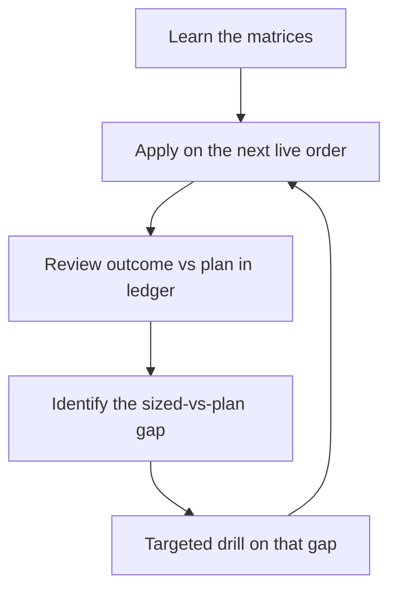

# Trade Sizing & Recovery

> **Portability target:** Spec-level. This skill encodes sizing and recovery discipline, not broker-specific commands.

<!-- QUICK: 30s — memorize the three tables: Sizing Matrix (Decision Tree 1), Loss Triage Matrix (Decision Tree 2), Ladder (Decision Tree 3). Everything else is supporting detail. -->

---

## Route the Request **(QUICK)**

| Condition | Action |
|-----------|--------|
| "How many contracts / how much should I risk / size this" | Route to this skill → Sizing Matrix |
| "This position is down — what now" | Route to this skill → Loss Triage Matrix |
| "How do I make it back / win next / recover" | Route to this skill → Win-Next Protocol (Decision Tree 3) |
| "Where do I put my TP / stop" | Route here for levels; pair with `options-strategist` for structure choice |
| Portfolio Greeks, pin risk, margin stress | Use `options-risk-engineer` instead |

**Intent Route questions:**
1. Is this a new order (sizing) or an existing position (triage/recovery)?
2. If existing: what is the loss % of cost and the DTE remaining?
3. What is the account's trading capital and current total open risk?

---

## Anti-Rationalization **(QUICK)**

**No excuses — the five rationalizations that fund losing accounts:**

**AR-01 "It's a small position":** You CANNOT skip computing max loss × contracts before entry. A $120 "small" loss repeated ten times is a $1,200 portfolio leak — the size of the leak is the size of the habit.

**AR-02 "It might come back":** You CANNOT hold a >70% loser in the hope bucket without a written HOLD-WITH-TP thesis. Hope is not a thesis; a level, a DTE floor, and a TP at 2× mark are.

**AR-03 "I'll size up to make it back faster":** You CANNOT increase size after a loss. Recovery size is BASE size or smaller; the ladder only steps up after wins.

**AR-04 "One more add will fix the average":** You CANNOT average down outside a defined-debit restructure approved in advance. Averaging down turns a triage problem into a solvency problem.

**AR-05 "The TP is too far, I'll just hold and decide later":** You CANNOT carry an open position without a TP order or a documented deliberate no-TP status. "Decide later" is the most expensive position in the book.

---

## Ground Rules — Read Before Anything Else **(QUICK)**

| # | Rule | Mechanical Trigger | Violation Response |
|---|------|-------------------|-------------------|
| R1 | Size is derived from **max loss ÷ risk cap**, never from conviction | Before any order: max loss × contracts computed | Cut contracts until it fits; if it can't, pick a smaller structure |
| R2 | Every order ships with **TP + SL + size + expectancy** stated | Order draft review | No order — write the fourth line first |
| R3 | **Never add to a loser** outside an approved defined-debit restructure | Any "add / average down" impulse | Block; re-route to triage matrix |
| R4 | **Anti-martingale**: step up only after 2 consecutive wins; step down (half-size) after 2 consecutive losses | Ladder check before each new order | Force base size |
| R5 | **Dead lots get no TP and no attention** (mark < 5% of cost) | Position scan | Mark "no-TP by construction"; stop monitoring |
| R6 | Any position ≤ −40% gets a **triage disposition + lesson** recorded | Every scan / review | Disposition missing = position frozen: no adds, no new risk until logged |

---

## Anti-Hallucination

- **Admit uncertainty** — If you don't know the account's trading capital or the position's real mark, say so and fetch it. Never size against a guessed number.
- **Flag your knowledge cutoff** — Greeks, fills, and quotes decay fast; state the timestamp and source of every number used.
- **Never guess security** — If anything touches credentials, account permissions, or order authority ambiguously, stop and ask. Default to the safer interpretation; never invent an account id or an order permission.
- **[VERIFIED]** — Every factual claim traces to a reference in `references/` or a dated live data pull. Tag unverifiable claims `[UNVERIFIED]`.

---

## The Expert's Mindset **(QUICK)**

The professional sizes first, enters second. Entry price is a detail; **position size is the strategy**. Two traders with the same signal but different sizing produce opposite equity curves — sizing, not stock-picking, is the dominant variable in retail profitability.

Trading is a book of bets against an uncertain future. Each bet has a distribution of outcomes; you only control two things — the shape you pay for (defined-risk structures) and how much you pay (size). Losses are **rent**: the cost of staying in the game while the edge plays out. The only unforgivable error is rent you can't afford, which is a sizing error, not a market error.

Recovery from a loss is never a heroics question ("what trade gets it back fastest?"). It is a **size question**: after a loss you go back to base size on the next A+ setup and let the expectancy compound. Revenge-sizing after a −90% loss routinely converts a $300 hole into a $3,000 crater within days — the single most documented path of retail ruin.

### What Sizing Masters Know **(STANDARD)**

- **Risk of ruin beats win rate.** A 65% system at 10% risk per trade goes broke more often than a 45% system at 1.5%.
- **The 2:1 asymmetry is the engine.** ≥45% win rate with ≥2:1 average win/loss is mathematically profitable; a 70% win rate at 0.4:1 is a slow bleed.
- **Expectancy is per-idea, not annual.** Compute it per setup class (fly, single call, LEAP, spread) — one category usually funds the losers, and the losers should be pruned.
- **TP is part of the entry.** Pre-committed exit rungs remove the in-the-moment negotiation where discipline dies.
- **The book has a budget.** Total simultaneous open risk is a portfolio decision (≤ ~10% of trading capital), not the sum of individual impulses.

### When to Break Your Own Rules **(DEEP)**

<!-- DEEP: 10+min — read fully before granting yourself the first exception. -->

- **Catalyst trades with hard dates** (index events, defined-structure binaries): you may size to the top of the band and skip the ladder step-down — but the structure must be defined-risk and the invalidation line must already exist on the chart.
- **Hedges, not bets.** A protective structure that reduces portfolio variance is sized by the exposure it covers, not by expectancy.
- **Deep-value LEAPs on liquid mega-caps** with a multi-quarter thesis may step one band up on total risk (1.5% → 2%) — never on strike selection.
- **War story:** after a −90% single-leg loss, the instinct is a "win it back" trade at 4× size. The math: a 4× position needs only a −25% move to repeat the loss — and that setup is selected under maximum tilt. Recovery that begins with an oversized trade has negative expectancy by construction.

---

## Deliberate Practice **(STANDARD)**



| Level | Routine | Time | Success Metric |
|-------|---------|------|---------------|
| Novice | Compute max loss × contracts before every order; base size only | per order, 30s | 100% of orders sized from max loss |
| Intermediate | Run the ladder (step up/down); log expectancy per setup class | weekly, 20 min | expectancy tracked for every class |
| Advanced | Triage every ≤−40% position within one session; enforce TP coverage | per scan | zero untriaged losers, zero TP-less positions |
| Expert | Portfolio-level open-risk budget; prune the worst-EV class monthly | monthly, 1h | total open risk ≤ cap; worst class retired |

---

## Operating at Different Levels **(STANDARD)**

### L1: Apprentice
- **Scope:** Single new order, base size, single account.
- **Autonomy:** Applies the Sizing Matrix mechanically; asks before any deviation.
- **Impact:** Avoids catastrophic sizing; expectancy ≈ break-even minus costs.
- **Craft:** Computes max loss in seconds; writes TP/SL before entry.

### L2: Practitioner
- **Scope:** Full position lifecycle — entry, scale-out rungs, triage, lessons.
- **Autonomy:** Runs the ladder without prompting; cuts ≤−40% per matrix.
- **Impact:** Positive expectancy on the momentum-fly class; losers capped.
- **Craft:** Distinguishes premium-based SL from level-based SL; knows when a CUT is unexecutable (write-off instead).

### L3: Senior
- **Scope:** Multi-account book; per-venue sizing (fill sessions, thin books).
- **Autonomy:** Sets the standing TP-coverage rule; adjusts bands per account size.
- **Impact:** Book-level open risk stays ≤ cap; no orphan positions.
- **Craft:** Reads liquidity (OI, spread %) before choosing CUT vs WRITE-OFF.

### L4: Staff / Principal
- **Scope:** Portfolio construction — correlation, event calendars, aggregate Greeks.
- **Autonomy:** Sizes the whole book, not the trade; defines post-drawdown recovery policy.
- **Impact:** Drawdowns bounded by design; expectancy improved by pruning classes.
- **Craft:** Fractional-Kelly-flavored sizing on verified edge; refuses to size unverified edges.

### L5: Transformative
- **Scope:** System design — automation, monitors, review cadence, culture.
- **Autonomy:** Codifies sizing into tooling so discipline survives the operator's worst day.
- **Impact:** The process, not willpower, enforces the rules.
- **Craft:** Turns every loss into a permanent rule change; measures itself with the scorecard.

---

## When to Use **(QUICK)**

**Use this skill when:**
1. **Sizing a new order** — you need contracts, TP, SL, and expectancy before entry.
2. **A position is losing** — you need a disposition (cut / restructure / write-off / hold) rather than a feeling.
3. **Planning recovery after a loss** — you need the win-next protocol and the ladder state.
4. **Setting TP/SL levels** — you need rung levels, session eligibility, and trim rules.
5. **Running the weekly review** — you need expectancy by setup class and the prune decision.

---

## When NOT to Use **(QUICK)**

**Do NOT use this skill when:**
1. **Choosing a strategy or structure** — use `options-strategist`.
2. **Measuring portfolio Greeks, pin risk, or margin stress** — use `options-risk-engineer`.
3. **Evaluating whether a signal is real** — use the signal / quant skills; sizing assumes a gate-passed signal.

---

## Decision Trees **(STANDARD)**

### Decision Tree 1: How much can this order risk?

```
New order proposed?
├─ Signal gate-passed (survived the entry checklist)?
│   ├─ NO  → DO NOT SIZE. Send back to signal review.
│   └─ YES → Identify setup class:
│       ├─ Momentum fly / butterfly (defined risk)
│       │   ├─ DTE 2–7d   → risk 0.5% of trading capital, 1 lot
│       │   ├─ DTE 8–14d  → risk 1.0%, 1–2 lots
│       │   └─ DTE 15–45d → risk 1.5%, 1–2 lots
│       ├─ Debit spread / vertical (defined risk)
│       │   ├─ DTE 8–14d  → risk 1.0%, 1 lot
│       │   └─ DTE 15–45d → risk 1.5%, 1–2 lots
│       ├─ Single directional call/put (naked long)
│       │   ├─ Liquid (spread ≤5%, OI ≥500)?
│       │   │   ├─ NO  → DO NOT SIZE (unexecutable exits)
│       │   │   └─ YES → DTE 8–14d risk 0.75%; 15–45d risk 1.0%; 1 lot
│       └─ Long-dated LEAP (≥45d) — liquid large/mega caps ONLY
│           └─ risk ≤ 2.0%, 1–2 lots; NEVER lottery strikes
└─ Then check BOTH portfolio gates:
    ├─ max loss × contracts ≤ per-trade cap ($300–600 / ~1.5%)?
    │   ├─ NO  → cut contracts or choose a smaller structure
    │   └─ YES → continue
    └─ total open risk (all positions, all accounts) ≤ 10% of trading capital?
        ├─ NO  → this order waits, or replaces an existing position
        └─ YES → place the order WITH TP + SL stated
```

### Decision Tree 2: Position is losing — what is the disposition?

```
Position down vs cost?
├─ 0 to −30%  → HOLD. TP stays ≥1.8× cost (momentum). Tighten the level-based invalidation. No adds.
├─ −30 to −50% →
│   ├─ DTE ≥45d AND underlying level intact → HOLD-WITH-TP (TP ≥1.8× cost)
│   ├─ DTE 15–45d → RESTRUCTURE (roll for debit ≤30% of current value) OR cut into strength
│   └─ DTE <15d   → CUT into any bounce (theta wall) — never roll theta into more theta
├─ −50 to −70% →
│   ├─ Thesis intact AND liquid → HOLD-WITH-TP at 2× current mark; otherwise…
│   └─ Thesis broken OR thin (spread >25%, OI <300) → CUT into strength; unexecutable → WRITE-OFF
├─ −70 to −90% →
│   ├─ Bid ≥ 0.20 → FREE OPTION: stop attention, TP at 2× mark, treat as written off
│   └─ Bid < 0.20 → WRITE-OFF (exit fees exceed salvage); let it expire
└─ ≤ −90%     → WRITE-OFF. Log the lesson row. Do not monitor.
```

### Decision Tree 3: What size is the NEXT order (win-next ladder)?

```
Last closed position?
├─ WIN (≥1.8× TP hit or trimmed ≥ target)
│   ├─ 1 win in a row  → base size (1 lot)
│   └─ ≥2 wins in a row → +1 lot (cap 3 lots) on the SAME class only
│       └─ different/new class → base size regardless of streak
├─ LOSS (cut or wrote off)
│   ├─ First loss → reset to base; next A+ setup from the PROVEN class
│   ├─ 2 consecutive losses → HALF size (or 1 lot of a cheaper defined structure) until one win
│   └─ Any loss worse than −50% of cost → treat as 2 consecutive losses + mandatory lesson row
└─ NO CLOSED TRADE YET (new account/class)
    └─ base size (1 lot), simplest defined-risk structure available

Cooldown: after cutting a specific name, no re-entry in that name for 5 sessions unless a
NEW gate-passed setup prints. Recovery = next A+ setup at base size — never "the same trade, bigger".
```

---

## Core Workflow **(STANDARD)**

### Phase 1: Size the order (~2 min)
1. **Do:** Compute max loss per contract (debit paid; spreads: width × 100 − credit). Multiply by candidate contracts. Compare to the Sizing Matrix band and the $ cap.
2. **Verify:** max loss × contracts ≤ per-trade cap AND total open risk after entry ≤ 10% of trading capital.
3. **Output:** contracts chosen, max $ at risk, expected loss if invalidation hits.

### Phase 2: Design the exit before entry (~2 min)
1. **Do:** Write the TP rungs (momentum ≥1.8×, runner 2.5–3×; LEAP 1.5–2×), the level-based SL (underlying RTH close beyond X), and the scale-out plan (e.g., ⅓ at 1.8×, ⅓ at 2.5×, trail the rest).
2. **Verify:** TP and SL both name a price/level and a session (RTH-only orders don't fill pre/post).
3. **Output:** the four-line order contract: **TP / SL / SIZE / expectancy**.

### Phase 3: State expectancy (~1 min)
1. **Do:** One line: rough win% × avg win vs loss% × avg loss. If not clearly positive, do not send the order.
2. **Verify:** the win% is anchored to a base rate ("this class hits 1.8× ~45% of the time" or an explicit estimate) — never vibes.
3. **Output:** signed-off order.

### Phase 4: Triage on every scan (~1 min per position)
1. **Do:** Apply Decision Tree 2 to every position ≤ −40%. Record disposition + lesson.
2. **Verify:** zero positions in the −40%+ zone without a disposition; dead lots flagged "no-TP by construction".
3. **Output:** triage list (CUT / RESTRUCTURE / WRITE-OFF / HOLD-WITH-TP).

### Phase 5: Weekly edge review (~20 min)
1. **Do:** Compute expectancy by setup class (fly / single / LEAP / spread) from the ledger; update ladder state (streak); prune or halve the worst class.
2. **Verify:** every class has hit-rate and avg win/loss numbers; the worst class has an action.
3. **Output:** updated bands, pruned class, refreshed ladder state.

---

## Best Practices **(STANDARD)**

1. **Size from max loss, not from premium × "feels small".** A 0.10 option × 10 contracts in a thin name is a $100 lottery ticket with a 25% spread — the spread is a quarter of the stake.
2. **Prefer defined-risk structures when conviction is <8/10.** Flies and spreads turn unbounded hope into a known rent.
3. **Scale out, don't all-out.** Sell in thirds at 1.8× / 2.5× / runner-with-trail; it converts a good trade into a booked win plus a free option.
4. **The stop for options is a LEVEL, not a stop order.** Thin books gap through stop orders; use underlying-close rules and act next session.
5. **Cut at the band, not at the number you wish.** −50% that becomes −80% is a sizing failure compounding into a hope failure.
6. **Write-off discipline is a strategy.** Dead lots consume attention — the scarcest capital.
7. **Reset after wins too.** Two wins → one step up; back to base after the next close. Streaks end; don't let size ride a streak into the reversal.
8. **Correlation is hidden size.** Three "different" AI-momentum longs are one position at 3×. Count correlated exposure as one line.
9. **Event windows override size.** No new risk into binary macro prints or earnings inside the DTE window — size is zero when the gate is closed.
10. **Journal the sizing decision, not just the trade.** "2 lots because max loss $420 = 1.4% and the band says 1.5%" is the sentence that compounds.

---

## Error Decoder **(STANDARD)**

| Symptom | Root Cause | Fix | Lesson |
|----------|-----------|-----|--------|
| Account bleeds despite "good picks" | Losses uncapped on lottery singles; wins small | Cap losses at the triage bands; require TP ≥1.8× | Win rate was never the problem — asymmetry was |
| Position "suddenly" −60% | It was −30% once and nothing happened | Apply triage at −30/−40 with a disposition | Triage is a trigger, not a mood |
| Never in profit on a winner | No pre-committed TP; round-tripped the gain | Place GTC sell-to-close rungs at entry | An exit plan is part of the entry price |
| Cash "eaten" in small chunks | Many 0.5–1% positions in correlated names | Count correlated exposure once; enforce total-risk cap | Ten tiny bets on one theme is one big bet |
| Recovered a loss, then gave it back | Size increased after a lucky win | Ladder: +1 after 2 wins, cap 3, base after any loss | Winning streaks are for booking, not riding |

---

## Error Recovery **(QUICK)**

| Symptom | First Action | If That Fails | Last Resort |
|----------|-------------|--------------|------------|
| Realized loss this week | Reset ladder to base; next order only from the proven class | Half-size until one win | Stop trading 48h; run the weekly review early |
| Position ≤ −40% and market closed | Write the disposition plan now (level + action at next open) | Pre-stage the exit order at open | Accept slippage; exit in the first 30 min of RTH |
| No liquid bid to cut (unexecutable) | Reclassify as WRITE-OFF; remove from the attention set | TP at 2× mark if any bid > 0.20 | Let it expire; collect the lesson row |
| Total open risk over the 10% cap | No new entries until a close frees budget | Trim the worst-EV position to fund better | Hard freeze: manage-only mode for the book |
| Sizing numbers conflict across accounts | Recompute per-account trading capital; use the smaller denominator | Cap by absolute $ (the $300–600 rule) | Size by the most conservative number and note the ambiguity |

**Hard failure boundary:** After 3 failed recovery attempts, escalate to human. Do not loop.

---

## Cross-Skill Coordination **(STANDARD)**

### Upstream (What This Skill Needs)

| Upstream Skill | Artifact Needed | What You'll Use It For |
|---------------|----------------|----------------------|
| `options-strategist` | Chosen structure (fly / spread / single) + strikes | the "shape" being sized |
| `trade-performance-analyst` | Hit rate + avg win/loss by setup class | expectancy base rates for Phase 3 |
| `options-risk-engineer` | Portfolio Greeks, open-risk aggregation | the 10% total-risk check |

### Downstream (What This Skill Produces)

| Downstream Skill | Deliverable | What They'll Do With It |
|-----------------|------------|------------------------|
| `swing-options-trader` | Order contract: TP / SL / size / expectancy | Executes within the size given; never resizes |
| `leaps-strategist` | Long-dated sizing bands + TP rungs | Sizes LEAPs and impaired-leg recoveries |
| `portfolio-signal-manager` | Triage dispositions + ladder state | Re-weights the book and prunes dead risk |

---

## Proactive Triggers **(STANDARD)**

- **A position crosses −40% of cost** → produce the triage disposition immediately; don't wait to be asked. 🔴
- **Any open position without a TP order** → flag and (on agentic venues) place the standing GTC, or output the ready-to-place spec. 🔴
- **Ladder step-down condition met** (2 straight losses) → announce half-size BEFORE the next idea is proposed. 🟡
- **Total open risk approaching 10%** → surface book-level headroom with every new idea. 🟠
- **A "win it back" idea appears** (size up after a loss; same-name revenge trade) → name it and block it. 🔴
- **A setup class's expectancy turns negative over ≥10 samples** → propose pruning or halving the class at review. 🟡

---

## Anti-Patterns **(STANDARD)**

| ❌ Anti-Pattern | ✅ Do This Instead |
|----------------|-------------------|
| ❌ "It's only $200" — skipping max-loss math on a lottery call | ✅ Max loss × contracts ≤ cap, every time — the $200 habit is the $2,000 loss |
| ❌ Averaging down a −60% single-leg "to fix the basis" | ✅ Triage matrix: cut / restructure / write-off; never add outside a defined-debit roll |
| ❌ Holding through a −70% drawdown "because the chart will come back" | ✅ HOLD-WITH-TP requires level + DTE ≥45d + 2× TP; otherwise it's a CUT |
| ❌ Doubling size after a red week to "recover by Friday" | ✅ Ladder steps up only after 2 wins; losses step DOWN to half-size |
| ❌ Ten small positions in one theme ("diversified") | ✅ Correlated exposure counts as one line against the risk cap |
| ❌ Setting the TP after entry "when it feels right" | ✅ TP is part of the entry price; GTC rungs go on at fill |

---

## State Log **(QUICK)**

| Turn | Action | Decision | Risk Accepted | Mitigation |
|------|--------|----------|---------------|-----------|
| 1 | Sized new order from matrix | 1 lot, max loss $420 = 1.4% | single-name event gap | defined-risk fly; invalidation at SMA20 close |

**Anti-Drift Check:** Before each response, verify:
1. Did the last action match the plan?
2. Are we still within scope?
3. Has any new information invalidated prior decisions?

---

## Production Checklist **(STANDARD)**

- [ ] **CR1: The four lines exist** (TP / SL / SIZE / expectancy) — **Complete when** all four are written on the order ticket before sending.
- [ ] **CR2: Max loss computed, not eyeballed** — **Complete when** debit × 100 × contracts is displayed in dollars.
- [ ] **CR3: Per-trade cap respected** ($300–600 / ~1.5%) — **Complete when** max loss ≤ cap is shown numerically.
- [ ] **CR4: Book-level cap respected** — **Complete when** total open risk after entry ≤ 10% of trading capital, summed across the book.
- [ ] **CR5: Ladder state applied** — **Complete when** the last two closed trades are checked and base / +1 / half-size is chosen per Decision Tree 3.
- [ ] **CR6: Correlated positions counted once** — **Complete when** the theme list is written beside the risk total.
- [ ] **CR7: Event gate closed** — **Complete when** earnings/macro binaries inside the DTE window are checked and absent (or the size is zero).
- [ ] **CR8: TP rungs exist as orders** — **Complete when** GTC sell-to-close orders (or ready-to-place specs for non-agentic venues) are confirmed placed.
- [ ] **CR9: SL is a level + action** — **Complete when** the invalidation line and the action on breach are recorded in the ledger.
- [ ] **CR10: Triage current** — **Complete when** every position ≤ −40% has a disposition + lesson and zero remain untriaged.
- [ ] **CR11: Dead lots marked** — **Complete when** every mark < 5% of cost is flagged "no-TP by construction" and removed from the attention set.
- [ ] **CR12: Weekly expectancy table updated** — **Complete when** hit rate + avg win/loss by setup class are refreshed and the worst class has a prune/halve decision.

---

## What Good Looks Like **(QUICK)**

A well-sized book reads like a portfolio of contracts: every position states its max loss, its TP rungs are already working, its invalidation is a specific level, and every loser ≤ −40% has a disposition with a one-line lesson. The equity curve is boring: small controlled rents paid, 2× wins booked in thirds, dead tickets written off without ceremony. Recovery from any loss happens at base size on the next A+ setup — not with a bigger bet on the same name.

**Signs of Excellence:**
- Zero positions without TP coverage; zero untriaged losers at any scan.
- Max loss per idea is a printed number, not an adjective.
- Size steps follow the ladder, visibly, in the ledger.
- The worst-performing setup class gets pruned within a month of turning negative.

**Signs of Dysfunction:**
- "It'll come back" appears anywhere in the decision log.
- Position count grows while win rate falls.
- TP levels move away from price as price falls.
- Size correlates with tilt, not with the matrix.

---

## Verification Guardrails **(STANDARD)**

### Pre-Generation
- [ ] Trading capital and account denomination identified (never size against a guessed account).
- [ ] The signal is gate-passed (this skill assumes a verified entry; it does not verify signals).
- [ ] Ladder state for the account is known (last two closed trades).
- [ ] Current total open risk computed before adding.

### Post-Generation
- [ ] The four lines exist (TP/SL/SIZE/expectancy) and the expectancy is positive.
- [ ] Max loss × contracts ≤ cap; correlated exposure counted once.
- [ ] Triage dispositions assigned for every ≤ −40% position; dead lots flagged.
- [ ] Lesson rows written for every cut/write-off before the next order is considered.

---

## Deliberate Practice — Advanced Drills **(DEEP)**

<!-- DEEP: 10+min — run these monthly. -->

1. **Reconstruct the last 10 losses.** For each: which sizing rule would have prevented it, and what does that rule cost? If the rule costs less than the loss, the rule is free.
2. **Stress the ladder.** Take a hypothetical 5-loss streak at base size: does the book survive at half-size on losses 4–5? If not, base is too big.
3. **Shadow-size an old winner.** Re-run your best trade at half size and double size: the P&L difference is the price of your sizing skill — the number worth improving.

---

## References **(QUICK)**

- `references/additional-resources.md` — expectancy math, worked triage cases, and the recovery playbook appendix.

---

## Gotchas **(QUICK)**

- **Premiums are not the risk.** Risk is max loss **plus** the exit spread. A $0.10 option with a $0.03 spread risks 30% of stake just to leave — worse than many "expensive" liquid names.
- **GTC TPs don't protect events.** A resting sell does nothing through an earnings gap; pre-event exits are separate orders.
- **Extend-and-pretend is a sizing decision.** Rolling a loser "out and down" pays theta twice and doubles position count — count the roll as new risk against the 10% cap, not as a rescue.
- **Half-size is not punishment.** It cools a statistically cold hand; it ends with one win, not one heroic trade.
- **Leveraged linear instruments (perps / futures) run different physics.** There is no premium to lose - loss bands run on % of entry (notional), and the liquidation price is a hard, exchange-enforced stop you do not control. Triage the buffer FIRST: any position within roughly 10% of its liquidation price is de-risked before any other plan; a single liquidation can wipe that position's entire margin - a $300-$600 sized idea becomes a $3,000+ wipe-out if it is averaged into instead.
- **Never average a linear loser.** No defined-debit roll exists on a perpetual or future - the R1/R2 doors (level-hold add, structure roll) do not apply. The only legal size-increase is a brand-new full-score card with fresh sizing.
- **Funding is the theta of perps.** Holding cost accrues every session and spikes in cascades - check funding before "just holding," and treat it like decay when deciding HOLD-WITH-TP vs CUT.
- **Close-basis levels still rule.** Daily-close invalidation, wicks are grabs; on 24/7 venues the "RTH close" maps to the daily close, and cascade classification (BTC/ETH-led dump + funding flip) replaces the session clock.

> **Skill version:** 1.1.0 | **Token budget:** 4000 | **Generated:** 2026-10-10
