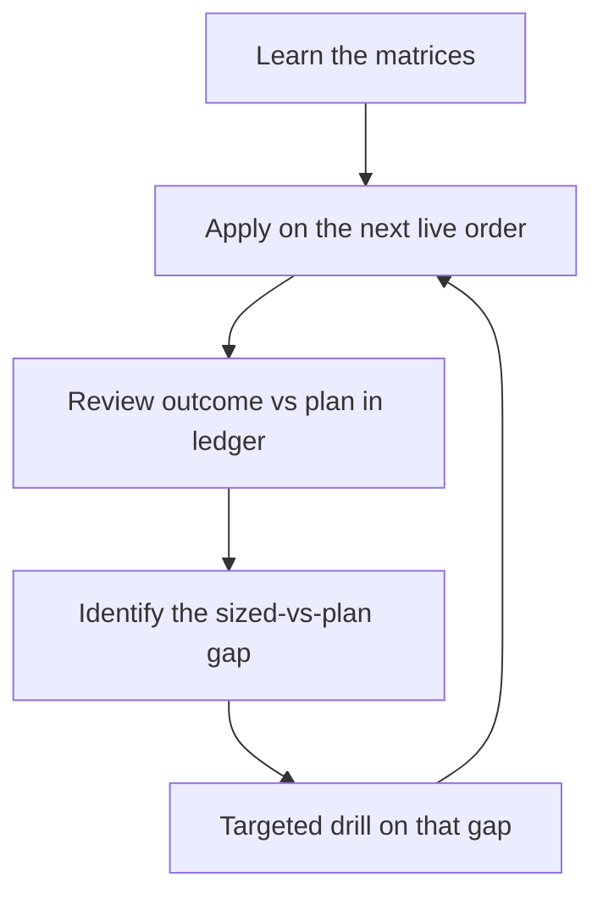

# Trade Sizing & Recovery

> **Portability target:** Spec-level. This skill encodes sizing and recovery discipline, not broker-specific commands.

<!-- QUICK: 30s — memorize four artifacts: the Sizing Matrix (Decision Tree 1), the Loss Triage Matrix (Decision Tree 2), the TWO size ladders (Decision Trees 3 and 5, combined by MIN), and the Canonical Threshold Table with its precedence rule. The exit ORDER belongs to `options-position-lifecycle`; the numbers belong to the table. Everything else is supporting detail. -->

---

## Route the Request **(QUICK)**

| Condition | Action |
|-----------|--------|
| "How many contracts / how much should I risk / size this" | Route to this skill → Sizing Matrix |
| "This position is down — what now" | Route to this skill → Loss Triage Matrix |
| "How do I make it back / win next / recover" | Route to this skill → Win-Next Protocol (Decision Tree 3) |
| "Where do I put my TP / stop" | Route here for levels; pair with `options-strategist` for structure choice |
| "Which TP/SL applies — mine or the other skill's?" | Route to this skill → Canonical Threshold Table (the tie-breaker); the exit ORDER is `options-position-lifecycle`'s |
| "How big after a drawdown / after a bad month" | Route to this skill → Drawdown-Linked Size Ladder (MIN with the streak ladder) |
| Portfolio Greeks, pin risk, margin stress | Use `options-risk-engineer` instead |

**Intent Route questions:**
1. Is this a new order (sizing) or an existing position (triage/recovery)?
2. If existing: what is the loss % of cost and the DTE remaining?
3. What is the account's trading capital and current total open risk?

---

## Anti-Rationalization **(QUICK)**

**No excuses — the seven rationalizations that fund losing accounts:**

**AR-01 "It's a small position":** You CANNOT skip computing max loss × contracts before entry. A $120 "small" loss repeated ten times is a $1,200 portfolio leak — the size of the leak is the size of the habit.

**AR-02 "It might come back":** You CANNOT hold a >70% loser in the hope bucket without a written HOLD-WITH-TP thesis. Hope is not a thesis; a level, a DTE floor, and a TP at 2× mark are.

**AR-03 "I'll size up to make it back faster":** You CANNOT increase size after a loss. Recovery size is BASE size or smaller; the ladder only steps up after wins.

**AR-04 "One more add will fix the average":** You CANNOT average down outside a defined-debit restructure approved in advance. Averaging down turns a triage problem into a solvency problem.

**AR-05 "The TP is too far, I'll just hold and decide later":** You CANNOT carry an open position without a TP order or a documented deliberate no-TP status. "Decide later" is the most expensive position in the book.

**AR-06 "The rule says 50% but I'm at 45%":** You CANNOT widen a rung to stay in. A pre-committed level is a level; "almost there" is the sentence that precedes every round-trip. When two skills quote different numbers, convert both into the family's unit and apply the Canonical Threshold Table — never split the difference.

**AR-07 "I'm at a fresh high, so I can size up now":** You CANNOT release a drawdown cut with a good day. The cut is released only by its restart condition — sessions above the level *and* closed trades at the reduced size. One win is not a restart, and a fresh high does not erase a streak.

---

## Ground Rules — Read Before Anything Else **(QUICK)**

| # | Rule | Mechanical Trigger | Violation Response |
|---|------|-------------------|-------------------|
| R1 | Size is derived from **max loss ÷ risk cap**, never from conviction | Before any order: max loss × contracts computed | Cut contracts until it fits; if it can't, pick a smaller structure |
| R2 | Every order ships with **TP + SL + size + expectancy** stated | Order draft review | No order — write the fourth line first |
| R3 | **Never add to a loser** outside an approved defined-debit restructure | Any "add / average down" impulse | Block; re-route to triage matrix |
| R4 | **Anti-martingale**: step up only after 2 consecutive wins; step down (half-size) after 2 consecutive losses | Ladder check before each new order | Force base size |
| R5 | **Dead lots get no TP and no attention** (mark < 5% of cost) | Position scan | Mark "no-TP by construction"; stop monitoring |
| R6 | Any position ≤ −40% gets a **triage disposition + lesson** recorded | Every scan / review | Disposition missing = position frozen: no adds, no new risk until logged |
| R7 | **One canonical threshold set**, and one ranked order for it — highest that applies wins: **desk circuit breaker → calendar/expiry force → plan override declared AT ENTRY → the Canonical Threshold Table's family row** | Two sources quote different TP/SL numbers for one position | Convert both into the family's unit, then apply the highest-ranked rule that applies. Never average two rules, never carry two, never widen a rung to "almost there" |
| R8 | **Size is the MIN of the two ladders** (streak ladder, drawdown ladder) and never rises while a new equity low is being printed | Sizing check before any new order | Take the smaller size; if the drawdown row is 0.00×, the order does not exist |
| R9 | **A winner-add is ≤ ⅓ of the original risk unit R**, re-runged before the fill, and blocked if the combined risk leaves the per-idea band | Any add to an open winner | No add — re-issue the rungs against the blended basis, or exit at the rung that already exists |

---

## Anti-Hallucination

- **Admit uncertainty** — If you don't know the account's trading capital or the position's real mark, say so and fetch it. Never size against a guessed number.
- **Flag your knowledge cutoff** — Greeks, fills, and quotes decay fast; state the timestamp and source of every number used.
- **Never guess security** — If anything touches credentials, account permissions, or order authority ambiguously, stop and ask. Default to the safer interpretation; never invent an account id or an order permission.
- **[VERIFIED]** — Every factual claim traces to a reference in `references/` or a dated live data pull. Tag unverifiable claims `[UNVERIFIED]`.

---

## The Expert's Mindset **(QUICK)**

The professional sizes first, enters second. Entry price is a detail; **position size is the strategy**. Two traders with the same signal but different sizing produce opposite equity curves — sizing, not stock-picking, is the dominant variable in retail profitability.

Trading is a book of bets against an uncertain future. Each bet has a distribution of outcomes; you only control two things — the shape you pay for (defined-risk structures) and how much you pay (size). Losses are **rent**: the cost of staying in the game while the edge plays out. The only unforgivable error is rent you can't afford, which is a sizing error, not a market error.

Recovery from a loss is never a heroics question ("what trade gets it back fastest?"). It is a **size question**: after a loss you go back to base size on the next A+ setup and let the expectancy compound. Revenge-sizing after a −90% loss routinely converts a $300 hole into a $3,000 crater within days — the single most documented path of retail ruin.

### What Sizing Masters Know **(STANDARD)**

- **Risk of ruin beats win rate.** A 65% system at 10% risk per trade goes broke more often than a 45% system at 1.5%.
- **The 2:1 asymmetry is the engine.** ≥45% win rate with ≥2:1 average win/loss is mathematically profitable; a 70% win rate at 0.4:1 is a slow bleed.
- **Expectancy is per-idea, not annual.** Compute it per setup class (fly, single call, LEAP, spread) — one category usually funds the losers, and the losers should be pruned.
- **TP is part of the entry.** Pre-committed exit rungs remove the in-the-moment negotiation where discipline dies.
- **The book has a budget.** Total simultaneous open risk is a portfolio decision (≤ ~10% of trading capital), not the sum of individual impulses.

### When to Break Your Own Rules **(DEEP)**

<!-- DEEP: 10+min — read fully before granting yourself the first exception. -->

- **Catalyst trades with hard dates** (index events, defined-structure binaries): you may size to the top of the band and skip the ladder step-down — but the structure must be defined-risk and the invalidation line must already exist on the chart.
- **Hedges, not bets.** A protective structure that reduces portfolio variance is sized by the exposure it covers, not by expectancy.
- **Deep-value LEAPs on liquid mega-caps** with a multi-quarter thesis may step one band up on total risk (1.5% → 2%) — never on strike selection.
- **War story:** after a −90% single-leg loss, the instinct is a "win it back" trade at 4× size. The math: a 4× position needs only a −25% move to repeat the loss — and that setup is selected under maximum tilt. Recovery that begins with an oversized trade has negative expectancy by construction.

---

## Deliberate Practice **(STANDARD)**



| Level | Routine | Time | Success Metric |
|-------|---------|------|---------------|
| Novice | Compute max loss × contracts before every order; base size only | per order, 30s | 100% of orders sized from max loss |
| Intermediate | Run the ladder (step up/down); log expectancy per setup class | weekly, 20 min | expectancy tracked for every class |
| Advanced | Triage every ≤−40% position within one session; enforce TP coverage | per scan | zero untriaged losers, zero TP-less positions |
| Expert | Portfolio-level open-risk budget; prune the worst-EV class monthly | monthly, 1h | total open risk ≤ cap; worst class retired |

---

## Operating at Different Levels **(STANDARD)**

### L1: Apprentice
- **Scope:** Single new order, base size, single account.
- **Autonomy:** Applies the Sizing Matrix mechanically; asks before any deviation.
- **Impact:** Avoids catastrophic sizing; expectancy ≈ break-even minus costs.
- **Craft:** Computes max loss in seconds; writes TP/SL before entry.

### L2: Practitioner
- **Scope:** Full position lifecycle — entry, scale-out rungs, triage, lessons.
- **Autonomy:** Runs the ladder without prompting; cuts ≤−40% per matrix.
- **Impact:** Positive expectancy on the momentum-fly class; losers capped.
- **Craft:** Distinguishes premium-based SL from level-based SL; knows when a CUT is unexecutable (write-off instead).

### L3: Senior
- **Scope:** Multi-account book; per-venue sizing (fill sessions, thin books).
- **Autonomy:** Sets the standing TP-coverage rule; adjusts bands per account size.
- **Impact:** Book-level open risk stays ≤ cap; no orphan positions.
- **Craft:** Reads liquidity (OI, spread %) before choosing CUT vs WRITE-OFF.

### L4: Staff / Principal
- **Scope:** Portfolio construction — correlation, event calendars, aggregate Greeks.
- **Autonomy:** Sizes the whole book, not the trade; defines post-drawdown recovery policy.
- **Impact:** Drawdowns bounded by design; expectancy improved by pruning classes.
- **Craft:** Fractional-Kelly-flavored sizing on verified edge; refuses to size unverified edges.

### L5: Transformative
- **Scope:** System design — automation, monitors, review cadence, culture.
- **Autonomy:** Codifies sizing into tooling so discipline survives the operator's worst day.
- **Impact:** The process, not willpower, enforces the rules.
- **Craft:** Turns every loss into a permanent rule change; measures itself with the scorecard.

---

## When to Use **(QUICK)**

**Use this skill when:**
1. **Sizing a new order** — you need contracts, TP, SL, and expectancy before entry.
2. **A position is losing** — you need a disposition (cut / restructure / write-off / hold) rather than a feeling.
3. **Planning recovery after a loss** — you need the win-next protocol and the ladder state.
4. **Setting TP/SL levels** — you need rung levels, session eligibility, and trim rules.
5. **Running the weekly review** — you need expectancy by setup class and the prune decision.

---

## When NOT to Use **(QUICK)**

**Do NOT use this skill when:**
1. **Choosing a strategy or structure** — use `options-strategist`.
2. **Measuring portfolio Greeks, pin risk, or margin stress** — use `options-risk-engineer`.
3. **Evaluating whether a signal is real** — use the signal / quant skills; sizing assumes a gate-passed signal.

---

## Decision Trees **(STANDARD)**

### Decision Tree 1: How much can this order risk?

```
New order proposed?
├─ Signal gate-passed (survived the entry checklist)?
│   ├─ NO  → DO NOT SIZE. Send back to signal review.
│   └─ YES → Identify setup class:
│       ├─ Momentum fly / butterfly (defined risk)
│       │   ├─ DTE 2–7d   → risk 0.5% of trading capital, 1 lot
│       │   ├─ DTE 8–14d  → risk 1.0%, 1–2 lots
│       │   └─ DTE 15–45d → risk 1.5%, 1–2 lots
│       ├─ Debit spread / vertical (defined risk)
│       │   ├─ DTE 8–14d  → risk 1.0%, 1 lot
│       │   └─ DTE 15–45d → risk 1.5%, 1–2 lots
│       ├─ Single directional call/put (naked long)
│       │   ├─ Liquid (spread ≤5%, OI ≥500)?
│       │   │   ├─ NO  → DO NOT SIZE (unexecutable exits)
│       │   │   └─ YES → DTE 8–14d risk 0.75%; 15–45d risk 1.0%; 1 lot
│       └─ Long-dated LEAP (≥45d) — liquid large/mega caps ONLY
│           └─ risk ≤ 2.0%, 1–2 lots; NEVER lottery strikes
└─ Then check BOTH portfolio gates:
    ├─ max loss × contracts ≤ per-trade cap ($300–600 / ~1.5%)?
    │   ├─ NO  → cut contracts or choose a smaller structure
    │   └─ YES → continue
    └─ total open risk (all positions, all accounts) ≤ 10% of trading capital?
        ├─ NO  → this order waits, or replaces an existing position
        └─ YES → place the order WITH TP + SL stated
```

### Decision Tree 2: Position is losing — what is the disposition?

```
Position down vs cost?
├─ 0 to −30%  → HOLD. TP stays ≥1.8× cost (momentum). Tighten the level-based invalidation. No adds.
├─ −30 to −50% →
│   ├─ DTE ≥45d AND underlying level intact → HOLD-WITH-TP (TP ≥1.8× cost)
│   ├─ DTE 15–45d → RESTRUCTURE (roll for debit ≤30% of current value) OR cut into strength
│   └─ DTE <15d   → CUT into any bounce (theta wall) — never roll theta into more theta
├─ −50 to −70% →
│   ├─ Thesis intact AND liquid → HOLD-WITH-TP at 2× current mark; otherwise…
│   └─ Thesis broken OR thin (spread >25%, OI <300) → CUT into strength; unexecutable → WRITE-OFF
├─ −70 to −90% →
│   ├─ Bid ≥ 0.20 → FREE OPTION: stop attention, TP at 2× mark, treat as written off
│   └─ Bid < 0.20 → WRITE-OFF (exit fees exceed salvage); let it expire
└─ ≤ −90%     → WRITE-OFF. Log the lesson row. Do not monitor.
```

### Decision Tree 3: What size is the NEXT order (win-next ladder)?

```
Last closed position?
├─ WIN (≥1.8× TP hit or trimmed ≥ target)
│   ├─ 1 win in a row  → base size (1 lot)
│   └─ ≥2 wins in a row → +1 lot (cap 3 lots) on the SAME class only
│       └─ different/new class → base size regardless of streak
├─ LOSS (cut or wrote off)
│   ├─ First loss → reset to base; next A+ setup from the PROVEN class
│   ├─ 2 consecutive losses → HALF size (or 1 lot of a cheaper defined structure) until one win
│   └─ Any loss worse than −50% of cost → treat as 2 consecutive losses + mandatory lesson row
└─ NO CLOSED TRADE YET (new account/class)
    └─ base size (1 lot), simplest defined-risk structure available

Cooldown: after cutting a specific name, no re-entry in that name for 5 sessions unless a
NEW gate-passed setup prints. Recovery = next A+ setup at base size — never "the same trade, bigger".
```

### Decision Tree 4: Which exit rule binds? (threshold arbitration)

```
Exit decision on an open position
├─ 1. Desk circuit breaker tripped? → MANAGE-ONLY: closest liquid exit, not the rung
│   ├─ Drawdown row, margin breach, reserve floor, closed event gate
│   └─ This outranks everything below — in that state the exit is "closest liquid exit"
├─ 2. Expiry force present? (the clock belongs to options-risk-engineer)
│   ├─ Short premium at DTE ≤ 21 → CLOSE 100% — outranks an entry-time override
│   ├─ Long premium at DTE ≤ 15  → CUT on any bounce (theta wall)
│   ├─ LEAPS leg at DTE ≤ 90     → roll-or-close decision (needs IV rank < 40)
│   └─ Expiring leg, pin or assignment window → de-risk that leg first
├─ 3. Was an override declared AT ENTRY on the ticket?
│   ├─ YES → the declared rung binds — but never looser than the table's LOSS CUT
│   └─ NO  → the family row of the Canonical Threshold Table binds
└─ 4. Two sources still disagree (% of max credit vs % of wing width)?
    └─ → convert both into the family's unit; the TABLE's row wins. Show the conversion.
```

### Decision Tree 5: What size does the book allow? (two ladders, one answer)

```
Sizing a new order — read the BOOK before the setup
├─ Drawdown from equity peak (closed P&L + open marks, deposit-adjusted)
│   ├─ 0 to −5%         → 1.00× multiplier; ≤ 5 concurrent short-dated ideas
│   ├─ −5 to −10%       → 0.75×; ≤ 4 concurrent
│   ├─ −10 to −15%      → 0.50×; ≤ 3 concurrent
│   ├─ −15 to −25%      → 0.25×; ≤ 2 concurrent
│   └─ worse than −25%  → 0.00×: manage-only, zero new risk
├─ Streak ladder (Decision Tree 3) → base / +1 lot (cap 3) / half size
└─ COMBINE: effective size = MIN(streak lots, base lots × drawdown multiplier)
    ├─ new equity low this session → the multiplier may only move DOWN; one win never restores size
    └─ climb one row only on its restart condition: sessions above the level AND closed trades at the lower size
```

### Decision Tree 6: Is an add to a winner legal, and how big?

```
Open winner, an add is proposed
├─ 1. LEGALITY — options-position-lifecycle owns this call, not this skill
│   ├─ Thesis intact + invalidation held + lifecycle window open → continue
│   ├─ Thesis broke or the stop already fired → FORBIDDEN (that is averaging down)
│   └─ The position is short premium → FORBIDDEN (a worse-credit add is a new position)
├─ 2. SIZE — this skill owns this
│   ├─ this add, added to every earlier add on this same position, ≤ ⅓ × R (the aggregate budget)
│   │   └─ past it → FORBIDDEN: R_max (1.5%) + ⅓R (0.5%) = 2.0% = the hard per-idea ceiling
│   ├─ R + all adds inside the per-idea ceiling and the book within 10%? → NO → shrink the ADD
│   └─ Add's quote spread ≤ the entry fill's spread? → NO → SKIP: that is a tax, not an edge
├─ 3. RECOMPUTE and show: blended basis, strike-weighted break-even, cushion vs 1 ATR-proxy
│   └─ an add NEVER improves the break-even; it buys delta per new dollar
└─ 4. RE-ISSUE the rungs against the NEW blended basis BEFORE the fill
    └─ rungs not re-issued → the position is UNMANAGED → block the add
```

---

## Canonical Thresholds, Ladders & Adds **(STANDARD)**

### Canonical Threshold Table — structure × exit level, with precedence

**This skill owns the NUMBERS; the ORDER of exit events on a live position belongs to `options-position-lifecycle`; the clock belongs to `options-risk-engineer`.** Five sources in this library state exit conventions, and they conflict in two different ways — one of them is not a numeric conflict at all:

| # | Source | What it contributes | How it conflicts |
|---|---|---|---|
| 1 | `trade-sizing-recovery` (this skill) | A rung level per structure family, in that family's unit | It is the only source that states a number per family |
| 2 | `options-strategist` (`references/profit-taking-and-trimming.md`, `references/adjustment-and-exit-rules.md`) | 50% of max credit, 25% of max credit (condor), 50%/75% of max profit, 2× credit, the 21-DTE rule | Agrees in the same unit on credit families; states the condor in % of max credit where source 3 states it in % of wing width |
| 3 | `swing-options-trader` | 50% of max profit, 25% of **wing width**, the 40%-of-debit long-option cut | **Unit conflict** — "% of wing width" is a different number, not a different opinion (worked 5× gap below) |
| 4 | `leaps-strategist` | Δ ≥ 0.95, DTE < 90, extrinsic-above-threshold, 2+ PMCC debit rolls | **Not a numeric conflict** — a *trigger-type* conflict: its exits are stated in delta / DTE / extrinsic, not as a price rung, so there is no number here for the table to overrule |
| 5 | `options-position-lifecycle` (`references/tp-sl-precedence-and-arbitration.md`) | **A precedence order only** (breaker → calendar → plan rung → family threshold → discretionary); it deliberately restates no rung numbers | **Order conflict** — a rank order over the same live position is a second arbitration scheme, and by default it would outrank this table's row |

None of the five was written as the arbiter. The table below is — and the precedence rule underneath it states which scheme governs when a rank order and a number disagree. Every level is the **pre-committed** order level, not a review point.

| Structure family (unit) | TP rung 1 | TP rung 2 | Runner rule | Loss cut (hard) | Time / DTE force | Why this number |
|---|---|---|---|---|---|---|
| **Long call/put** — directional single (multiple of debit paid) | **+80% of debit** (1.8× cost) → sell the first third | **+150%** (2.5×) → sell the second third | Last third trailed at 50% of peak gain | Underlying-close level rule fires first; premium backstop **−40% of debit** | Close on a bounce at **DTE ≤ 15** (theta wall) — never roll decayed theta into more theta | A −0.4R backstop against a +0.8R/+1.5R rung pair breaks even at a 33% win rate [COMPUTED: 0.4R ÷ (0.8R + 0.4R)] — below the honest 0.35–0.45 band |
| **Debit vertical** (bull call / bear put) (% of max profit) | **50% of max profit** → sell half | **75% of max profit** → close the rest | Trail at 50% of peak profit when DTE > 30 | Level rule first; premium backstop **−40% of debit**. 100% of debit is the structural worst case — NOT an actionable stop | Close at **21 DTE**; pre-earnings for gap-exposed names | The last 25% of a debit vertical needs ~half the remaining duration for a third of the profit — negative expectancy after spreads |
| **Credit vertical** (bull put / bear call) (% of max credit) | **50% of max credit** → close the whole position | — (no rung 2 by design) | None — a third of a short-premium position is a tail-risk stub, not a position | **2× credit received** (GTC debit-to-close bracket) | Close at **21 DTE** regardless of P&L; if 25% arrives inside 7 days, close 100% | The corpus's most-repeated number, and both `options-strategist` and `swing-options-trader` state it in the same unit and the same direction |
| **Iron condor / iron butterfly** (% of max credit) | **25% of max credit** (condor) / **30%** (iron butterfly) → close the whole position | — | None — a rung-2 trim concentrates gamma on the tested side | **2× total credit**, OR a short strike tested and held two consecutive closes | Close at **21 DTE**; the 7-day fast rule above applies | Four legs carry four exits; the last 10% of the credit is where the wings are cheapest to breach and dearest to leave |
| **Calendar / diagonal** (% of debit paid) | **+25% of debit** → sell half | **+50% of debit** → close the rest | None | **−25% of debit** (vega flip), or the theta crossover where net theta turns negative (≈ ±1σ from the short strike) | Close at **50% of max duration** if not profitable, and at **21 DTE** | Max profit is not well defined on a two-expiry structure, so the rung has to be stated in debit, not in "% of max" |
| **LEAPS / PMCC** (delta, DTE, extrinsic) | **+50% of debit** (1.5×) → trim a third | **Δ ≥ 0.95** → take profit or roll up to reset delta | Long leg rides to the DTE force | Extrinsic above the acceptable threshold → close; **2+ PMCC debit-roll cycles → close**; thesis invalidated | **DTE < 90** → roll-or-close decision (rolling needs IV rank < 40 and trend > 40); DTE < 180 with the thesis unmaterialized → time exit | A LEAP is a capital-efficiency instrument; at Δ ≥ 0.95 it has become the stock with none of the stock's advantages |
| **CSP / covered call** (% of premium) | **50% of premium** → close or roll | **80% of premium** while DTE > 14 | None | CSP: **3× credit**, or an underlying daily close below the 200-SMA. CC: assignment acceptable, else roll up-and-out for net credit ≥ $0.05 | Close or roll at **21 DTE**; exit undefined-risk legs before earnings | The last 20% of an income premium does not pay for assignment risk; the 3× CSP stop reflects undefined downside |

- **Units are not interchangeable — convert before comparing.** `% of wing width = % of max credit × (credit ÷ width)` [COMPUTED]. The same condor reads "25% of max credit" in one source and "25% of wing width" in another; those differ by 5× and one of the two can never fire (worked below). The same trap sits in **"sell in thirds"**: thirds presuppose a 3-lot position (`references/05-scale-out-ladders.md` gives the 1-lot and 2-lot variants). On a 1-lot position rung 1 is a full exit; on short premium rung 1 is always a full close.
- **The triage bands are review triggers, not exits.** HOLD-WITH-TP is the rescue disposition for a position that reached a band with no pre-committed row. Once a row above is on the ticket, the row **is** the plan, and Tree 2's HOLD-WITH-TP is unavailable above that row's loss cut. A level-based invalidation also outranks a premium stop on long-premium and debit structures — thin books gap through stop orders.

**Precedence rule — the highest-ranked rule that applies wins (one order, stated once):**

1. **A desk-level circuit breaker** — the drawdown row, a margin breach, the reserve floor, a closed event gate. In that state the exit is "closest liquid exit", not the rung. Nothing below it may be applied while it is tripped.
2. **A calendar / expiry force** — DTE ≤ 21 on short premium, DTE ≤ 15 on long premium, DTE ≤ 90 on LEAPS, expiring-leg pin and assignment windows. `options-risk-engineer` owns the clock; this table does not argue with it, and a rung declared at entry cannot buy an extension of the calendar.
3. **A plan-level override declared AT ENTRY** — a rung written on the order ticket *before* the fill. It may be tighter or looser than the family row, within the limit stated next. An override invented after entry is a moving goalpost, not an override.
4. **The family row of the Canonical Threshold Table** — the default, and the binding rule whenever none of 1–3 applies.

**When the table and an entry-time override disagree, the override wins — inside two hard limits.** (a) **Timing:** it must have been declared before the fill. A number chosen after entry is not an override; the table's row governs it, and the correct response is to close and re-enter as a new, separately-sized idea. (b) **The loss cut:** the override may be tighter than the row on every level, and it may be *looser* than the row on the TP rungs and the time stop — but it may **never** be looser than the row's **LOSS CUT**. The loss cut is the row's floor, not a default. So the resolution is mechanical: tighter override → the override binds; looser override on a rung or a time stop → the override binds; looser override on the loss cut → the row's loss cut binds and the override is amended on the ticket before the fill. Anything still disagreeing after (a) and (b) is a unit error — convert both into the family's unit, re-read, and if they still differ the **higher-ranked** of the two binds. Never average them and never carry both on one position.

> `options-position-lifecycle` ranks a post-entry discretionary override *last* (`references/tp-sl-precedence-and-arbitration.md`, rank 5). This skill does not recognise that case as an override at all: a number invented on an open position is a new plan, and a plan is not re-written on a position that is already losing. If the family row is genuinely the wrong band, the remedy is to close and re-enter, not to re-price in place.

**The other skills' numbers are entry-time defaults only.** `options-strategist`'s 50%-of-max and 2×-credit, `swing-options-trader`'s 50% / 25%-of-wing-width / 40%-long-option, and `leaps-strategist`'s DTE-90 and Δ-0.95 triggers are the defaults to use when no row above governs the structure — subject to the four-rank order just stated. Where they disagree with a row, or with each other, **this table is the tie-breaker**; the ordering of the resulting exit events is `options-position-lifecycle`'s. Whether a row is reachable at all is a vol-regime question: the IV-rank crossover at roughly 40–50 — below it, a premium-selling rung is not reachable on the credit it can collect — is set out in `options-strategist`'s `pattern-recognition-engine` reference.

**Worked [COMPUTED] — two rules, one position, a 5× gap.** A 10-lot condor with $10-wide wings collected $2.00 of credit → **$2,000 credit**, $8,000 max loss. At 30 DTE it marks at $1.50, i.e. $500 of profit = 25% of max credit.

| Rule in force | Target in dollars | Fires? |
|---|---|---|
| This table (precedence level 1): 25% of **max credit** | 0.25 × $2,000 = **$500 profit** [COMPUTED] | YES — full close, booked |
| `swing-options-trader`: 25% of **wing width** | 0.25 × ($10 × 100 × 10) = **$2,500 profit** [COMPUTED] | NO — that is 125% of the position's maximum profit, so the target can never fire |

Conversion that settles it: `% of wing width = 25% × ($2.00 ÷ $10.00) = 5% of wing width` [COMPUTED]. The table's unit — % of max credit — scales with what the position actually collected, so it is the unit that binds and the $500 is booked, not "almost". Full derivations of every level above: `references/08-canonical-thresholds-and-precedence.md`.

### Drawdown-Linked Size Ladder (alongside the streak ladder)

<!-- STANDARD: 3min — the streak ladder keys on the last two closed trades; this ladder keys on the book's peak-to-trough drawdown. Two cuts on the same size, and both apply. -->

**Failure mode this exists to catch.** The streak ladder is blind to the open book: two wins reset it to base while an unclosed position sits at −20% of cost — the account is in drawdown and the size says "fresh hand". This ladder reads the book *including open marks*, so the two ladders can never disagree about the account's actual state.

| Book drawdown (peak-to-trough, closed P&L + open marks, deposit-adjusted) | Size multiplier on base | Max concurrent short-dated (≤45d) ideas | Restart condition — climb back ONE row, and only when all of it is true |
|---|---|---|---|
| 0 to −5% | 1.00× | 5 | — normal operation |
| −5% to −10% | 0.75× | 4 | 5 sessions with no new equity low AND ≥2 closed trades at 0.75× |
| −10% to −15% | 0.50× | 3 | 10 sessions above the −10% level AND ≥3 closed trades at 0.50× |
| −15% to −25% | 0.25× | 2 | 15 sessions with no new low AND ≥5 closed trades at 0.25× |
| worse than −25% | 0.00× — manage-only, zero new risk | 0 | 20 sessions of manage-only with zero rule violations, then resume at 0.25× |

**Why these breakpoints — data-backed, not taste.** At the 1.5% band this skill's own streak arithmetic gives `drawdown after k consecutive losses = 1 − 0.985^k` [COMPUTED]: −5% ≈ 3.4 losses, −10% ≈ 7 losses, −14.0% = 10 losses (the 1-in-400 streak already tabulated in `references/02-expectancy-math.md`), −15% ≈ 11 losses, and −25% ≈ 19 straight losses. A 19-loss streak at a 45% win rate has probability 0.55^19 ≈ 1 in 86,000 [COMPUTED] — so a −25% book at disciplined sizing is **not luck**: it is a broken rule, hidden correlation, or a gap, and the correct response is zero new risk until the cause is named.

**Combining the two ladders.** Effective size = **MIN(streak-ladder size, base size × drawdown multiplier)** — and **never size up into a drawdown**: while a new equity low is being printed this session, the multiplier may only move down. A streak step-up is never restored by a fresh equity high, and a fresh high never lifts a drawdown cut: two wins with the book −12% from peak is still 0.50×, and a new high after two losses is still half size. The climb back is earned in sessions *and* closed trades at the reduced size — never by one win, and never by one gap-up. A 0.75× or 0.25× row on a 1-lot base cannot be expressed in whole contracts: implement the cut with a **cheaper structure of the same class** (narrower width, closer strike, shorter DTE), never by rounding the size back up. One edge case: peak equity is adjusted for cash flow — a $5,000 deposit [ESTIMATED: the invariant is proportionality, not the figure] raises peak and current equity equally and so does not erase the drawdown; counting a deposit as recovery is the failure mode that quietly switches the ladder off. **Which row binds is a regime question:** a bull-market uptrend rarely engages this ladder at all, a 5–10% correction typically parks a 1.5%-sized book in the 0.75× row, a bear market can hold it in the 0.50× and 0.25× rows for weeks, and a crash can cross three rows in a single session — which is exactly what the 0.00× row exists for. The restart conditions are written in sessions for that reason: a crash is not "over" because one bounce printed.

**Worst case — the recovery plan fights the reserve floor.** `options-risk-engineer` owns the reserve floor (the untouchable maintenance-margin buffer plus the book open-risk budget); this skill does not restate it, shrink it, or re-derive it. If the ladder permits new risk but funding the plan would draw on the floor, **the floor wins**: the plan does not run and the book stays in manage-only mode until margin headroom is rebuilt. The known limitation of any recovery ladder is exactly this — it can size a recovery correctly and still be unable to fund it. If the restart condition cannot be met because the book keeps printing new lows, the method rather than the size is broken: escalate at the third failed recovery attempt (Error Recovery's hard boundary).

### Winner-Add Sizing (size only — legality belongs to options-position-lifecycle)

**Scope split.** Whether an add is *allowed at all* — is this a scale-in, a roll, or a re-entry? — is a lifecycle question and belongs to `options-position-lifecycle`. **This skill owns only the SIZE.** Ask for the legality verdict; do not derive it here. (This is the DEEP subsection of the skill: read it fully before sizing your first add.)

```
add ≤ 1/3 × R      R = the ORIGINAL risk unit (max loss as sized at entry)
WHY: the top of the per-idea band is 1.5%; the hard per-idea ceiling is 2.0%.
     R(1.5%) + 1/3 R(0.5%) = 2.0% — 1/3 is the largest fraction that can never push a
     max-band idea through the ceiling. 1/2 R would be 1.5% + 0.75% = 2.25% — outside it.
BUDGET: 1/3 R is the position's TOTAL added risk, not the size of one add.
```

1. **The add budget is ⅓ × R per position, in total — not ⅓ × R per add.** One add at the cap exhausts the budget. A second (rung-2) add is admissible **only** while the *cumulative* risk added to that position — every add since entry, summed — stays ≤ ⅓R; the moment a second add would push the cumulative total past ⅓R it is refused, and the correct action is to let the rungs that already exist work. There are no pyramiding ladders on options. (The pyramid gate in `algorithmic-trader` is an equity/code gate; this one is options-shaped and strictly size-capped.)
   > **Change required in `options-position-lifecycle`** (reported, not edited here): `references/add-to-winner-pyramiding.md:17` currently entitles a rung-2 position to "a *second* ADD, subject to the same five preconditions plus a band check on the enlarged position". That is admissible only if the two adds *together* stay inside ⅓R. The row needs one added clause: "…subject to the same five preconditions, to a band check on the enlarged position, and to the aggregate add budget — the *sum* of all adds on this position must stay within ⅓ × the original risk unit (`trade-sizing-recovery`, Winner-Add Sizing). The budget is not refreshed by each rung."
2. **Combined risk stays inside the band** — after the add, R + add ≤ the per-idea ceiling (2.0% / the $ cap) and the book stays ≤ 10% open risk. If it does not fit, shrink the ADD, never the structure's definition. Corollary: **a position already at the 2.0% long-dated-single ceiling has no admissible add at any fraction.**
3. **Blended basis and blended break-even are recomputed and SHOWN on the ticket** — `blended basis = (Σ nᵢ·pᵢ) ÷ Σ nᵢ`, `strike-weighted break-even = (Σ nᵢ·Kᵢ) ÷ Σ nᵢ + blended basis` [COMPUTED]. An add **never improves the break-even**; it buys delta per new dollar. If the ticket claims a better break-even, the arithmetic is wrong.
4. **The mechanics are re-issued, never inherited** — the new break-even must sit at least 1 ATR-proxy below spot; the invalidation line is re-issued **tighter or equal, never wider**; the add's quote spread must be ≤ the spread the original filled at; and the rungs are re-issued against the NEW blended basis before the fill (rung 1 = +80% of the new total debit, rung 2 = +150%, runner trailed at 50% of peak). A position whose rungs still reference the pre-add basis is unmanaged: block the add.

- **The forbidden version of the same trade is any add made *after a loss*** — that is averaging down; R3 and AR-04 close this door. The only legal way to put money into a loser is a defined-debit restructure approved in advance.
- Adding to a structure whose **thesis broke**, adding **past the ⅓R aggregate budget** (including a second add that would push the cumulative added risk past it), or adding after the lifecycle window closes — the invalidation line is the reason there is no add.
- Adding **past the band** — if R + add exceeds the per-idea ceiling, the answer is "no add", not "a smaller structure".
- Adding on a **wider spread than the entry filled at** — a 6% quote on an entry that filled at 2% is a 4% toll to own the same idea twice.
- Adding to **short premium** because it is winning — a worse-credit add is a new position with worse odds wearing the winner's P&L.

**Worked [COMPUTED] — an add that passes, and the check that rejects most of them.** Book: $60,000 trading capital. Original entry: **2 lots of an XYZ 200-strike call at $4.00** with XYZ at $202 and 45 DTE → R = 2 × $4.00 × 100 = **$800 risk** (1.33% of the book). Later: XYZ is $212, 28 DTE, and `options-position-lifecycle` has cleared the add window.

| Step | Arithmetic | Result |
|---|---|---|
| Add cap, and the candidate | ⅓ × R = ⅓ × $800 = $266.67; 1 lot XYZ 215 strike at $2.50 = $250 | **$250 cost** — inside the **$266.67** cap ✓ |
| Combined risk and blended basis | $800 + $250 = $1,050, ÷ 3 contracts = $350 per contract | **$1,050 risk** = 1.75% of $60,000 ≤ the 2.0% ceiling ($1,200) ✓; basis **$3.50** per share |
| Strike-weighted break-even | (2 × $200 + 1 × $215) ÷ 3 + $3.50 = $205.00 + $3.50 | **$208.50**, against $204.00 before the add — the add moved the break-even **$4.50 higher**, which is what an add costs |
| Cushion test, then re-issued rungs on the new basis | spot $212 − $208.50 = $3.50 vs an ATR-proxy of $3.00; rung 1 = +80% of $1,050 → **$840 profit** on 3 contracts | 1.17 ATR ≥ 1.0 → passes, barely — place the GTC sell-to-close before the add fills |

**The check that rejects most adds.** A *same-strike* add on a winner usually fails on size alone: one more lot of the original 200 strike now marks ~$12.60 → **$1,260 cost**, which is 4.7× the ⅓R cap, so the add is illegal before any break-even math is done. And had the ATR-proxy been $5.00, the cushion (0.7 ATR) would fail the second test — an add with no room underneath is a coin-flip on one session. When either test fails, let the existing runner ride and book the rung that already exists. "The trade is working, so buy more" is a conviction statement; this add is a size statement.

---

## Core Workflow **(STANDARD)**

### Phase 1: Size the order (~2 min)
1. **Do:** Compute max loss per contract (debit paid; spreads: width × 100 − credit). Multiply by candidate contracts. Compare to the Sizing Matrix band and the $ cap.
2. **Verify:** max loss × contracts ≤ per-trade cap AND total open risk after entry ≤ 10% of trading capital.
3. **Output:** contracts chosen, max $ at risk, expected loss if invalidation hits.

### Phase 2: Design the exit before entry (~2 min)
1. **Do:** Write the TP rungs (momentum ≥1.8×, runner 2.5–3×; LEAP 1.5–2×), the level-based SL (underlying RTH close beyond X), and the scale-out plan (e.g., ⅓ at 1.8×, ⅓ at 2.5×, trail the rest).
2. **Verify:** TP and SL both name a price/level and a session (RTH-only orders don't fill pre/post).
3. **Output:** the four-line order contract: **TP / SL / SIZE / expectancy**.

### Phase 3: State expectancy (~1 min)
1. **Do:** One line: rough win% × avg win vs loss% × avg loss. If not clearly positive, do not send the order.
2. **Verify:** the win% is anchored to a base rate ("this class hits 1.8× ~45% of the time" or an explicit estimate) — never vibes.
3. **Output:** signed-off order.

### Phase 4: Triage on every scan (~1 min per position)
1. **Do:** Apply Decision Tree 2 to every position ≤ −40%. Record disposition + lesson.
2. **Verify:** zero positions in the −40%+ zone without a disposition; dead lots flagged "no-TP by construction".
3. **Output:** triage list (CUT / RESTRUCTURE / WRITE-OFF / HOLD-WITH-TP).

### Phase 5: Weekly edge review (~20 min)
1. **Do:** Compute expectancy by setup class (fly / single / LEAP / spread) from the ledger; update ladder state (streak); prune or halve the worst class.
2. **Verify:** every class has hit-rate and avg win/loss numbers; the worst class has an action.
3. **Output:** updated bands, pruned class, refreshed ladder state.

---

## Best Practices **(STANDARD)**

1. **Size from max loss, not from premium × "feels small".** A 0.10 option × 10 contracts in a thin name is a $100 lottery ticket with a 25% spread — the spread is a quarter of the stake.
2. **Prefer defined-risk structures when conviction is <8/10.** Flies and spreads turn unbounded hope into a known rent.
3. **Scale out, don't all-out.** Sell in thirds at 1.8× / 2.5× / runner-with-trail; it converts a good trade into a booked win plus a free option.
4. **The stop for options is a LEVEL, not a stop order.** Thin books gap through stop orders; use underlying-close rules and act next session.
5. **Cut at the band, not at the number you wish.** −50% that becomes −80% is a sizing failure compounding into a hope failure.
6. **Write-off discipline is a strategy.** Dead lots consume attention — the scarcest capital.
7. **Reset after wins too.** Two wins → one step up; back to base after the next close. Streaks end; don't let size ride a streak into the reversal.
8. **Correlation is hidden size.** Three "different" AI-momentum longs are one position at 3×. Count correlated exposure as one line.
9. **Event windows override size.** No new risk into binary macro prints or earnings inside the DTE window — size is zero when the gate is closed.
10. **Journal the sizing decision, not just the trade.** "2 lots because max loss $420 = 1.4% and the band says 1.5%" is the sentence that compounds.

---

## Error Decoder **(STANDARD)**

| Symptom | Root Cause | Fix | Lesson |
|----------|-----------|-----|--------|
| Account bleeds despite "good picks" | Losses uncapped on lottery singles; wins small | Cap losses at the triage bands; require TP ≥1.8× | Win rate was never the problem — asymmetry was |
| Position "suddenly" −60% | It was −30% once and nothing happened | Apply triage at −30/−40 with a disposition | Triage is a trigger, not a mood |
| Never in profit on a winner | No pre-committed TP; round-tripped the gain | Place GTC sell-to-close rungs at entry | An exit plan is part of the entry price |
| Cash "eaten" in small chunks | Many 0.5–1% positions in correlated names | Count correlated exposure once; enforce total-risk cap | Ten tiny bets on one theme is one big bet |
| Recovered a loss, then gave it back | Size increased after a lucky win | Ladder: +1 after 2 wins, cap 3, base after any loss | Winning streaks are for booking, not riding |

---

## Error Recovery **(QUICK)**

| Symptom | First Action | If That Fails | Last Resort |
|----------|-------------|--------------|------------|
| Realized loss this week | Reset ladder to base; next order only from the proven class | Half-size until one win | Stop trading 48h; run the weekly review early |
| Position ≤ −40% and market closed | Write the disposition plan now (level + action at next open) | Pre-stage the exit order at open | Accept slippage; exit in the first 30 min of RTH |
| No liquid bid to cut (unexecutable) | Reclassify as WRITE-OFF; remove from the attention set | TP at 2× mark if any bid > 0.20 | Let it expire; collect the lesson row |
| Total open risk over the 10% cap | No new entries until a close frees budget | Trim the worst-EV position to fund better | Hard freeze: manage-only mode for the book |
| Sizing numbers conflict across accounts | Recompute per-account trading capital; use the smaller denominator | Cap by absolute $ (the $300–600 rule) | Size by the most conservative number and note the ambiguity |

**Hard failure boundary:** After 3 failed recovery attempts, escalate to human. Do not loop.

---

## Cross-Skill Coordination **(STANDARD)**

### Upstream (What This Skill Needs)

| Upstream Skill | Artifact Needed | What You'll Use It For |
|---------------|----------------|----------------------|
| `options-strategist` | Chosen structure (fly / spread / single) + strikes | the "shape" being sized |
| `trade-performance-analyst` | Hit rate + avg win/loss by setup class | expectancy base rates for Phase 3 |
| `options-risk-engineer` | Portfolio Greeks, open-risk aggregation | the 10% total-risk check |

### Downstream (What This Skill Produces)

| Downstream Skill | Deliverable | What They'll Do With It |
|-----------------|------------|------------------------|
| `swing-options-trader` | Order contract: TP / SL / size / expectancy | Executes within the size given; never resizes |
| `leaps-strategist` | Long-dated sizing bands + TP rungs | Sizes LEAPs and impaired-leg recoveries |
| `portfolio-signal-manager` | Triage dispositions + ladder state | Re-weights the book and prunes dead risk |

---

## Proactive Triggers **(STANDARD)**

- **A position crosses −40% of cost** → produce the triage disposition immediately; don't wait to be asked. 🔴
- **Any open position without a TP order** → flag and (on agentic venues) place the standing GTC, or output the ready-to-place spec. 🔴
- **Ladder step-down condition met** (2 straight losses) → announce half-size BEFORE the next idea is proposed. 🟡
- **Total open risk approaching 10%** → surface book-level headroom with every new idea. 🟠
- **A "win it back" idea appears** (size up after a loss; same-name revenge trade) → name it and block it. 🔴
- **A setup class's expectancy turns negative over ≥10 samples** → propose pruning or halving the class at review. 🟡

---

## Anti-Patterns **(STANDARD)**

| ❌ Anti-Pattern | ✅ Do This Instead |
|----------------|-------------------|
| ❌ "It's only $200" — skipping max-loss math on a lottery call | ✅ Max loss × contracts ≤ cap, every time — the $200 habit is the $2,000 loss |
| ❌ Averaging down a −60% single-leg "to fix the basis" | ✅ Triage matrix: cut / restructure / write-off; never add outside a defined-debit roll |
| ❌ Holding through a −70% drawdown "because the chart will come back" | ✅ HOLD-WITH-TP requires level + DTE ≥45d + 2× TP; otherwise it's a CUT |
| ❌ Doubling size after a red week to "recover by Friday" | ✅ Ladder steps up only after 2 wins; losses step DOWN to half-size |
| ❌ Ten small positions in one theme ("diversified") | ✅ Correlated exposure counts as one line against the risk cap |
| ❌ Setting the TP after entry "when it feels right" | ✅ TP is part of the entry price; GTC rungs go on at fill |

---

## State Log **(QUICK)**

| Turn | Action | Decision | Risk Accepted | Mitigation |
|------|--------|----------|---------------|-----------|
| 1 | Sized new order from matrix | 1 lot, max loss $420 = 1.4% | single-name event gap | defined-risk fly; invalidation at SMA20 close |

**Anti-Drift Check:** Before each response, verify:
1. Did the last action match the plan?
2. Are we still within scope?
3. Has any new information invalidated prior decisions?

---

## Production Checklist **(STANDARD)**

- [ ] **CR1: The four lines exist** (TP / SL / SIZE / expectancy) — **Complete when** all four are written on the order ticket before sending.
- [ ] **CR2: Max loss computed, not eyeballed** — **Complete when** debit × 100 × contracts is displayed in dollars.
- [ ] **CR3: Per-trade cap respected** ($300–600 / ~1.5%) — **Complete when** max loss ≤ cap is shown numerically.
- [ ] **CR4: Book-level cap respected** — **Complete when** total open risk after entry ≤ 10% of trading capital, summed across the book.
- [ ] **CR5: Ladder state applied** — **Complete when** the last two closed trades are checked and base / +1 / half-size is chosen per Decision Tree 3.
- [ ] **CR6: Correlated positions counted once** — **Complete when** the theme list is written beside the risk total.
- [ ] **CR7: Event gate closed** — **Complete when** earnings/macro binaries inside the DTE window are checked and absent (or the size is zero).
- [ ] **CR8: TP rungs exist as orders** — **Complete when** GTC sell-to-close orders (or ready-to-place specs for non-agentic venues) are confirmed placed.
- [ ] **CR9: SL is a level + action** — **Complete when** the invalidation line and the action on breach are recorded in the ledger.
- [ ] **CR10: Triage current** — **Complete when** every position ≤ −40% has a disposition + lesson and zero remain untriaged.
- [ ] **CR11: Dead lots marked** — **Complete when** every mark < 5% of cost is flagged "no-TP by construction" and removed from the attention set.
- [ ] **CR12: Weekly expectancy table updated** — **Complete when** hit rate + avg win/loss by setup class are refreshed and the worst class has a prune/halve decision.
- [ ] **CR13: One threshold set, in the family's unit** — **Complete when** the structure's row in the Canonical Threshold Table is applied, or an override declared at entry is quoted; two different TP/SL numbers are never carried for one position.
- [ ] **CR14: Drawdown ladder read and applied** — **Complete when** the book's deposit-adjusted peak-to-trough drawdown is computed including open marks, its row is named, and the effective size is the MIN of the streak ladder and the drawdown multiplier.
- [ ] **CR15: Winner-add arithmetic shown** — **Complete when** any add to an open winner displays add ≤ ⅓R, the combined risk against the per-idea ceiling, the blended basis and strike-weighted break-even, and the re-issued rungs — or the add is refused.

---

## What Good Looks Like **(QUICK)**

A well-sized book reads like a portfolio of contracts: every position states its max loss, its TP rungs are already working, its invalidation is a specific level, and every loser ≤ −40% has a disposition with a one-line lesson. The equity curve is boring: small controlled rents paid, 2× wins booked in thirds, dead tickets written off without ceremony. Recovery from any loss happens at base size on the next A+ setup — not with a bigger bet on the same name.

**Signs of Excellence:**
- Zero positions without TP coverage; zero untriaged losers at any scan.
- Max loss per idea is a printed number, not an adjective.
- Size steps follow the ladder, visibly, in the ledger.
- The worst-performing setup class gets pruned within a month of turning negative.

**Signs of Dysfunction:**
- "It'll come back" appears anywhere in the decision log.
- Position count grows while win rate falls.
- TP levels move away from price as price falls.
- Size correlates with tilt, not with the matrix.

---

## Verification Guardrails **(STANDARD)**

### Pre-Generation
- [ ] Trading capital and account denomination identified (never size against a guessed account).
- [ ] The signal is gate-passed (this skill assumes a verified entry; it does not verify signals).
- [ ] Ladder state for the account is known (last two closed trades).
- [ ] Current total open risk computed before adding.

### Post-Generation
- [ ] The four lines exist (TP/SL/SIZE/expectancy) and the expectancy is positive.
- [ ] Max loss × contracts ≤ cap; correlated exposure counted once.
- [ ] Triage dispositions assigned for every ≤ −40% position; dead lots flagged.
- [ ] Lesson rows written for every cut/write-off before the next order is considered.

---

## Deliberate Practice — Advanced Drills **(DEEP)**

<!-- DEEP: 10+min — run these monthly. -->

1. **Reconstruct the last 10 losses.** For each: which sizing rule would have prevented it, and what does that rule cost? If the rule costs less than the loss, the rule is free.
2. **Stress the ladder.** Take a hypothetical 5-loss streak at base size: does the book survive at half-size on losses 4–5? If not, base is too big.
3. **Shadow-size an old winner.** Re-run your best trade at half size and double size: the P&L difference is the price of your sizing skill — the number worth improving.

---

## References **(QUICK)**

- `references/08-canonical-thresholds-and-precedence.md` — the derivations behind the Canonical Threshold Table: the four-convention reconciliation, unit conversions, the ⅓R add cap, the drawdown breakpoints, the failure-mode register, and the precedence arbitrations worked end to end.
- `references/01-sizing-bands.md` … `references/07-ladder-tracking-template.md` — band tables, expectancy math, loss-triage cases, the recovery playbook, scale-out ladders, session/venue rules, and the weekly tracking template.
- `references/additional-resources.md` — expectancy math, worked triage cases, and the recovery playbook appendix.

---

## Gotchas **(QUICK)**

- **Premiums are not the risk.** Risk is max loss **plus** the exit spread. A $0.10 option with a $0.03 spread risks 30% of stake just to leave — worse than many "expensive" liquid names.
- **GTC TPs don't protect events.** A resting sell does nothing through an earnings gap; pre-event exits are separate orders.
- **Extend-and-pretend is a sizing decision.** Rolling a loser "out and down" pays theta twice and doubles position count — count the roll as new risk against the 10% cap, not as a rescue.
- **Half-size is not punishment.** It cools a statistically cold hand; it ends with one win, not one heroic trade.
- **Leveraged linear instruments (perps / futures) run different physics.** There is no premium to lose - loss bands run on % of entry (notional), and the liquidation price is a hard, exchange-enforced stop you do not control. Triage the buffer FIRST: any position within roughly 10% of its liquidation price is de-risked before any other plan; a single liquidation can wipe that position's entire margin - a $300-$600 sized idea becomes a $3,000+ wipe-out if it is averaged into instead.
- **Never average a linear loser.** No defined-debit roll exists on a perpetual or future - the R1/R2 doors (level-hold add, structure roll) do not apply. The only legal size-increase is a brand-new full-score card with fresh sizing.
- **Funding is the theta of perps.** Holding cost accrues every session and spikes in cascades - check funding before "just holding," and treat it like decay when deciding HOLD-WITH-TP vs CUT.
- **Close-basis levels still rule.** Daily-close invalidation, wicks are grabs; on 24/7 venues the "RTH close" maps to the daily close, and cascade classification (BTC/ETH-led dump + funding flip) replaces the session clock.

> **Skill version:** 1.2.0 | **Token budget:** 6000 | **Generated:** 2026-10-14
