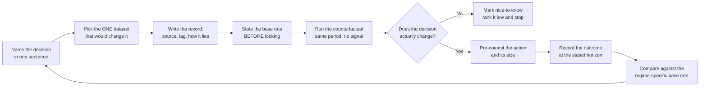

# Trading Decision Data Catalogue

> **Portability target:** Spec-level (runs on Claude Code, Copilot CLI, Gemini CLI, Codex, Cursor, Kimi Code CLI). No vendor-specific frontmatter fields; every vendor, price and dataset named here is a public artefact and every rule is cited by document.

**A rule book without data is an opinion.** A trader who can name a decision but not the dataset that
would sharpen it is not deciding — they are making a bet with a story attached. And a trader who can
name the dataset but cannot say **how fresh it is** and **how it lies** is barely better off, because a
dataset read at the wrong age is a dataset read wrong. This skill is the catalogue: **which dataset
answers which decision, where it comes from, what it costs, how old it is when you see it, how it lies
to you, and what decision it changes** — across both sides of the book an ordinary trader runs, listed
options and equities.

**This skill does not build pipelines.** Ingestion, streaming, tick storage, corporate-action
normalisation and schema design belong to `market-data-engineer`, the repo's owner of the plumbing.
This skill is the *buyer's* discipline: given that a feed exists, is it worth believing, and what would
you do differently because of it? **Choosing a security is not this skill's job.** It will tell you
FINRA short interest is the only real short-position number in public data. It will not tell you
whether to short the name.

### The Three Kinds — Every Dataset Is Exactly One

| Kind | Claim | Read it as | Example |
|---|---|---|---|
| **SIGNAL** | "This is predictive" | A hypothesis with a base rate attached, or inadmissible | Form 4 cluster buys; COT positioning; a vendor's "unusual options activity" flag |
| **STATE** | "This is the condition now" | A fact about today that bounds what is possible | Open interest; short interest; the H.4.1 balance sheet; the Reg SHO threshold list |
| **CONSTRAINT** | "This binds you regardless of the signal" | A rule, limit or deadline that removes options from the table | The exchange calendar's early close; the 13-settlement-day close-out; the 45-day 13F lag |

The classification is not decoration — it decides **what you are allowed to do with the number**. A
STATE figure may be asserted flatly with its timestamp. A SIGNAL figure may not be asserted at all
until the protocol in [signal-validation-protocol.md](references/signal-validation-protocol.md) has
been run on it. A CONSTRAINT figure must be resolved to a **date and a market calendar** before it is
quoted, because a constraint expressed as a duration is not a constraint — it is a rumour.

### The Constraints This Catalogue Treats as Binding

Six constraints do most of the work of removing options from the table. Each is cited here rather than
summarised, because a constraint quoted from memory is a constraint that has already drifted.

| Constraint | The rule | What it removes |
|---|---|---|
| **Settlement** | US equities and listed options settle **T+1** (SEC Release 34-96930; compliance date 2024-05-28) `[VERIFIED — SEC Release 34-96930]`. Older pages still stating T+2 for equities are **stale** — state T+1 and cite the release | the assumption that cash arrives when you think it does |
| **The Reg T payment / margin-call window** | the settlement cycle **+ 2 business days = 3 business days** from the trade (12 CFR 220.2, 220.4(c)(3)(i)) `[VERIFIED — 12 CFR 220.4(c)(3)(i)]` | the assumption that a margin deficiency has a fortnight to cure |
| **Rule 204 close-out** | the general fail closes out by the **beginning of regular trading on the settlement day following settlement**; **3 consecutive settlement days** for a long-sale fail; **35 consecutive calendar days** for a Rule 144 / deemed-to-own fail (17 CFR 242.204(a)) `[VERIFIED — 17 CFR 242.204(a)]` | the assumption that a fail-to-deliver is a passive event |
| **Threshold close-out** | fails of **≥10,000 shares AND ≥0.5% of shares outstanding for 5 consecutive settlement days** place a security on the list; close out after **13 consecutive settlement days** (17 CFR 242.203) `[VERIFIED — 17 CFR 242.203; SEC]` | the short position itself |
| **The session clock** | equities close **4:00pm ET**, options **4:15pm ET**; equity early close **1:00pm ET** on the day after Thanksgiving, **July 3** and **Dec 24** `[VERIFIED — NYSE and Nasdaq published calendars]`. The **options** early close is **venue-specific** (1:15pm ET for eligible options on some venues; Cboe options close at **13:00**) — **check your venue's calendar** | the comparability of every intraday statistic you own |
| **Exemptive relief** | Form SHO / Rule 13f-2 **exempt until Jan 2, 2028**; Rule 10c-1a **exempt until Sept 28, 2028**, dissemination until **March 29, 2029** `[VERIFIED — SEC exemptive order, FR 2025-22158]` | the illusion that these datasets exist |

### The Catalogue Record — Every Dataset Gets All Nine Fields

| Field | Why it exists | Failure if omitted |
|---|---|---|
| **Question it answers** | Anchors the dataset to a decision, not a mood | The dataset gets collected because it is available |
| **Kind** | SIGNAL / STATE / CONSTRAINT | A state figure gets traded as if it predicted |
| **Exact source** | Publisher, dataset name, endpoint or file | The number cannot be re-checked, so it cannot be wrong either |
| **Cost** | Free, or the specific tier and its price | The stack is bought before it is justified |
| **Update frequency AND lag** | **Both.** Frequency is when the publisher produces; lag is when *you* can see it | Backtests become look-ahead biased; live reads become stale |
| **How it lies** | The documented failure mode of this dataset | The one failure mode it always has is the one you will not plan for |
| **What decision it changes** | The action that differs because of it | The dataset is decoration |
| **Timestamp rule** | What timestamp must be recorded with the read | Two analysts disagree without knowing they disagree |
| **Rank** | Its position against every other dataset for this decision | Everything is "important", so nothing is |

> **The rule that makes this catalogue worth reading — stated plainly, because it is the whole
> discipline: a catalogue that ranks everything as useful is worthless.** If a dataset changes no
> decision, write **"nice-to-know"** next to it and rank it low. A catalogue where everything is a 9/10
> carries exactly as much information as a blank page. Six entries in the best-datasets list at
> [decision-to-data-map.md](references/decision-to-data-map.md) beat the other six outright, and the
> twelve in [overrated-datasets.md](references/overrated-datasets.md) are ranked there precisely because
> they are widely believed and do not earn their keep.

## Route the Request

<!-- QUICK: 30s — auto-route first, then intent-route -->

| # | Condition | Action |
|---|-----------|--------|
| A1 | `file_contains("*", "what data\|which data\|where do I get\|data source\|dataset")` AND `file_contains("*", "trade\|position\|signal\|screen")` | This is your skill. Jump to **Core Workflow** — Phase 1. |
| A2 | `file_contains("*", "short interest\|borrow\|shortable\|threshold list\|reg sho\|fail to deliver\|ftd")` | This is your skill. Jump to **Phase 3** and DT2. |
| A3 | `file_contains("*", "open interest\|options flow\|unusual options\|gex\|dealer gamma")` | This is your skill. Jump to **Phase 4** and DT3. |
| A4 | `file_contains("*", "13f\|form 4\|insider\|13d\|13g\|institutional\|smart money")` | This is your skill. Jump to **Phase 5** and DT4. |
| A5 | `file_contains("*", "is this signal real\|backtest\|does this work\|validate\|base rate\|edge")` | This is your skill. Jump to **Phase 6** and [signal-validation-protocol.md](references/signal-validation-protocol.md). |
| A6 | `file_contains("*", "build\|ingest\|pipeline\|kafka\|tick store\|schema\|normaliz\|corporate action")` AND `file_contains("*", "data")` | Invoke **market-data-engineer** instead. This skill names the dataset and its credibility; that skill builds the pipe that carries it. |
| A7 | `file_contains("*", "should I buy\|should I short\|is this a good company\|which stock")` AND NOT `file_contains("*", "data\|source\|evidence")` | Invoke **fundamental-analyst**, **technical-signals-engineer** or **macro-strategist** instead. Selection is not this skill's. |
| A8 | `file_contains("*", "how many\|position size\|kelly\|risk parity")` | Invoke **portfolio-signal-manager** or **algorithmic-trader** instead. |

```
What is the user actually trying to decide?
├── "I have a trade idea and need evidence"     → Phase 1 → Phase 2 → Phase 6
├── "Which datasets are worth paying for?"      → Phase 2 (cost ledger) → Phase 7
├── "Is this signal real?"                      → Phase 6 + the validation protocol
├── "How fresh is <dataset>?"                   → Phase 2 (lag field) + DT1
├── "Where do I get short interest / borrow?"   → Phase 3 + DT2
├── "Is this unusual options activity?"         → Phase 4 + DT3
├── "What's the lag on a 13F?"                  → Phase 5 + DT4
├── "My backtest looks amazing"                 → Phase 6 + DT5, then the traps table
├── "What is free that I am not using?"         → Phase 7 + free-and-underused-sources.md
└── Full data audit for a strategy (all phases) → Run Phases 0-8 in order
```

**Research prerequisite — a hard gate.** Before any recommendation, establish: (1) **the decision in one sentence with an action verb** — "consider shorting", "consider selling a covered call", not a mood; (2) **the horizon**, because it sets the lag budget and the same 45-day dataset is useless for a five-day trade and adequate for a two-year thesis; (3) **the account regime** — cash, Reg T margin or portfolio margin, since constraints that bind in one regime do not exist in another; (4) **the read date of every external artefact**, because a dataset's age is part of the dataset; and (5) **what the user already pays for**, because the cost field prices the next marginal read, not an ideal stack. **If the decision or the horizon is missing, say so and stop.** A data plan built around an unnamed decision is a subscription list, and subscription lists are how traders buy noise by the month.

## Anti-Rationalization

<!-- DEEP: 10+min -->

| Rationalization | Reality |
|---|---|
| "It's a public dataset, so it's fine as-is." | Public is a licence status, not a quality status. Fails-to-deliver are public, twice monthly, free — and the SEC itself says a fail "may result from either a short or a long sale" and that naked short selling "is not necessarily a violation" `[VERIFIED — SEC Reg SHO investor page]`. Used raw as a bearish signal it is not weak evidence, it is *inverted* evidence. **Provenance note on that page, first cited here and cited throughout this skill:** it is authoritative for those two Reg SHO propositions and it is **stale on settlement** — it still teaches **T+2** for US equities and predates the 2024-05-28 T+1 compliance date, so **do not inherit settlement facts from it**; take settlement from SEC Release 34-96930. |
| "The vendor's backtest shows a 3.1 Sharpe, so the signal is real." | The seller chose the holdout — the period, the universe, the metric. Re-run it on a period *you* pick, point-in-time, before paying. A $75/mo tier is a $900/yr cost `[COMPUTED: 75 × 12]`, and its own backtest is not the evidence for it. |
| "Open interest says the dealers are long gamma at 5000." | **No exchange publishes dealer gamma by strike.** GEX is *inferred* from open interest by a vendor's sign convention, and flipping the dealer-long-versus-short assumption flips the conclusion `[COMMON-PRACTICE — vendor product documentation]`. The inference is a fact about the vendor's assumption, not about the market. |
| "I'll check the intraday open interest to see if flow is real-time." | **Open interest is an end-of-day figure.** An intraday "OI" column is yesterday's. The tell is in the product sheets: venues sell a separate end-of-day snapshot *and* a 3:45pm ET snapshot with OI as an **optional** field `[VERIFIED — exchange market-data product documentation]`. |
| "13F shows the smart money; I'll trade the delta." | Two defects in one sentence. **Lag:** 45 days after quarter-end `[VERIFIED — 17 CFR 240.13f-1]`, so the delta is up to four and a half months stale. **Content:** 13F is long-only, omits shorts and much of the book, and confidential-treatment requests now file on EDGAR, so some positions are simply absent `[VERIFIED — SEC 13F FAQ]`. |
| "Short interest went up, so shorts are piling in." | FINRA Rule 4560 revisions carry a **Revision Flag** and **overwrite history** `[VERIFIED — FINRA Rule 4560]`. The increase may be a *correction to a prior period*, not new shorting. Without the flag you cannot tell, and the flag is the difference between a signal and a data-management artefact. |
| "It's a threshold security, so it's being manipulated." | The SEC states appearance on the threshold list "should not be interpreted as connoting anything negative about the particular issuer" `[VERIFIED — SEC]`. The list is a **CONSTRAINT** that changes what a short seller can do, not a SIGNAL about the company. |
| "I read that 0DTE is 59% of SPX volume." | That figure sits on a marketing page with **no as-of date** `[ESTIMATED — undated vendor marketing page]`. An undated market-share statistic is not a statistic; it is a claim that was true on a day nobody recorded, if ever. Do not put it in a chart, and say why when asked. |

## Ground Rules

**Read before anything else.** Every rule below has a mechanical trigger and a specific violation
response. The triggers make these rules enforceable by a machine and reviewable by a person; an
unenforceable ground rule is a preference.

<!-- STANDARD: 3min -->

| # | Negative Constraint | Mechanical Trigger | Violation Response |
|---|-------------------|-------------------|-------------------|
| R1 | REFUSE to present any dataset without its **kind** — SIGNAL, STATE or CONSTRAINT. | Trigger: a dataset named with no kind label | STOP. "'{dataset}' has no kind. SIGNAL claims to predict, STATE describes now, CONSTRAINT binds you. Classify it before it enters a decision." |
| R2 | REFUSE to state an update frequency without independently stating the **lag**. Frequency is when the publisher produces; lag is when you can see it. | Trigger: a frequency given with no lag on the same line | STOP. "'Weekly' is not complete. CFTC Commitments of Traders is *as of* the close of the preceding Tuesday and *published* Friday 3:30pm ET — a three-day processing lag the CFTC states itself. Give both." |
| R3 | REFUSE to rank a dataset as useful when it changes no decision. A filter that passes everything is a wire. | Trigger: three or more datasets ranked 8/10 or above with no "nice-to-know" | STOP. "Everything is a 9. Name the decision each one changes, or mark it 'nice-to-know' and rank it low. A catalogue that ranks everything as useful is worthless." |
| R4 | REFUSE to assert a dataset exists because a headline or a press release says it will. Check the effective date and any exemptive relief. | Trigger: Form SHO, Rule 13f-2 monthly short positions, or Rule 10c-1a securities-lending data named as available | STOP. "That dataset does not exist yet. Form SHO / Rule 13f-2 is **exempt until Jan 2, 2028**; Rule 10c-1a is **exempt until Sept 28, 2028**, with public dissemination until **March 29, 2029**." |
| R5 | REFUSE to quote a SIGNAL dataset's number as evidence before the validation protocol has been run. | Trigger: a signal used as a reason to act with no base rate, no point-in-time sample and no counterfactual | STOP. "That is a hypothesis, not evidence. Name the claim, name the counterfactual, get a point-in-time sample, state the base rate **before** looking, and pre-commit to the decision it would change." |
| R6 | REFUSE to use restated macro history in a backtest. | Trigger: a macro series used with no ALFRED vintage identifier | STOP. "FRED gives the restated series. Without ALFRED vintages every macro backtest is look-ahead biased — the number you would have seen differs from the number you are using." |
| R7 | REFUSE to treat fails-to-deliver as evidence of naked short selling, or daily short-sale volume as short interest. | Trigger: FTD data or FINRA daily short-sale volume cited as a shorting-pressure signal | STOP. "A fail 'may result from either a short or a long sale'. Daily short-sale volume is off-exchange (TRF/ADF/ORF) only, not consolidated, and FINRA says it does not equate to bi-monthly short interest." |
| R8 | REFUSE to quote borrow availability as a market-wide fact. | Trigger: "shortable shares" or a borrow fee given without naming the broker and the read time | STOP. "Borrow data has **no primary public source** — Rule 10c-1a is exempt to 2028. One broker's inventory is not the market's, and it changes intraday. Tag it `[BROKER-VERIFIED]` with the broker and the read timestamp." |
| R9 | REFUSE to quote an equity or options statistic without resolving the exchange calendar it was measured on. | Trigger: an intraday statistic quoted for a session that may be an early-close day | STOP. "Equities close 4:00pm ET, options 4:15pm ET, and the **equity** early close is 1:00pm ET on the day after Thanksgiving, **July 3** and Dec 24. The **options** early close is venue-specific — check your venue's calendar rather than assuming 1:15pm. Every intraday statistic you own is distorted on those days." |
| R10 | REFUSE to build a historical panel without a point-in-time source or an explicit survivorship admission. | Trigger: a backtest over a historical constituent file with no point-in-time provenance and no survivorship statement | STOP. "That file is survivorship-biased by construction. Every delisted name that used to be in it is missing, and the missing ones are the losers." |
| R11 | REFUSE to accept adjusted and unadjusted price series as interchangeable. | Trigger: a return computed across a split, a spin-off or a symbol change with no adjustment stated | STOP. "State which series this is. A 2:1 split reads as a −50% daily return in unadjusted data. Rebuild one known spin-off by hand and compare before trusting any of it." |
| R12 | REFUSE to spend on a paid dataset before its marginal decision is written down and its free substitute checked. | Trigger: a subscription recommended with no named decision it changes and no free alternative evaluated | STOP. "Name the decision this changes and the free source that would answer the same question first. The price of the next marginal read must be justified by an action, not by a feeling of being underinformed." |

## Anti-Hallucination

<!-- STANDARD: 3min — EXTRA CRITICAL for a data catalogue -->

A catalogue is the highest-leverage place in a trading library for a hallucinated fact to do permanent
damage, because **a catalogue is read as a directory, not as an argument.** A wrong opinion gets argued
with. A wrong dataset name gets typed into a vendor's search box, paid for, and believed for a year.

| Tag | Meaning | When to use |
|-----|---------|-------------|
| `[VERIFIED]` | **A named, checkable source is written next to it** — a CFR section, a FINRA rule number, an SEC release, a Federal Reserve release page, a CFTC page, a dataset documentation page. The tag claims provenance, not confidence | Lag and deadline rules; the existence or non-existence of a dataset; what a filing form contains |
| `[COMPUTED]` | Arithmetic done here from stated inputs, formula shown | Cost of a stack; monthly-versus-annual billing delta; share-count threshold arithmetic |
| `[ESTIMATED]` | Modelled, derived, or a vendor/marketing claim, with the reason stated | Undated statistics; vendor accuracy claims; anything whose derivation is a judgement |
| `[BROKER-VERIFIED]` | From the user's broker platform or a written desk statement, with the read timestamp | Borrow availability, shortable shares, borrow fee, locates |
| `[COMMON-PRACTICE]` | A desk or vendor convention with no primary source retrieved; claims only "this is what is done" | GEX construction; dealer-sign conventions; aggregator-derived lock-up dates |
| `[ILLUSTRATIVE]` | A hypothetical figure that makes a worked example reproducible, never an observation of any market | Every dollar figure in a worked validation example |

**Every `[VERIFIED]` must print its source inline.** A bare `[VERIFIED]` with no document beside it is a
mis-tagged estimate — the exact failure this section exists to prevent. Where the research behind this
skill could not reach a primary source, the text says so in plain words and sends the reader to the
primary source; see the list at the end of ## Verification Guardrails.

| Rule | Description | Consequence of violation |
|------|-------------|--------------------------|
| **Admit uncertainty** | When a dataset's effective date is unknown, when a vendor's methodology is unpublished, when a lag has not been read from the publisher's own page — say so. "Cannot rank this dataset: the lag is undocumented and I will not infer it." | A dataset believed fresh that is a quarter old, and a decision made on it |
| **Flag your knowledge cutoff** | Every fact here carries a date because dataset rules move: Form SHO slipped to 2028, Rule 10c-1a to 2028/2029, the 13D amendment window shortened in 2024, settlement moved to T+1 in 2024, Russell reconstitution moves to semi-annual from 2026. Any may have moved again. | A catalogue read as current that describes a superseded rulebook |
| **Never guess security** | A dataset's identity is its publisher, its name and its endpoint. "The short interest feed" is not an identifier; FINRA Rule 4560 equity short interest, published the 7th business day after settlement, is. | A vendor search returning the wrong product, and a number read off the wrong series |
| **Never invent a citation** | If the URL, endpoint, file name or price was not read from the publisher, do not write it. Where a price could not be verified, say the price could not be verified. | A citation that 404s six months later and takes the whole catalogue's credibility with it |
| **Name the primary source** | Third-party summaries of a regulatory dataset are frequently wrong about the lag. Read the publisher's own page. | A lag taken from a blog, propagated into a backtest, unbounded |
| **Disclose the read date** | Every dataset entry carries the date it was read. A dataset's age is part of the dataset. | Two analysts disagree about the same number with no way to find out why |

## The Expert's Mindset

<!-- STANDARD: 3min -->

Data work in trading has one central asymmetry: **the cost of a missing dataset is a missed opportunity, and the cost of a wrong dataset is a wrong size at the wrong time.** Those are not symmetric, and treating them as symmetric is the most common way a data budget goes wrong. A trader who adds a dataset to feel better informed has bought an option to be confidently wrong. Four questions define the discipline, and none of them asks what a dataset *contains*: **what decision does this change, and what would I do differently?** (if nothing, it is nice-to-know — say so out loud); **how old is it when I can see it?** (lag, not frequency, because conflating the two is what produces look-ahead bias); **how does it lie?** (every dataset has a documented failure mode — find it from the publisher, not from experience, which finds it once and expensively); and **what is the base rate?** (write down how often the event happens in the population before looking at any signal output — a pattern firing into a 40% base rate is not a pattern).

### What Data Masters Know

**Credibility is a property of the publisher, not of the chart.** The SEC's fails-to-deliver file and a vendor's "dark pool accumulation" feed both render as a falling line. One is a twice-monthly regulatory settlement artefact with a stated meaning and a stated non-meaning; the other is an unattributed print stream with no counterparty identity. The chart does not tell you which is which.

**Lag is not a footnote; it is the dataset.** The CFTC publishes COT Friday for a Tuesday close because processing takes three days `[VERIFIED — CFTC]`. Form 4 is due before the end of the second business day after execution `[VERIFIED — 17 CFR 240.16a-3(g)]`. A 13F is due within 45 days after quarter-end `[VERIFIED — 17 CFR 240.13f-1]`. Those three lags describe three different instruments, and reading one as fresh is trading the wrong instrument.

**Constraints are where the money is actually saved.** The most valuable entries here are not signals: the exchange calendar's early closes, the Reg SHO 13-settlement-day close-out, the borrow that can be pulled, the 13F that cannot tell you what you want. A constraint entry prevents a loss; a signal entry only offers a gain.

### When to Break Your Own Rules

Three situations justify relaxing the discipline, each with a price. **When the decision is irreversible and the lag is short**, prefer the fast, imperfect STATE dataset — a settlement deadline does not wait for the revised series. **When the dataset is free and the marginal cost is genuinely zero**, it can be collected as a habit, provided it never enters a ranked list until it has changed a decision; free is an argument for recording, never for believing. **When the primary source is down**, use the secondary **and label it** — EDGAR's own rules mean a correction filed after the fact is not backfilled into the prior index `[VERIFIED — SEC Accessing EDGAR Data]`, so a secondary source may be your only sight of a filing already superseded.

### The Four Regimes — What Changes in Each

The dataset does not change across regimes; its **information content** does.

| Regime | What happens to the data | What changes in the plan | The one thing to do |
|---|---|---|---|
| **Bull market / uptrend** | Lags look harmless because the trend forgives a stale entry. Every signal appears to work and base rates are drift-inflated | The temptation is to add datasets, because everything confirms. False positives are highest and least visible here | Write the base rate down **now**, mark it drift-inflated, and do not buy a dataset because it looks right in an uptrend |
| **Correction / pullback** (roughly −5% to −20%) | Lag starts to bite; a signal that was three days late is now three days behind a move | STATE datasets get promoted, the constraint entries start firing, flows diverge between index and single-name | Re-rank: the same twelve datasets reorder. Re-read the lag field on everything rated high |
| **Bear market / downturn** | Cross-sectional correlations rise; a factor panel that looked diversified collapses toward one factor, and vendor panels are re-estimated on a sample that no longer applies | Constraint entries take over; short-side data becomes live rather than academic; conditional base rates differ from unconditional ones | Use conditional base rates — most published base rates were computed in an uptrend |
| **Crash / tail event** (a market collapse, March 2020, 2008) | The constraint entries *are* the market: early closes, halts, the closing print that is not a tradable price, option quotes stale for minutes | No signal survives contact with a tail event intact. What survives is the calendar, the borrow, the settlement, and knowing your fill is not your mark | Do not re-derive anything mid-crash. Execute the plan written in the first regime, and afterwards record which dataset failed to update |

**Thresholds in this file are of exactly two kinds, each labelled:** **documented** (`[VERIFIED]` with the publisher beside it — a lag, a deadline, an exemption date) and **convention** (`[COMMON-PRACTICE]` or `[ESTIMATED]` with the reason shown — a ranking, a vendor inference, a base-rate adjustment). No threshold here is a round number chosen for comfort, and nothing here is claimed to be **data-backed** beyond the page it cites. The four-regime framing follows the convention used across this repo's finance skills; the meta-layer at `skills/14-finance/options-strategist/references/pattern-recognition-engine.md` is where the repo's pattern work lives, and it is a repo-relative path — nothing here depends on it being installed.

## Deliberate Practice

<!-- STANDARD: 3min -->



| Level | Routine | Cadence | What it builds |
|---|---|---|---|
| **Novice** | For one trade idea, name one dataset and write its lag from the publisher's own page. Do not rank it | Weekly | The habit of reading a lag instead of assuming freshness |
| **Intermediate** | Build a full nine-field record for five candidates, classify each, and mark at least two "nice-to-know" | Weekly | The habit of discarding, which is the actual skill |
| **Advanced** | Take one signal you believe, run the protocol end to end including a holdout you chose, and write the counterfactual in dollars | Monthly | The ability to kill your own idea with evidence |
| **Expert** | Maintain the living catalogue: each quarter re-read the publisher's page for every entry, correct any lag or effective date that moved, and delete every entry that changed no decision | Quarterly | A catalogue that stays true, which is a rare artefact |

**A deliberate practice with no discard step is not practice — it is collection.** The highest-value
drill in this skill is the one where you remove an entry.

## Operating at Different Levels

<!-- STANDARD: 3min -->

| Level | Scope | Example of the work at this level |
|-------|-------|---------|
| **L1: Apprentice** | Read one dataset correctly: source, lag, kind | "Open interest is end-of-day; the intraday column is yesterday's `[VERIFIED — exchange market-data product documentation]`. So my 2:00pm read of 'OI rising' is a read of yesterday." |
| **L2: Practitioner** | Anchor five or more datasets to one decision, classify each, rank with at least two nice-to-know demotions | "For 'consider shorting into the print': the threshold list is a CONSTRAINT that may remove the trade entirely, short interest is the only real short-position number, and a social-sentiment feed changes nothing. Ranked 1, 2, and 11." |
| **L3: Senior** | Run a cost ledger across the stack, prune it, name the free substitute for anything paid | "The verified Unusual Whales retail tiers are $0, $50/mo, $75/mo and $120/mo, or $42, $63 and $102 billed annually `[VERIFIED — Unusual Whales public pricing page]`. Nothing else here has a verified price — check the vendor's own page rather than guessing." |
| **L4: Staff** | Build the standing catalogue: nine fields as a schema, the ranked best-12 and over-rated-12 as documents, an orphan check in CI | "Nine mandatory fields plus a rank; anything that fails to change a decision is demoted in the quarterly review. Reference links are validated by a script so no entry can point at a file that no longer exists." |
| **L5: Transformative** | Change how the desk decides what to believe — publish base rates, require counterfactuals, treat the vendor's holdout as inadmissible | "Every signal proposal now arrives with its base rate, its point-in-time sample and a holdout period the proposer did not choose. Proposals without them are not discussed, and that rule is what changed the outcomes." |

## When to Use

<!-- QUICK: 30s -->

- A trading decision has been named and the question is **which evidence** would sharpen it
- A signal is under consideration and the question is whether it is real, and what the base rate is
- A **short-side** question: where to get short interest, borrow availability, the threshold list,
  fails-to-deliver, and what each one actually means
- An **options positioning** question: how fresh open interest is, what unusual options activity can and
  cannot show, whether a dealer-gamma figure is observed or inferred
- A **filing** question: the lag on 13F, what Form 4 prints that is not information, the current Schedule
  13D/13G deadlines, whether a dataset legally exists yet
- A **backtest credibility** question: is the history point-in-time, survivorship-biased, adjusted, and
  was the holdout chosen by the seller
- Building or pruning a **data budget**: what to pay for, what is free and underused, what to cancel
- Writing the **evidence record** for a decision so a second person can grade it

## When NOT to Use

<!-- QUICK: 30s -->

- **Building or operating** ingestion, streaming, storage, corporate-action normalisation or schemas —
  use **market-data-engineer**. That skill owns the pipeline; this one owns what it is worth believing
- **Choosing a security** or forming a directional view — use **fundamental-analyst**,
  **technical-signals-engineer**, or **macro-strategist**. This skill says FINRA short interest is the
  only real short-position number; it does not say to short anything
- **Deciding what to do with an open position** — use **equity-position-lifecycle** or
  **options-position-lifecycle**. This skill supplies the evidence; they decide the action
- **Sizing** a position or a risk budget — use **portfolio-signal-manager** or **trade-sizing-recovery**
- **Options portfolio risk**, pin risk, expiration calendars — use **options-risk-engineer**
- **Writing the statistical test itself** at production grade — use **data-scientist** or
  **quantitative-analyst**; this skill frames the protocol and the discipline, not the estimator
- **Vendor contract negotiation, procurement or licence review** — commercial and legal work
- **Broker-statement reconciliation** — bookkeeping, not evidence

## Decision Trees

<!-- STANDARD: 3min -->

### DT1: Should This Dataset Enter the Decision at All?

```
Is the dataset admissible?
├── Can I write the DECISION it changes, with an action verb?
│    ├── No  → NICE-TO-KNOW. Rank it low, record it, do not pay for it
│    └── Yes → continue
├── Which KIND is it?
│    ├── CONSTRAINT → resolve to a DATE on the market's own calendar; then admissible
│    │    └── quoted as a duration ("about two weeks") → NOT admissible
│    ├── STATE     → admissible as a fact with a timestamp; record the read time and the lag
│    └── SIGNAL    → admissible ONLY after the validation protocol. Until then, a hypothesis
├── Is the LAG known from the publisher's own page?
│    ├── No  → do not infer it. Write "lag undocumented — check the primary source" and stop
│    └── Yes → compare lag to the decision horizon
│         ├── lag > horizon → it cannot inform this decision. Drop it
│         └── lag < horizon → continue
└── Is it a duplicate of something already in the catalogue?
     ├── Yes → keep the one with the shorter lag and the named publisher
     └── No  → add it, with all nine fields and a rank
```

### DT2: Short-Side Data — Which Number Actually Says What?

```
The user wants to know how short a name really is
├── POSITION number or FLOW number?
│    ├── POSITION → FINRA Rule 4560 equity short interest
│    │    ├── semi-monthly; settlement on the 15th and the last settlement business day
│    │    ├── published the 7th BUSINESS DAY after settlement; 5 rolling years available
│    │    └── check the REVISION FLAG — revisions overwrite history
│    ├── FLOW → FINRA daily short-sale volume: off-exchange (TRF/ADF/ORF) only, not
│    │    consolidated, and FINRA states it does NOT equate to bi-monthly short interest
│    └── SETTLEMENT STRESS → SEC fails-to-deliver, twice a month, history from 2004Q1, free
│         └── NOT a naked-shorting measure: the SEC says a fail "may result from either a
│              short or a long sale"
├── Is the name on the threshold list?
│    ├── Yes → CONSTRAINT live: fails ≥10,000 shares AND ≥0.5% of shares outstanding for 5
│    │    consecutive settlement days; close out after 13 consecutive settlement days
│    │    └── and Rule 204 [17 CFR 242.204(a)] closes the general fail by the beginning of
│    │         regular trading on the settlement day following settlement, a long-sale fail
│    │         by the 3rd consecutive settlement day, a Rule 144 fail in 35 calendar days
│    │    └── ONLY the exchange with the primary listing publishes a name — one list is
│    │         not the universe
│    └── No  → the constraint is not live. Do not manufacture one
├── Can they actually borrow it?
│    ├── Ask the BROKER. Borrow has no primary public source (10c-1a exempt to 2028)
│    ├── shortable shares are ONE broker's inventory, and they change intraday
│    └── did they ask about Form SHO / Rule 13f-2? → exempt until Jan 2, 2028. Say so
└── Is the real question "how many shares are short"?
     └── then answer with Rule 4560, or say the answer is not publicly available
```

### DT3: Options Positioning — What Is Observed and What Is Inferred?

```
The user has an options positioning figure
├── What is it?
│    ├── Open interest → END-OF-DAY figure. An intraday "OI" is yesterday's
│    │    ├── tell: venues sell a separate EOD snapshot AND a 3:45pm ET snapshot with OI
│    │    │         as an OPTIONAL field. If OI were intraday there would be no EOD product
│    │    └── so: state the as-of date, never "right now"
│    ├── Volume / flow → observed, but not directional in the way it looks
│    │    ├── could be one leg of a spread, a hedge, a roll, or a close
│    │    ├── open-close volume by participant capacity (Cboe DataShop) tells you WHO traded
│    │    └── free Cboe daily market statistics give put/call disaggregated by
│    │         index / ETF / equity / VIX
│    ├── Dealer gamma / GEX by strike → INFERRED, never observed
│    │    ├── no exchange publishes it; the sign convention FLIPS the conclusion
│    │    └── label it [COMMON-PRACTICE] and name the assumption you used
│    └── IV → observed per contract, but vendor disagreement is common
│         └── diff two feeds on the SAME timestamp; in illiquid strikes check the QUOTE AGE
└── Is the position in an illiquid strike?
     ├── Yes → the quote may be minutes or hours old; the MID is not a price you can trade
     └── No  → still check quote age on an early-close day — and note the options early close
              is VENUE-SPECIFIC: check your venue's calendar, not another venue's
```

### DT4: Filings — Which Clock, Which Blocker?

```
The user is reading a filing
├── Form 4 (insider)
│    ├── due before the end of the 2nd business day after execution
│    ├── is it an OPEN-MARKET code-P cluster buy?
│    │    ├── No  → plan trades, option exercises, tax withholding and gifts ALL print here.
│    │    │         They are not information
│    │    └── Yes → and is it under a 10b5-1 plan? A plan trade dates from broker notification
│    └── cluster = ≥3 insiders, open market, code P, no plan, over a short window
├── 13F (institution ≥$100M)
│    ├── due within 45 days after quarter-end → the delta is up to 4.5 months stale
│    ├── LONG-ONLY, no shorts, not the whole book
│    ├── confidential-treatment requests now file on EDGAR → some positions are ABSENT
│    └── aggregate by CIK FAMILY, not manager name — duplicate and managed filings are common
├── Schedule 13D / 13G (beneficial ownership)
│    ├── 13D: initial within 5 business days; amendments within 2 business days
│    ├── 13G variants: 45 days after quarter-end / 5 business days after month-end /
│    │    5 business days after acquisition
│    └── the ticker→CIK mapping files are explicitly "not guaranteed for accuracy" and
│         cumulative — one CIK can map to several historical names
├── Form 144 → an INTENT to sell, not a sale. Never report it as a sale
└── Form SHO / Rule 13f-2 → EXEMPT until Jan 2, 2028. First reports would cover Jan 2028,
     due within 14 calendar days after month-end. It does not exist yet
```

### DT5: Is This Backtest Data Biased?

```
Audit the data before the strategy
├── Is the history POINT-IN-TIME or RESTATED?
│    ├── macro → without ALFRED vintages every macro backtest is look-ahead biased
│    ├── index membership → a current constituent file is survivorship-biased by construction
│    │    └── delisted names are exactly the losers. Missing them flatters everything
│    └── fundamentals → a restated series contains numbers nobody had at the time
├── Are the PRICES adjusted, and for what?
│    ├── splits → a 2:1 split reads as −50% in unadjusted data
│    ├── spin-offs → the parent's return is wrong without adjustment
│    ├── symbol changes → the series fragments silently
│    └── sanity check: rebuild ONE known spin-off by hand and compare to the vendor series
├── Is the CLOSE a tradable price?
│    ├── the official closing print is an auction result, not an executable quote
│    ├── an ATS/dark print has no identity and no direction
│    └── an illiquid option's last trade may be hours old
├── Did the SELLER choose the holdout?
│    ├── Yes → inadmissible as evidence. Pick your own period and re-run before paying
│    └── No  → still state the period and the universe in the record
├── Is the base rate stated BEFORE the result was seen?
│    ├── No  → the "edge" is a fitted description of the sample
│    └── Yes → compare the signal's hit rate against it, not against 50%
└── Timezone, DST and early closes
     └── every intraday statistic is distorted on a half day: 1:00pm ET equities (the day after
         Thanksgiving, July 3, Dec 24 — and the exchange's own designated day when July 4 falls
         on a weekend). The OPTIONS close is venue-specific; check your venue's calendar.
         State the session or the claim is unmeasured
```

## Core Workflow

<!-- QUICK: 30s — Phase 1 and the traps table alone answer most questions -->

**Nine phases. Each has a deliverable that either exists or does not, so the workflow can be graded by a
second person without re-deriving anything.**

| Phase | ~Time | What you do | **Complete when** |
|---|---|---|---|
| **0 — Decision and horizon** | 5 min | One sentence with an action verb and a horizon, plus the regime: `decision: "consider shorting NAME ahead of the print" · horizon: 10 trading days · regime: reg-t margin, $500,000 NAV` | **Complete when** the decision names an action and a horizon, the regime is written down, and the horizon is in the same units as the lags you are about to collect |
| **1 — Anchor to datasets** | 15 min | Enumerate every dataset that could plausibly sharpen *this* decision. Do not filter yet — filtering is Phase 2, and filtering early produces the comfortable list rather than the complete one. Use [decision-to-data-map.md](references/decision-to-data-map.md) and add anything the user already holds | **Complete when** every candidate's name identifies a publisher and a dataset — "the short data" is not a name |
| **2 — The nine-field record** | 30 min | Fill all nine fields. The lag is read from the publisher's own page, never inferred. Question · Kind · Exact source · Cost (**if the price was not read from the vendor, write "price unverified"**) · Frequency · **Lag** · How it lies · What decision it changes · Rank | **Complete when** every candidate has all nine fields and no field says "TBD" |
| **3 — Short side and ownership** | 20 min | [equity-ownership-and-short-data.md](references/equity-ownership-and-short-data.md). Short interest is a **position**; daily short-sale volume is a **flow**; fails-to-deliver are a **settlement** artefact; borrow is a **broker** | **Complete when** the answer names which of the four is being reported and explicitly rules out the other three |
| **4 — Options positioning** | 20 min | [options-positioning-data.md](references/options-positioning-data.md). Separate **observed** (end-of-day open interest, volume, per-contract IV) from **inferred** (GEX / dealer gamma by strike, "smart money" labels) | **Complete when** every options figure is labelled observed or inferred, and every inferred figure names the assumption that produced it |
| **5 — Filings** | 20 min | [insider-and-filing-data.md](references/insider-and-filing-data.md). Every form has a deadline and a **content limit**: 13F is long-only and 45 days late; Form 4 prints plan trades and gifts; Form 144 is an intent, not a sale | **Complete when** the filing claim names the form, its deadline, and what the form structurally cannot contain |
| **6 — Signal validation** | 45 min | [signal-validation-protocol.md](references/signal-validation-protocol.md), six steps in order: (1) name the claim; (2) name the counterfactual; (3) get a point-in-time sample; (4) define the base rate BEFORE looking; (5) hold out a period the seller did not choose; (6) pre-commit the decision and the size | **Complete when** all six are written and the base-rate line precedes the results line — if it does not, the validation is void and must be re-run |
| **7 — Cost ledger and pruning** | 20 min | Total the stack annually, mark every entry that changed no decision, name the free substitute for anything paid. Cross [free-and-underused-sources.md](references/free-and-underused-sources.md) with [overrated-datasets.md](references/overrated-datasets.md) | **Complete when** every paid entry has a named decision it changed, on a named date, or is on the cancellation list |
| **8 — Write the record** | 10 min | The evidence record per [examples/backtest/README.md](examples/backtest/README.md). The record is the deliverable; the analysis that produced it is not, because the analysis cannot be graded and the record can | **Complete when** every numeric claim carries a provenance tag, every `[VERIFIED]` names its source, and the record states what would have falsified the decision |

The cost arithmetic, using the one vendor price verified end to end here:

```
[VERIFIED — Unusual Whales public pricing page] retail tiers
  Free $0/mo · Retail Basic $50/mo or $42/mo annually · Retail Pro $75/mo or $63/mo annually
  Retail Max $120/mo or $102/mo annually

[COMPUTED] the annual-billing saving on each tier
  Basic: (50 − 42) × 12 = $96 saved per year  → a $504/yr cost instead of a $600/yr cost
  Pro:   (75 − 63) × 12 = $144 saved per year → a $756/yr cost instead of a $900/yr cost
  Max:  (120 − 102) × 12 = $216 saved per year → a $1,224/yr cost instead of a $1,440/yr cost
```

**No other vendor price in this skill is verified.** Any figure for any other data vendor must be read
from that vendor's own pricing page; where it has not been read, this skill says so rather than guessing,
because a guessed price is a citation that cannot be checked.

### Failure Modes

The list below is the one to read when a plan looks fine and something is still wrong. Each is a way this
skill's own output fails; the traps table in ## Gotchas is the parallel list of ways the *datasets* fail.

1. **Failure mode — the comfortable list.** Phase 1 produces only what the user already holds, so the catalogue describes the existing subscription. Detect it by naming the decision classes in [decision-to-data-map.md](references/decision-to-data-map.md) that got no candidate.
2. **Failure mode — lag omitted or inferred.** The record carries a frequency and no lag, and the backtest becomes look-ahead biased. Detect it by grepping the record for a lag line; if absent the entry is incomplete regardless of rank.
3. **Failure mode — every dataset ranked high.** Nothing was discarded, so nothing was decided. Detect it by counting entries rated 8+ against entries marked nice-to-know; a ratio above 3:1 means the ranking step did not happen.
4. **Failure mode — the signal was never validated.** A SIGNAL entry reached a decision with no base rate and no counterfactual. Detect it by finding the base-rate line's position — if it sits *after* the results, the section is void.
5. **Failure mode — a non-existent dataset cited.** Form SHO, Rule 13f-2 monthly positions and Rule 10c-1a lending data all read as available in secondary sources. Detect it against the Federal Register API: relief in force means the dataset does not exist yet.
6. **Failure mode — a constraint quoted as a duration.** "About three weeks before it closes out" instead of a date. Detect it by asking which market's business day and what holiday assumption was used.
7. **Failure mode — duplicate filings counted twice.** A manager files through several entities and the "total position" is multiplied. Detect it by aggregating by CIK family and checking for identical holdings across rows.
8. **Failure mode — adjusted and unadjusted prices mixed.** A return series computed across a split or spin-off that reads as a real move. Detect it by rebuilding one known spin-off by hand.
9. **Failure mode — survivorship in a historical constituent file.** The delisted names — the losers — are exactly the ones missing. Detect it by counting delisted names; a historical universe with zero delistings is not historical.
10. **Failure mode — the close treated as a tradable price.** The official closing print is an auction result, a market-on-close fill is not that number, and an ATS print has no identity or direction.
11. **Failure mode — vendor disagreement unresolved.** Two feeds give different OI or IV for the same timestamp and the record picks neither. Detect it by diffing both on one fixed timestamp.
12. **Failure mode — the seller chose the holdout.** Detect it by re-running on a period you chose; if the seller's period cannot be replaced, the panel is inadmissible as evidence.
13. **Failure mode — a base rate borrowed from another regime.** An uptrend base rate applied in a downturn, where the conditional rate is far worse. Detect it by re-stating the base rate within the current regime before acting.
14. **Failure mode — the ranking is asserted, not derived.** Detect it by asking, of each entry, which decision it changes and by how much in dollars — a rank that cannot survive that question did not come from an analysis.

**Exit conditions.** This workflow stops without a recommendation in four cases: the decision or horizon is unnamed; a SIGNAL is being used with no base rate; a CONSTRAINT is quoted as a duration; or a paid dataset is recommended with no named decision and no free substitute evaluated. In each case the output is the gap, not a guess — **the exit condition is a written statement of what is missing, and it is a valid deliverable.**

## Best Practices

<!-- STANDARD: 3min -->

1. **Write the lag as its own field, read from the publisher.** Frequency and lag are different facts, and only lag decides whether a dataset can inform a horizon. The CFTC publishes COT Friday 3:30pm ET for a Tuesday close and states that processing takes three days `[VERIFIED — CFTC]`.
2. **Classify before you rank.** SIGNAL, STATE, CONSTRAINT decides what you may do with the number. A CONSTRAINT can be quoted flatly once resolved to a date. A SIGNAL cannot be quoted at all until validated.
3. **Demote at least two candidates per decision to "nice-to-know" and say so.** The discard step is the deliverable. If nothing was discarded, the ranking carried no information.
4. **Read the primary source for any deadline or lag.** Third-party summaries of SEC and FINRA datasets are wrong about lags often enough that the error rate matters. Where the primary is unreachable, label the secondary and say why.
5. **Check whether the dataset legally exists before adding it.** The Federal Register API answers this in one call. Form SHO and Rule 13f-2 are exempt until Jan 2, 2028; Rule 10c-1a is exempt until Sept 28, 2028 `[VERIFIED — SEC exemptive order, FR 2025-22158]`.
6. **Separate observed from inferred, every time.** Open interest is observed. Dealer gamma by strike is inferred from open interest using a vendor's sign convention, and flipping the convention flips the conclusion `[COMMON-PRACTICE — vendor product documentation]`.
7. **Diff two vendor feeds on the same timestamp before trusting either.** Where two sources disagree about one fixed instant, at least one is wrong, and a silent pick hides an assumption.
8. **Rebuild one historical corporate action by hand as a standing sanity check.** Pick a known spin-off, reconstruct the adjusted series yourself, compare it to the vendor's. Once per vendor.
9. **Record the read time on every external figure.** A number with no read date cannot be distinguished from a year-old one by its reader.
10. **Total the stack in dollars and attach each line to a decision.** Use annual figures, because monthly billing hides the annual number `[COMPUTED: $75/mo × 12 = $900/yr]`. A line with no decision attached is the first cancellation candidate.
11. **Keep the best-12 and the over-rated-12 as living documents and re-audit quarterly.** Datasets move: an exemption expires, a lag shortens, a methodology changes.
12. **Prefer the free source until the paid one has a named decision.** EDGAR full-text search, `data.sec.gov`, the daily and index files, FINRA Rule 4560 short interest, the Nasdaq threshold list, Cboe's three free index CSVs — **`VIX_History.csv` (VIX from 1990), `VVIX_History.csv` (from 2006) and `SKEW_History.csv`** `[VERIFIED — Cboe]` — Cboe daily market statistics, FRED **and ALFRED**, H.4.1, SLOOS and the CFTC Public Reporting Environment all cost nothing.
13. **Write the counterfactual in dollars, not adjectives.** "The exit was better" is not evidence; a $1,200 cost avoided on the same position over the same window `[ILLUSTRATIVE]` is a claim that can be wrong, and therefore a claim that can be tested.
14. **Never let a signal's base rate be written after its results.** The order of those two lines is the entire difference between a test and a description. If the document shows results first, re-run it; do not re-read it charitably.
15. **Read the publisher's own error statistics, if it publishes them.** The Atlanta Fed publishes the accuracy of its own GDPNow model — a mean absolute error of **0.77 percentage points** and an RMSE of **1.17 percentage points** for final forecasts over 2011:Q3–2025:Q2 — and states itself that this "does not give compelling evidence that the model is more accurate than professional forecasters" `[VERIFIED — Atlanta Fed]`. A nowcast with a published error band goes on a chart with the band on it, or it does not go on the chart.

## Error Decoder

<!-- DEEP: 10+min -->

| Symptom | Root Cause | Fix | Lesson |
|---|---|---|---|
| A short thesis built on "short interest is climbing" reversed; the prior period's number was later restated | FINRA Rule 4560 short interest **revisions carry a Revision Flag and overwrite history** `[VERIFIED — FINRA Rule 4560]`; the increase read was a correction to an earlier period | Re-read the series with the revision flag visible and record the flag value alongside the number | A dataset that rewrites its own past needs its revision metadata read in the same breath as its values |
| A "bearish flow" screen fired on a large put purchase; the name then rallied hard | The print was one leg of a spread, a hedge or a roll; the screen cannot see the other leg | Use open-close volume by **participant capacity** (Cboe DataShop) where available; otherwise treat a single-leg flag as unclassified flow | Flow data is directional only when the counterparty structure is visible. One leg is half a position presented as sentiment |
| A backtest over a vendor constituent file beat the index every year | The file was a **current** constituent list — survivorship bias by construction; the delisted names, the losers, were absent | Obtain a point-in-time membership source, or label the result as biased and stop drawing conclusions in dollars from it | Survivorship bias shows up as results *slightly too good everywhere*, which is exactly what a promising strategy looks like |
| A macro strategy backtested beautifully and failed immediately live | FRED was used, which serves only the **restated** series; every point reflected a revision the trader could not have seen | Re-run using **ALFRED vintages** with the vintage date matching each decision date `[VERIFIED — FRED/ALFRED]` | Look-ahead bias enters through revision, not through the future. The number was published on time — but published *differently* |
| The same open interest figure read 15 minutes before the close disagreed with the end-of-day file | **Open interest is an end-of-day figure**; the intraday figure was yesterday's | State the as-of date on every OI figure. The tell: venues sell a separate EOD snapshot and a 3:45pm ET snapshot with OI as an *optional* field `[VERIFIED — exchange market-data product documentation]` | If an exchange sells a separate end-of-day product for a field, that field is not intraday |
| A 13F-derived "smart money accumulating" signal showed a large increase; the manager had filed through a second entity | Duplicate and managed 13F filings; the same book is reported by several entities and naive aggregation by manager name double-counts it | Aggregate by **CIK family**, not manager name, and check for identical holdings across rows in the same quarter | Every "institutional position" dataset is really a dataset of *filings*, not of *holders* |
| A GEX heatmap flipped sign between two vendors on the same day and the trade conclusion flipped with it | GEX is **inferred** from open interest, never observed; the sign convention is a vendor choice `[COMMON-PRACTICE — vendor product documentation]` | Name the assumption in the record; never present the inference as an observation of dealer positioning | When two producers disagree, the disagreement *is* the information: the underlying quantity is not measured |
| An options leg was "filled" on paper at the mid of a quote four hours old | A stale quote in an illiquid strike; on a half day the last update may predate the early close | Check the quote **age** before the price, especially on early-close days — **1:00pm ET** equities, and options early **by venue** (check your venue's calendar; do not carry another venue's time) | A quote's timestamp matters more than its value, because a stale quote is not a price |
| A monthly-short-position dataset was cited and the citation could not be reproduced by anyone | Form SHO / Rule 13f-2 **does not exist yet** — exempt until Jan 2, 2028 `[VERIFIED — SEC exemptive order, FR 2025-22158]`; the claim had been assembled from a headline about the adopting release | Check the Federal Register API for the implementing release and any exemptive relief before citing a dataset as available | A rule's existence and a dataset's existence are different facts. A rule can be adopted and the data still years away |

## Error Recovery

<!-- QUICK: 30s -->

| Symptom | First Action | If That Fails | Last Resort |
|---|---|---|---|
| A lag or deadline cannot be found on the publisher's page | Search the publisher's own site for the dataset's documentation page; the lag is usually in a footnote or a table header | Use the API documentation or file-layout description, which often states the as-of field explicitly | Write "lag undocumented — verify with the publisher" and rank the dataset low. **Never infer a lag from a third-party summary** |
| Two vendors disagree on the same field at the same timestamp | Diff both feeds on a single fixed timestamp and record both values with their read times | Prefer the one whose publisher is named and whose methodology is documented; treat the other as unattributed | Drop the field from the decision, and say which field was dropped and why |
| A historical file's point-in-time provenance cannot be established | Ask the vendor for the as-of date of each row | Test for survivorship by counting delisted names; zero delistings means the file is not historical | Label every derived result as biased, and never let a biased backtest set a position size |
| A dataset was believed available and turned out to be under exemptive relief | Check the Federal Register API for the implementing release and its effective date | Check the regulator's own dataset index for an actual file or endpoint, not a description of one | Remove the entry, record the correction and its date, and add it back with a dated note when the relief expires |
| A constraint's date cannot be resolved to a market calendar | Pull the exchange's own holiday and early-close calendar for the year in question | Cross-check the exchange's published trading-hours page for the specific date | Express it as a range of dates with the assumption stated, flagged unresolved, rather than closing the question with a plausible day |
| **Three attempts at the same sourcing question have failed** | Stop. Escalate with the full record: what was asked, what was found, what was checked, what remains unknown | — | Produce the gap as the deliverable. A written "this cannot be sourced from primary material" is a valid output; a guessed citation is not |

## Cross-Skill Coordination

<!-- STANDARD: 3min -->

### Upstream — What This Skill Consumes

| Upstream Skill | Artifact | What You Need |
|---|---|---|
| **market-data-engineer** | Pipeline and schema inventory | The list of feeds actually landing in the store, each with its as-of field and arrival timestamp. This skill ranks datasets; that skill knows which ones physically arrive |
| **fundamental-analyst** | The thesis statement | The claim being tested. A catalogue cannot rank datasets against a thesis it has not been given |
| **technical-signals-engineer** | The signal definition | The exact rule — indicator, parameters, timeframe, entry and exit. "Momentum" is not a signal definition and cannot be validated |
| **macro-strategist** | The macro regime read | Which of the four regimes the book is in, so base rates can be conditioned instead of borrowed |
| **quantitative-analyst** | Pricing and Greek conventions | Which IV source and which model, so a vendor-disagreement row can be diagnosed rather than merely noted |

### Downstream — Who Consumes This Skill's Output

The primary downstream artefact is the nine-field catalogue record plus the evidence record in
[examples/backtest/README.md](examples/backtest/README.md) — a per-dataset record with a provenance tag
on every number, and a per-decision record whose outcome can be graded at a stated horizon.

| Downstream Skill | Deliverable | What They'll Do |
|---|---|---|
| **equity-position-lifecycle** | The ranked evidence set for an open equity position, with lags and constraints resolved | Decide hold / trim / add / close, now that the evidence base and its freshness are known |
| **options-position-lifecycle** | The observed-versus-inferred split for the options figures that position depends on | Decide the leg action without re-deriving which options numbers were measured and which assumed |
| **market-data-engineer** | The ranked, sourced dataset list with required as-of fields and lags | Prioritise which feeds to ingest, at what cadence, with which point-in-time columns preserved |
| **fundamental-analyst** | The point-in-time sample and the survivorship status of the historical file | Re-underwrite the thesis on data a live trader could actually have had |
| **portfolio-signal-manager** | The validated signal's base rate and its conditional-by-regime rates | Size the position against a measured base rate rather than an assumed edge |
| **technical-signals-engineer** | The counterfactual and the holdout for the signal | Re-estimate the signal's parameters on a period the seller did not choose |
| **macro-strategist** | The macro series with ALFRED vintage identifiers | Rebuild the macro backtest without look-ahead bias |
| **trade-performance-analyst** | The evidence records for closed decisions | Attribute outcomes to the data used, and detect which datasets never earned their cost |

## Proactive Triggers

<!-- QUICK: 30s -->

| # | Detectable Pattern | What To Do |
|---|---|---|
| T1 | "what data should I look at", "which data", "where do I get", "data source", "dataset" | Phase 1 → Phase 2. Build the nine-field record before naming a vendor |
| T2 | "is this signal real", "does this work", "can I trust", "backtest", "edge", "base rate" | Phase 6. Run the protocol and refuse the seller's holdout |
| T3 | "short interest", "borrow", "shortable", "locate", "threshold list", "hard to borrow" | Phase 3 + DT2. Distinguish position, flow, settlement and broker, and check whether the name is shortable at all |
| T4 | "open interest", "OI", "options flow", "unusual options activity", "UOA", "sweep" | Phase 4 + DT3. Label observed versus inferred before the number enters a sentence |
| T5 | "gex", "gamma exposure", "dealer positioning", "charm", "vanna exposure" | Phase 4. Name the sign assumption; present it as inference, never observation |
| T6 | "13F", "13D", "13G", "form 4", "insider buying", "smart money", "institutional ownership" | Phase 5 + DT4. Name the form's deadline and its structural content limit |
| T7 | "form sho", "13f-2", "securities lending", "10c-1a", "daily short position reporting" | Answer immediately: **exempt until Jan 2, 2028** (Form SHO) and **Sept 28, 2028 / March 29, 2029** (10c-1a). The dataset does not exist yet |
| T8 | "fails to deliver", "FTD", "naked short", "failure to deliver" | DT2. Say plainly: a fail may result from either a short or a long sale, and naked short selling is not necessarily a violation |
| T9 | "cot", "commitments of traders", "positioning", "speculative net length" | State the Tuesday as-of and the Friday 3:30pm ET publication together; historical COT is never updated |
| T10 | "fred", "alfred", "vintage", "revised", "restated", "point in time" | Phase 6 step 3 and R6. Without ALFRED vintages a macro backtest is look-ahead biased |
| T11 | "is this data expensive", "should I subscribe", "worth paying for", "cancel" | Phase 7. Total the stack annually, attach each line to a decision, check the free substitute first |
| T12 | "adjusted", "split", "spin-off", "ticker change", "symbol change" | DT5. Rebuild one known spin-off by hand and compare before trusting any return |
| T13 | "half day", "early close", "holiday", "timezone", "dst" | Phase 2 and R9. Equities close 4:00pm ET, options 4:15pm ET; **equity** early close 1:00pm ET on the day after Thanksgiving, **July 3** and Dec 24. The **options** early close is **venue-specific** — check your venue's calendar |
| T14 | "index rebalance", "lock-up expiry", "ipo lockup", "russell reconstitution" | Constraint pass. S&P share/IWF changes take effect after the close of the third Friday of Mar/Jun/Sep/Dec; Russell moves to semi-annual from 2026; no primary IPO lock-up calendar exists |

## Anti-Patterns

<!-- STANDARD: 3min -->

❌ **The all-important catalogue.** Every dataset rates 7 or above, nothing is demoted, and the document reads like a vendor's product page. **Why it fails:** a ranking that passes everything carries no information, and the user pays for all of it. **Instead:** force at least two "nice-to-know" demotions per decision and write the reason next to each.

❌ **Frequency substituted for lag.** "It updates daily" is offered as the answer to "how fresh is it". **Why it fails:** daily production with a two-day publication delay is a two-day-old number, and that gap is exactly where look-ahead bias enters a backtest. **Instead:** two separate fields, always, the lag read from the publisher's own documentation.

❌ **Citing a dataset from a headline.** "The SEC now requires monthly short reporting" becomes a catalogue entry. **Why it fails:** Form SHO and Rule 13f-2 are exempt until Jan 2, 2028 `[VERIFIED — SEC exemptive order, FR 2025-22158]`, so a catalogue listing them as available is wrong for years. **Instead:** check the Federal Register API for the implementing release and any relief first.

❌ **Reading a constraint as a signal.** The threshold list, the fails-to-deliver file and the early close are used as evidence about a company's prospects. **Why it fails:** the SEC says appearing on the threshold list "should not be interpreted as connoting anything negative about the particular issuer" `[VERIFIED — SEC]`, and a fail may result from a long sale. **Instead:** resolve constraints to dates and let them restrict *actions*; never let them carry a *view*.

❌ **Presenting an inference as an observation.** A GEX chart is described as showing what dealers are positioned for. **Why it fails:** no exchange publishes dealer gamma by strike; the figure is inferred from open interest using a vendor's sign convention, and the convention flips the conclusion `[COMMON-PRACTICE — vendor product documentation]`. **Instead:** write "inferred, using assumption X" and state what would falsify it.

❌ **Treating the seller's holdout as evidence.** An alt-data panel arrives with a backtest and the backtest is treated as independent verification. **Why it fails:** the seller chose the period, the universe and the metric, and each is a degree of freedom leaning the same way. **Instead:** hold out a period you pick, point-in-time, before paying.

❌ **The untagged number.** A figure appears in the record with no provenance tag, usually because it came from memory. **Why it fails:** an untagged number cannot be checked, so it cannot be wrong either — and a number that cannot be wrong cannot be corrected. **Instead:** every number gets a tag, and every `[VERIFIED]` names its source inline.

❌ **Survivorship-blind history, or a guessed price in a cost ledger.** A current constituent file is used as history and beats the index every year; separately, the ledger carries a monthly figure nobody read. **Why it fails:** the delisted names — the losers — are missing by construction, and a guessed price is a citation that cannot be checked. **Instead:** point-in-time membership or an explicit bias label, and a verified price where one exists — "price unverified" where it does not.

## State Log

<!-- STANDARD: 3min -->

One row per dataset candidate. The record is append-only within a session; a correction is a new row,
never an edit, so the read history survives.

| Turn | Action | Decision | Risk Accepted | Mitigation |
|---|---|---|---|---|
| 1 | Named the decision and horizon | Proceed to candidate enumeration | The horizon may be wrong | State it explicitly; a wrong horizon is recoverable, an unnamed one is not |
| 2 | Enumerated N candidates | Filter in Phase 2 | The list may be the familiar one | Cross-check against decision-to-data-map.md decision classes with no candidate |
| 3 | Filled nine-field records | Proceed to classification | Some lags are undocumented | Mark them; rank low until confirmed from the publisher |
| 4 | Classified SIGNAL / STATE / CONSTRAINT | Route SIGNALs to validation | A misclassified STATE will be traded as a signal | Require a one-line reason for every SIGNAL classification |
| 5 | Ran the validation protocol | Accept or reject the signal | The base rate may be drift-inflated | Note the regime the base rate was computed in |
| 6 | Totaled the cost ledger | Prune or subscribe | A pruned dataset may be re-needed later | Record the cancel date; free sources are re-checkable |
| 7 | Wrote the evidence record | Hand off downstream | The record may omit the falsifier | The falsifier field is mandatory and is checked by the grader |

**Anti-drift check.** Before handoff, re-read the base-rate line and the results line **in the order they
appear in the document**. If the results precede the base rate, the validation is void. Then re-read the
rank column and confirm at least two entries are marked nice-to-know. If none are, the ranking step did
not happen and Phase 2 must be re-run.

## Production Checklist

<!-- DEEP: 10+min -->

| # | Check | Verification method |
|---|---|---|
| CR1 | **Nine fields present on every dataset record** | Count fields per row; "TBD" counts as missing |
| CR2 | **Kind assigned to every dataset** | Every row is exactly one of SIGNAL / STATE / CONSTRAINT; no row blank or "both" |
| CR3 | **Lag stated separately from update frequency** | Grep the record for both fields; a row with only one fails |
| CR4 | **Every lag traced to a publisher's own documentation** | Note the URL or document title beside each lag; secondary summaries are labelled as such |
| CR5 | **Every `[VERIFIED]` names a checkable source inline** | No bare `[VERIFIED]` outside the tag-definition table |
| CR6 | **Every price read from the vendor's own page, or marked unverified** | Cross-check each paid line against the vendor's pricing page; unread prices say so |
| CR7 | **At least two "nice-to-know" demotions per decision** | Count demotions against the number of decisions in scope |
| CR8 | **Base rate written before the results were viewed** | Check document order; if results come first, re-run |
| CR9 | **Counterfactual stated in dollars, not adjectives** | Grep for a `$` figure in the counterfactual field |
| CR10 | **Holdout period chosen by the user, not the seller** | The holdout date is stated and is not the seller's backtest end date |
| CR11 | **Every constraint resolved to a date on a named market calendar** | Zero constraints expressed only as durations |
| CR12 | **Point-in-time status stated for every historical file** | Each file labelled point-in-time, restated, or biased; none unlabelled |
| CR13 | **Adjustment status stated for every price series** | Splits, spin-offs and symbol changes each addressed or explicitly absent |
| CR14 | **No dataset cited that is under exemptive relief** | Check any short-position or lending dataset against the Federal Register API |
| CR15 | **Observed and inferred figures labelled on options data** | Every options figure carries one of the two labels; inferred ones name the assumption |
| CR16 | **Reference links all resolve, no orphans** | `bash scripts/verify-skill.sh` runs the orphan check and link-resolution check |
| CR17 | **Every paid dataset attached to a named decision and date** | Walk the cost ledger line by line; a line with no decision is on the cancellation list |
| CR18 | **Half-day and DST effects addressed for any intraday claim** | Every intraday statistic names its session and whether the session was an early close |

## What Good Looks Like

<!-- QUICK: 30s -->

A good answer to "what data should I look at for this short idea" is **not a list of ten datasets**. It is a short list with a shape: two CONSTRAINT entries that resolve to dates and bound what is even possible, one STATE entry that is the only real number in the question, one SIGNAL entry carrying its base rate and counterfactual, and an explicit line saying four other datasets the user mentioned are nice-to-know and ranked low. It says where each number comes from, how old it is when it arrives, and how it lies. It says plainly that Form SHO does not exist yet, that a fail is not evidence of naked shorting, and that the borrow is the broker's answer and not the market's. It ends with what would falsify the plan.

| | Signs of Excellence | Signs of Dysfunction |
|---|---|---|
| **Sourcing** | Every entry names a publisher and a dataset; every deadline has a rule behind it | "The API says so"; deadlines held as durations |
| **Freshness** | Lag is a field, read from the source, and compared to the horizon | "It updates daily" and nothing else |
| **Honesty** | Non-existent and unverified datasets named as such, in the answer itself | A citation no one can reproduce, buried in a footnote |
| **Discard** | At least two demotions per decision, each with a reason | Everything rated important; the list only grows |
| **Decision link** | Each entry names the action that differs because of it | Datasets described by what they contain, never by what they change |

## Verification Guardrails

<!-- DEEP: 10+min -->

**Pre-generation.** (1) Is the decision named with an action verb and a horizon? If not, stop and ask. (2) Is the regime written down? Cash, Reg T margin or portfolio margin changes which constraints bind. (3) Has the user stated what they already pay for? (4) Is there a signal in scope whose base rate has not yet been written? Write the base rate first, before any data is fetched.

**Post-generation.** (1) **Tag sweep** — every number carries a tag, every `[VERIFIED]` names a source, no invented citation survives. (2) **Existence sweep** — every dataset named as available has been checked against a publisher's own index or the Federal Register API; Form SHO, Rule 13f-2 and Rule 10c-1a are excluded by construction. (3) **Lag sweep** — every entry has both a frequency and a lag, and the lag was read from the publisher. (4) **Demotion sweep** — at least two entries per decision are nice-to-know. (5) **Link sweep** — every reference link resolves and no reference file is orphaned.

### What This Research Could Not Verify — Check the Primary Source

This list exists because a catalogue that hides its own gaps is worse than one that has them. Each item was sought and not confirmed against a primary source at the time of writing. **Read the publisher's own page before relying on any of them.**

| Item | Status | What to do |
|---|---|---|
| OCC volume and open-interest statistics pages | **Not verified in this skill's research.** No OCC page was retrieved, and no OCC figure is stated here | Retrieve the OCC page directly before citing any OCC volume or open-interest statistic |
| OPRA and CTA plan documents (fee schedules, participant definitions) | **Not verified.** No OPRA or CTA plan document was retrieved | Read the plan documents from the plans' own sites before quoting a fee or a participant category |
| S&P Dow Jones Indices methodology behind a paywall or a 403 | **Not verified beyond the published effective-date convention** stated in this skill | Retrieve the current methodology document before depending on a specific rebalance detail |
| MSCI review effective dates | **Not verified.** No MSCI review calendar was retrieved | Check MSCI's own index-review page before using any MSCI effective date |
| Any IPO lock-up calendar | **No primary calendar exists.** Terms live in the 424B prospectus on EDGAR; aggregator dates are frequently wrong; lock-ups have staggered tranches and early-release triggers `[COMMON-PRACTICE]` | Read the 424B prospectus for the specific deal. Do not use an aggregator's date as a fact |
| Any securities-lending vendor's price or coverage | **Not verified.** No securities-lending vendor price was read for this skill | Check the vendor's own pricing page; borrow data has no primary public source at all |
| Any data vendor price other than Unusual Whales | **Not verified.** Only the Unusual Whales retail tiers were read end to end | Read the vendor's own pricing page. A guessed price is a citation that cannot be checked |
| The exact contents and cadence of any commercial alternative-data panel | **Not verified.** Panels are described here only in general terms; none is named as verified | Request the vendor's own methodology document and data dictionary |

**Admit uncertainty** where it exists. Every row above is a place where guessing would have been easy and would have produced a citation that looked exactly like a correct one.

## References

<!-- QUICK: 30s -->

| Reference | What it covers |
|---|---|
| [decision-to-data-map.md](references/decision-to-data-map.md) | The decision-to-dataset map and **the 12 datasets that most change a decision, ranked best first**, with the nine-field record for each |
| [options-positioning-data.md](references/options-positioning-data.md) | Open interest and its end-of-day nature, volume by participant capacity, IV and its disagreements, GEX as inference, quote age |
| [equity-ownership-and-short-data.md](references/equity-ownership-and-short-data.md) | FINRA Rule 4560 short interest, daily short-sale volume, fails-to-deliver, the Reg SHO threshold list, Rule 204 close-out clocks, borrow |
| [insider-and-filing-data.md](references/insider-and-filing-data.md) | Form 4 and the 10b5-1 distinction, 13F and its structural limits, Schedule 13D/13G deadlines, Form 144, EDGAR operational limits |
| [macro-and-liquidity-data.md](references/macro-and-liquidity-data.md) | H.4.1, SLOOS, CFTC Commitments of Traders, GDPNow and its own published accuracy, ALFRED vintages, Treasury auctions |
| [constraint-data-and-calendars.md](references/constraint-data-and-calendars.md) | Exchange calendars and early closes, settlement T+1, the Reg T window, index rebalance dates, Russell's move to semi-annual, lock-up reality |
| [alternative-data-and-base-rates.md](references/alternative-data-and-base-rates.md) | Alt-data categories, the seller's-holdout problem, base-rate construction, regime-conditional base rates, sample-size arithmetic |
| [text-and-language-data.md](references/text-and-language-data.md) | EDGAR full-text search, filing text as data, news and its timestamp problems, sentiment construction, NLP pitfalls on financial text |
| [data-quality-traps.md](references/data-quality-traps.md) | The traps table in full: every documented way each dataset lies, how it bites, and how to detect it |
| [signal-validation-protocol.md](references/signal-validation-protocol.md) | The six-step repeatable test, the pre-commitment rule, and the statement that a dataset which cannot change a decision is not evidence |
| [free-and-underused-sources.md](references/free-and-underused-sources.md) | The free source list: EDGAR search and APIs, FINRA short interest, threshold list, Cboe CSVs, FRED and ALFRED, H.4.1, SLOOS, CFTC PRE, Treasury Fiscal Data, BLS/BEA ICS, openFDA, ClinicalTrials.gov, EIA, Federal Register API |
| [overrated-datasets.md](references/overrated-datasets.md) | **The 12 most over-rated datasets, ranked**, each with why it is believed and what it actually supports |
| [examples/backtest/README.md](examples/backtest/README.md) | The evidence *format* and the grading rubric: schema, horizons, four grading axes, worked grading illustration |

> **Provenance note on one repeated source.** The SEC's *Key Points About Regulation SHO* investor
> page is cited repeatedly across this skill and its reference files for two Reg SHO propositions it
> does state — a fail "may result from either a short or a long sale", and naked short selling "is not
> necessarily a violation". It is **authoritative for those and it is stale on settlement**: the page
> still teaches **T+2** for US equities and predates the 2024-05-28 T+1 compliance date. **Do not
> inherit settlement facts from it** — take settlement from SEC Release 34-96930
> (`constraint-data-and-calendars.md` §2). The citations are kept because they are correct for what
> they are used for, and this note is what makes that distinction visible at the point of use.

## Gotchas

<!-- DEEP: 10+min -->

### The Traps — One Row Each

Every row is a documented failure mode of the *dataset*, not of the trader. The Failure Modes list in
## Core Workflow is the parallel list for the trader's own process.

| # | Trap | How it bites | How to detect it |
|---|---|---|---|
| 1 | **Intraday "open interest"** | The intraday column is yesterday's. A position sized on "OI is rising into the close" is sized on a stale figure | Venues sell a separate end-of-day snapshot *and* a 3:45pm ET snapshot with OI as an **optional** field `[VERIFIED — exchange market-data product documentation]`. If the field were intraday, the EOD product would not exist. Check the field's as-of |
| 2 | **Vendor disagreement on OI or IV** | Two feeds differ for the same contract at the same instant and one is silently chosen | Diff both feeds on **one fixed timestamp** and record both values with read times. A silent choice is a hidden assumption |
| 3 | **Short-sale volume versus short interest** | Daily short-sale volume is read as a shorting-pressure signal and substituted for the position number | Daily short-sale volume is **off-exchange (TRF/ADF/ORF) only**, not consolidated, and FINRA states it **does not equate** to bi-monthly short interest `[VERIFIED — FINRA dataset documentation]`. If the number is daily, it is not short interest |
| 4 | **Fails-to-deliver as naked shorting** | FTD counts are used to argue manipulation, so the thesis is wrong about both the mechanism and the timeline | The SEC states a fail "may result from either a short or a long sale" and naked short selling "is not necessarily a violation" `[VERIFIED — SEC Reg SHO investor page]`. A fail is a settlement event |
| 5 | **The 13F 45-day lag and the "delta" trap** | A quarter-over-quarter change is traded as if four months fresher than it is, and as if the file were the whole book | Due within **45 days after quarter-end** `[VERIFIED — 17 CFR 240.13f-1]`; **long-only, no shorts**, and confidential-treatment requests now file on EDGAR so positions can be absent `[VERIFIED — SEC 13F FAQ]` |
| 6 | **Duplicate and managed 13F filings** | The same book is filed by several entities and the aggregate "position" is double- or triple-counted | **Aggregate by CIK family, not manager name.** Look for identical holdings rows in one quarter; the ticker↔CIK mapping files are explicitly "not guaranteed for accuracy" and cumulative `[VERIFIED — SEC]` |
| 7 | **COT Tuesday-as-of published Friday** | Positioning is read as current when it is three days old at publication and older by the time it is read | **Data as of the close of the preceding Tuesday; published Friday 3:30pm ET** — the CFTC states it takes three days to process `[VERIFIED — CFTC]`. Historical COT is **never updated** once published |
| 8 | **Point-in-time versus restated** | A macro backtest uses revised history nobody had at the time, so the strategy is fitted to revisions | FRED serves only the **restated** series; without **ALFRED vintages** every macro backtest is look-ahead biased `[VERIFIED — FRED/ALFRED]`. Every macro series in a backtest needs a vintage identifier |
| 9 | **Survivorship in any historical file** | The delisted names — the losers — are missing, so results are flattered everywhere and the bias is invisible | Count delisted names in the file. A "historical" universe with **zero** delistings is not historical |
| 10 | **Look-ahead in a revised "history"** | A vendor ships a "history" restated after the fact; the strategy is tuned on numbers that post-date the trades | Ask when each row was *first published*, not what value it now holds. If the vendor cannot answer, the file is restated |
| 11 | **Adjusted versus unadjusted prices, splits, spin-offs, symbol changes** | A 2:1 split reads as a −50% daily return; a spin-off's parent return is wrong; a symbol change fragments the series silently | **Rebuild one known spin-off by hand** and compare it to the vendor's series. Once per vendor, and any systematic defect shows up immediately |
| 12 | **The closing print is not a tradable price** | A backtest fills at the official close, an auction result, not a price obtainable in the size being simulated | State the fill assumption and the venue. A market-on-close fill is not the printed close, and the printed close is not a bid |
| 13 | **Stale quotes in illiquid options** | A paper fill is taken at the mid of a quote hours old, and the position is marked at a price that never traded | Check the quote **age** before the quote, especially on early-close days (1:15pm ET for eligible options). A stale quote is not a price |
| 14 | **ATS / dark prints lack identity and direction** | A "dark pool accumulation" feed is read as institutional buying when the print carries no counterparty identity and no direction | ATS prints have no identity and no direction in the public tape. Treat any feed assigning a direction as attributing something the data does not contain |
| 15 | **The GEX sign assumption** | A dealer-gamma conclusion is drawn from an inferred figure whose sign convention the vendor chose; flipping it flips the trade | **GEX / dealer gamma by strike is inferred from open interest, never observed.** No exchange publishes it `[COMMON-PRACTICE — vendor product documentation]`. Name the assumption or do not use the figure |
| 16 | **UOA that is one leg of a spread, a hedge or a roll** | A large single-leg print is read as directional conviction; it was one leg of a structure the screen cannot see | Use open-close volume by **participant capacity** where it is sold (Cboe DataShop) to see *who* traded `[VERIFIED — Cboe DataShop]`. Otherwise label it unclassified flow, never a signal |
| 17 | **Timezone, DST and half-day effects** | An intraday statistic is compared across a DST shift, or measured on an early-close day, and reads as a regime change in volume or volatility | Equities close **4:00pm ET**, options **4:15pm ET**; **equity** early close **1:00pm ET** on the day after Thanksgiving, **July 3** and **Dec 24** `[VERIFIED — NYSE and Nasdaq published calendars]`. The **options** early close is **venue-specific** (1:15pm ET for eligible options on some venues; **13:00** at Cboe) — check your venue's calendar. State the session or the claim is unmeasured |
| 18 | **EDGAR post-acceptance corrections not in prior indexes** | A correction to a filing is missed because the daily index was already read and will never be updated; a throttled crawler that swallows errors looks like an empty result | EDGAR accepts **6:00am–10:00pm ET**; filings after **5:30pm ET** (**10:00pm ET** for Forms 3/4/5) disseminate the **next business day**; rate limit **10 requests/second** and a declared **User-Agent** is required; corrections and deletions are **not backfilled** into prior daily or feed indexes (full/quarterly indexes rebuild weekly, early Saturday) `[VERIFIED — SEC Accessing EDGAR Data]` |
| 19 | **COT category migration on a Form 40 update** | A trader changes category and the whole historical series shifts; the "positioning change" is an accounting reclassification | The CFTC suppresses category counts with fewer than **4** traders and drops a contract when reportable large traders fall below **20**; spread legs double-count `[VERIFIED — CFTC]`. Check the reportable-trader count before reading a change as positioning |
| 20 | **Vendor alt-data backtests whose holdout the seller chose** | A panel is bought on the strength of a backtest over the period, universe and metric the seller selected | Hold out a period **you** pick, point-in-time, before paying. If the seller's period cannot be replaced, the panel is inadmissible as evidence |

### Two More That Are Usually Missed

- **A dataset that is free is not therefore unbiased.** SEC fails-to-deliver is free, twice monthly, and
  has a stated non-meaning `[VERIFIED — SEC]`. Free datasets are the most-read ones, which is why their
  documented non-meaning matters more, not less.
- **A dataset with a short lag is not therefore accurate.** Daily short-sale volume arrives daily and is
  not a short-position number at all. Fresh and relevant are independent properties, and a catalogue that
  conflates them ranks the wrong thing first.
