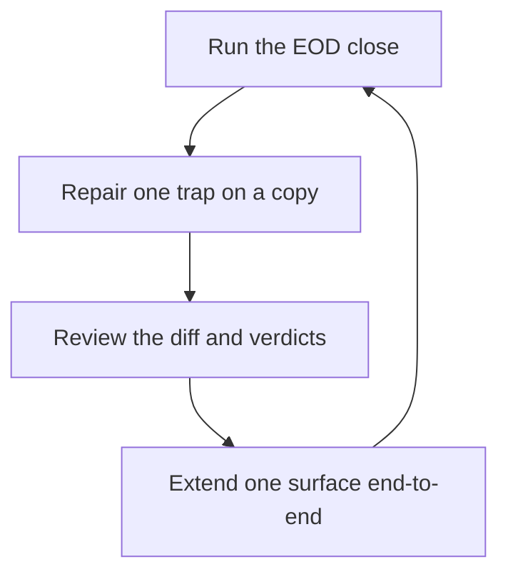

# Trading Desk Sheets

> Portability target: Spec-level. This skill encodes the workbook standard and its traps, not one desk's private cell addresses.

<!-- QUICK: 30s - memorize the pipeline (snapshot -> renderer -> verify), the ownership zones, and the four great traps: stale validations, format persistence, broadcast formulas, grid caps. -->

---

## Route the Request **(QUICK)**

| Condition | Action |
|-----------|--------|
| Building the workbook / a new year | One workbook per calendar year; everything renders from a snapshot JSON |
| Adding a venue, account, or asset class | Snapshot first, then renderer, then wire EVERY derived surface the same day |
| A cell shows the red invalid triangle | Stale-validation trap -> clear-then-apply repair |
| A format looks wrong after rows shifted | Format persistence trap -> reset-then-reapply |
| A values write fails ("exceeds grid limits") | Expand the grid BEFORE the write |
| Numbers look stale or disagree | Refresh snapshot -> re-render -> run the full audit |
| The user edited cells | Identify the zone: user zones are sacred; desk zones render from the snapshot |

**Intent Route questions:**
1. Which tab / account / asset class is this about?
2. Is the snapshot current, and does the renderer point at the right workbook?
3. Is the touched cell a desk-owned cell or a user-edit zone?

---

## Anti-Rationalization **(QUICK)**

**The five excuses that corrupt a workbook:**
- **AR-01 "It's one cell, I'll fix it by hand."** NO. The next render erases it. Fix the snapshot; the sheet is a render target, not a workspace.
- **AR-02 "The red triangle is cosmetic."** NO. A stale validation rule hides real invalid cells - repair it before trusting anything on that tab.
- **AR-03 "Formats look fine."** You did not check after a row shift. Reset-then-reapply, or stale format ranges ship silently.
- **AR-04 "I'll regenerate the derived artifacts later."** NEVER "later": flat indexes, marketplace files, and graph data ship in the SAME commit as the source, or CI sees a stale pair.
- **AR-05 "Quota is fine, I'll write cell-by-cell."** NO. Batch the calls, sleep on 429, never parallelize - the render is one conversation with the API.

---

## Ground Rules - Read Before Anything Else **(QUICK)**

| # | Rule | Mechanical Trigger | Violation Response |
|---|------|--------------------|-------------------|
| R1 | Never hand-edit desk cells; everything renders from the snapshot | Any direct cell edit | Re-render; fix the snapshot instead |
| R2 | The snapshot is the single source of truth | Any tab update | Update snapshot -> render |
| R3 | Renders are idempotent and quota-batched; on 429 sleep then retry | Any render | Let the api() retry; never parallelize |
| R4 | Every render ends with machine verdicts: invalid-cell check = 0 and audit = pass | After every render | Fix and re-render; a non-zero exit is "not done" |
| R5 | User zones are sacred: fill columns, checkboxes, user notes | Any write cycle | Skip them; read them back, never overwrite |
| R6 | No secrets, tokens, or full account numbers in the sheet | Any cell write | Last-4 identifiers only; credentials live outside |

---

## Anti-Hallucination

- **Admit uncertainty** - If the snapshot, the venue number, or the render verdict is not in hand, say so and fetch it. Never render a guessed value into a cell or a report.
- **Flag your knowledge cutoff** - Layouts, quotas, and API behaviors change; state the timestamp and source of every structural claim you make about the workbook.
- **Never guess security** - Sheet sharing, credentials, and account identifiers touch security. If anything about access is ambiguous, stop; default to the safer interpretation; never invent a spreadsheet ID, an account number, or a permission.
- **[VERIFIED]** - Every factual claim about the workbook traces to a live read (checker output, audit line, spot-read cell) or a reference in `references/`. Tag anything else as advisory. Corrections are logged (old -> new + why), never silent.

---

## The Expert's Mindset **(QUICK)**

A desk workbook is a **build product**, not a document: a data model (snapshot), a renderer (idempotent, quota-aware), and a verification loop (checks that actually fire). The professional treats the spreadsheet as something that can be destroyed and rebuilt from one JSON plus one command, with a machine verdict at each step. If a human hand is required to keep a value correct, the pipeline is already broken - fix the pipeline, not the cell.

### What Sheet Masters Know **(STANDARD)**

- The renderer owns layout; humans own only the input columns. Never fight the boundary.
- Google Sheets quirks are not surprises - they are known traps with known repairs: validations persist outside their range, formats persist after rows shift, formulas differ in broadcast behavior, and USER_ENTERED parses anything that looks like a date or formula.
- Quota math matters: 60 write calls per minute; batch writes, retry on 429, never parallelize.
- Derived artifacts (flat discovery indexes, marketplace manifests, graph data) are part of the build; they are regenerated in the same commit that changes their source.
- The close is one command that ends in a verdict line, not a checklist a human ticks.

### When to Break Your Own Rules **(DEEP)**

<!-- DEEP: 10+ min - read fully before granting yourself the first exception. -->

- **Live-fire repair.** During an active trading fire, repair the minimum cell range needed to keep the report readable, then re-render within the day and log the exception. The exception is logged or it did not happen.
- **Manual P&L stamp.** When a render missed a day, a manual stamp script may write that day's data row only - idempotent, logged, never touching formulas.
- **Schema migration.** When the snapshot schema changes, migrate deliberately: snapshot -> renderer -> derived surfaces -> full audit, on a copy first when the workbook is live.

---

## Deliberate Practice **(STANDARD)**



| Level | Routine | Time | Success Metric |
|-------|---------|------|---------------|
| Novice | Run the render + checks; read the verdicts | per close, 5 min | 100% of closes end in a verdict |
| Intermediate | Repair validation/format traps without help | weekly, 15 min | Triangle count 0 across tabs |
| Advanced | Extend the schema (new account / class) end-to-end | per change, 1 h | Tab + PNL + dashboard + chart all wired, checks green |
| Expert | Design pipeline contracts so violations fail loudly | monthly, 1 h | Zero silent inconsistencies between snapshot and sheet |

---

## Operating at Different Levels **(STANDARD)**

### L1: Apprentice
- **Scope:** One workbook, one command for the close. Runs the render and reads the verdict lines.
- **Craft:** Knows the ownership zones and never hand-edits desk cells.

### L2: Practitioner
- **Scope:** Full repair set: validations, formats, grid caps, formula traps. Handles user-zone conflicts correctly.
- **Craft:** Spot-reads changed ranges after every render; logs corrections instead of silently fixing.

### L3: Senior
- **Scope:** Multi-venue books; adds accounts and asset classes end-to-end; owns the P&L grid and monthly structure.
- **Craft:** Wires every derived surface the same day; keeps the class split (options / stocks / crypto) honest.

### L4: Staff
- **Scope:** Snapshot schema design; quota budgeting; renderer architecture; CI-fresh derived artifacts.
- **Craft:** Designs so that a stale pair (source vs artifact) fails loudly in CI.

### L5: Transformative
- **Scope:** The pipeline itself - self-verifying, idempotent, multi-agent safe; yearly rollover is a one-command ceremony.
- **Craft:** Makes the correct procedure the path of least resistance for every future operator.

---

## When to Use **(QUICK)**

**Use this skill when:**
1. Building or auditing the desk's workbook pipeline (snapshot -> renderer -> checks).
2. Adding a venue, account, asset class, or year to an existing workbook.
3. Repairing the classic traps: invalid cells, format bleed, formula broadcast failures, grid caps.
4. Reconciling desk-rendered cells with user-maintained input zones.

---

## When NOT to Use **(QUICK)**

**Do NOT use this skill when:**
1. The task is trade selection, sizing, or order placement - that is the trading and sizing skills' job.
2. The task needs live market data - this skill renders what the snapshot says; refresh the snapshot first (venue reads are upstream).
3. The workbook is a one-off scratch sheet with no rendering pipeline - the traps here are for maintained workbooks.

---

## Decision Trees **(STANDARD)**

### Decision Tree 1: A cell looks wrong - what is it?

```
Cell complaint?
|-- Red triangle on a value cell
|     --> STALE VALIDATION: a rule from an older build persists outside its range.
|         Repair = clear-then-apply per column (a range set WITHOUT a rule key REMOVES
|         validation), then re-apply a tight range that ENDS at the table boundary
|         (data + total row; never headers, never the next block).
|-- Wrong number format after a row shift
|     --> FORMAT PERSISTENCE: formats survive row moves.
|         Repair = reset-then-reapply: set the used block back to General/false first,
|         then re-apply currency/percent/bold ranges.
|-- Wrong VALUE
|     --> Snapshot wrong or stale. Fix the snapshot, re-render, re-audit.
|-- Formula shows #N/A
|     --> BROADCAST TRAP. Range-based XLOOKUP and LOOKUP(2,1/(...)) do NOT broadcast.
|         Use INDEX(range, SUMPRODUCT(MAX(cond*ROW(range)))-base) for last-match,
|         INDEX(range, MATCH(TRUE, ARRAYFORMULA(range<>""), 0)) for first-match.
|-- Summary line shows #ERROR!
      --> The line STARTS with "+" - USER_ENTERED parsed it as a formula. Reword it.
```

### Decision Tree 2: A write or render fails

```
Write failure?
|-- "exceeds grid limits"
|     --> Expand gridProperties (rowCount/colCount) BEFORE the values write.
|         Tabs created with explicit caps STAY capped - expand them, then write.
|-- 400 on addChart / addBanding / conditional-format add
|     --> You added before deleting. Deletions run FIRST in the same batch.
|         addBanding REQUIRES rowProperties (colorOnly fails).
|-- 429
|     --> Quota. The api() helper sleeps ~45 s and retries; reduce call count, never parallelize.
|-- Partial / interrupted render
      --> Re-run the SAME render (idempotent). Verify with the checks. Never patch by hand.
```

### Decision Tree 3: Adding a venue, account, or asset class

```
New surface?
|-- 1. SNAPSHOT: add the account block (key, title, value, cash, holdings, notes).
|       Value = the venue's OWN reported number; never sum across venues.
|-- 2. RENDERER: the per-account tab builds from the snapshot - confirm each class
|       table renders (STOCKS / OPTIONS / CRYPTO), with empty classes handled cleanly.
|-- 3. DERIVED SURFACES, same day: P&L column (merge by the sheet's own header row,
|       never positionally), dashboard row + class block, per-account chart.
|-- 4. ARTIFACTS: flat index / marketplace / graph regenerated in the same commit.
|-- 5. VERIFY: run the close (render -> invalid-cell check -> audit) to ALL GREEN;
      spot-read three cells of the new tab.
      --> If any step is skipped, the surface is HALF-WIRED: say so in the report.
```

### Decision Tree 4: Desk and user both edited - who wins?

```
Conflict?
|-- Cell inside a USER ZONE (fill-in columns, checkboxes, user-typed notes)
|     --> User wins. NEVER overwrite. Read it back, mirror into the ledger/records, leave it.
|-- Cell inside a DESK ZONE (any rendered value)
|     --> Desk wins on the next render. If the user MEANT to change it,
|         change the SNAPSHOT to match, then re-render.
|-- Unsure
      --> Treat as user zone. Surface the question in the report; never guess.
```

---

## Core Workflow **(STANDARD)**

### Phase 1: Refresh the snapshot (~5 min)
1. **Do:** Read every venue (native APIs only; the owning venue's API is the ONLY truth for balances and positions). Rewrite the snapshot JSON; stamp `generated`.
2. **Verify:** Every account `value` equals the venue's own reported number; classes within an account reconcile to it (or the divergence is documented in a note).
3. **Output:** Updated snapshot + stamp.

### Phase 2: Render (~minutes; idempotent)
1. **Do:** Run the one-command close: render -> invalid-cell check -> full audit.
2. **Verify:** The close prints its verdict ("ALL GREEN" or equivalent); spot-read the changed tab.
3. **Output:** Rendered tabs, rebuilt charts, applied formats/validations.

### Phase 3: Stamp the day
1. **Do:** The P&L day row auto-stamps from the snapshot (weekend snapshots stamp the last session). Manual corrections only through the dedicated script, logged.
2. **Verify:** The day row shows every account column; the TOTAL chain is intact.
3. **Output:** Stamped P&L.

### Phase 4: Learnings + user input
1. **Do:** Rebuild the learnings tab from the trade ledger (spread legs netted per date+symbol). Pull user fill columns back into the ledger; never push into user zones.
2. **Verify:** Realized totals in the sheet equal the ledger's netted numbers exactly.
3. **Output:** Consistent learnings + refreshed ledger rows.

---

## Best Practices **(STANDARD)**

1. **Snapshot first, render second, verify third** - in that order, every time.
2. **One command for the close** (render -> check -> audit). If the close is three commands a human must remember, it is already drifting.
3. **Money formats:** currency for money, percent for rates, and the sign in the number as the redundant channel - never encode meaning in color alone.
4. **Dates and labels as apostrophe TEXT.** Month labels and expiry dates included.
5. **Charts:** delete-first on every render (charts, bandings, conditional-format rules), zero-baseline column charts, pie with <= 3 slices, titles that state the insight.
6. **Keep the class split honest.** For unknown cost bases render a dash ("-") and EXCLUDE those rows from P&L - never substitute zero, never invent a basis. Say why in a note.
7. **Grid discipline:** expand before big writes; grids created with caps stay capped.
8. **Merge by header, not by position,** whenever a column is inserted into an existing grid.

---

## Error Decoder **(STANDARD)**

| Symptom | Root Cause | Fix | Lesson |
|---------|-----------|-----|--------|
| Red triangles all over one column | Stale validation rule from an older build | Clear-then-apply per column | Validations outlive their ranges forever |
| "$14.00" printed on a count row | Number format persisted after rows shifted | Reset-then-reapply formats | Formats are sticky too |
| Month lookups return #N/A | Formula type does not broadcast in Sheets | INDEX + SUMPRODUCT(MAX(...ROW(...))) | Test formulas live, per sheet |
| addBanding returns 400 | rowProperties missing | Include rowProperties | The API is strict where the UI is forgiving |
| #ERROR! in a summary line | Line started with "+" | Reword the line | USER_ENTERED parses leading + as a formula |
| Values write fails hard | Grid cap too small | Expand gridProperties first | Caps are forever unless raised |
| Old values lost after a column insert | Positional merge assumed | Merge by the header row | Headers are the stable keys |

---

## Error Recovery **(QUICK)**

| Symptom | First Action | If That Fails | Last Resort |
|---------|--------------|---------------|-------------|
| Render half-completed | Re-run the same close (idempotent) | Restore from the last green render | Rebuild the tab from the snapshot (delete-first) |
| Validation damage spread | Run the per-cell checker to see REAL coverage | Clear + re-apply per column | Recreate the tab |
| Suspect numbers | Re-read the venue natively; disagreement = data alert + no action | Refresh the snapshot | Stamp the stale value "as of <time>" and fix next cycle |
| User zone overwritten (worst case) | Restore from the user's own record or their app; document in the report | Ask the user for the missing input | Leave the zone blank rather than guessing |

**Hard failure boundary:** Never hand-patch a value to make an audit pass. A faked green is worse than a red.

---

## Cross-Skill Coordination **(STANDARD)**

### Upstream (What This Skill Needs)

| Upstream Skill | Artifact Needed | What You'll Use It For |
|---------------|----------------|----------------------|
| `trade-sizing-recovery` | Rules text, triage dispositions, WHY lines | Why/Falsifier notes rendered onto holdings rows |
| `trade-performance-analyst` | Netted trade record, expectancy by class | Learnings rollups and realized-P&L columns |
| `options-risk-engineer` | Portfolio-level risk views | Dashboard risk lines that must stay consistent with source reads |

(Venue read tools - broker APIs / MCP servers - are infrastructure, not skills; they feed the snapshot.)

### Downstream (What This Skill Produces)

| Downstream | Deliverable | What They'll Do With It |
|------------|-------------|-------------------------|
| Daily reports / mirrors | Fresh rendered tabs + verdicts | Quote the sheet as the end-of-day source |
| Weekly review | Learnings rollups, monthly blocks | Calibration and pruning decisions |
| The user | Input zones (fills, checkboxes, notes) | Maintain their own book without touching desk cells |

---

## Proactive Triggers **(STANDARD)**

- **After ANY render** -> run the invalid-cell checker and the audit. "Looks fine" is not a verdict. 🔴
- **Daily close** -> the one-command EOD; stamp the P&L row; note the verdict in the log. 🟠
- **New venue/class added anywhere** -> wire all derived surfaces the same day, artifacts in the same commit. 🔴
- **User touched fill columns** -> pull back into the ledger at the next sync. 🟡
- **Two consecutive red closes** -> stop feature work; repair the pipeline before adding anything. 🔴

---

## Anti-Patterns **(STANDARD)**

| ❌ Anti-Pattern | ✅ Do This Instead |
|----------------|-------------------|
| ❌ Hand-editing desk cells "just this once" | ✅ Snapshot -> render |
| ❌ Ignoring the red invalid triangle as cosmetic | ✅ Clear-then-apply repair, then re-check |
| ❌ Adding charts/bandings/rules before deleting old ones | ✅ Delete-first, then add, in the same batch |
| ❌ Writing values before expanding the grid | ✅ Expand gridProperties first |
| ❌ Dates typed as USER_ENTERED | ✅ Apostrophe-prefixed text |
| ❌ "Regenerate artifacts later" | ✅ Same commit as the source |
| ❌ Merging P&L columns positionally | ✅ Merge by the sheet's own header row |
| ❌ Substituting 0 for an unknown cost basis | ✅ Render a dash and exclude from P&L |

---

## State Log **(QUICK)**

| Turn | Action | Decision | Risk Accepted | Mitigation |
|------|--------|----------|---------------|------------|
| 1 | Added a venue end-to-end | Snapshot -> renderer -> P&L col + dashboard row + chart | Half-wired surface if a step skipped | Tree 3 followed to a green close |

**Anti-Drift Check:** Before each response, verify: (1) did the last action match the pipeline order? (2) are user zones intact? (3) did the close end in a machine verdict?

---

## Production Checklist **(STANDARD)**

- [ ] **CR1: Render is idempotent** - Complete when two consecutive close runs both print the green verdict.
- [ ] **CR2: Invalid cells** - Complete when the per-cell checker reads 0 mismatches on every tab.
- [ ] **CR3: Formats hold** - Complete when spot cells still show the intended formats after a row shift.
- [ ] **CR4: User zones intact** - Complete when fill columns / checkboxes are unchanged by the render.
- [ ] **CR5: New surfaces fully wired** - Complete when tab + P&L column + dashboard row + chart all show the new item.
- [ ] **CR6: Provenance** - Complete when every new number traces to a source + time.
- [ ] **CR7: Derived artifacts fresh** - Complete when the flat-index / marketplace / graph checks pass.
- [ ] **CR8: Verdict captured** - Complete when the close prints its one-line machine verdict and the log line is written.
- [ ] **CR9: No secrets** - Complete when the sheet contains no tokens, keys, or full account numbers (last-4 only).
- [ ] **CR10: Snapshot stamp matches** - Complete when the snapshot `generated` stamp is older than the render but newer than the last venue read.
- [ ] **CR11: Corrections logged** - Complete when every manual fix carries an old -> new + why entry; zero silent corrections.
- [ ] **CR12: Rollover drill** - Complete when a copy-of-the-workbook rollover (new year) runs end-to-end without touching the live sheet.

---

## What Good Looks Like **(QUICK)**

A workbook you can destroy and rebuild from one JSON plus one command, in minutes, with a machine verdict at each step. User inputs survive every render. Every number carries provenance. The class split (options / stocks / crypto) is honest - unknown costs are dashes, not zeros. Nothing about the sheet requires a human hand to stay correct, and any stale pair (source vs artifact) fails loudly before a user ever sees it.

**Signs of Excellence:**
- Zero manual cell edits between renders; zero untriaged traps.
- Every close ends in a verdict line; every exception is logged.
- New venues and classes appear on every derived surface the same day.

**Signs of Dysfunction:**
- "It looked fine" appears in the change log.
- Triangles and format bleed accumulate across tabs.
- The snapshot and the sheet disagree, and nobody knows since when.

---

## Verification Guardrails **(STANDARD)**

### Pre-Generation
- [ ] The snapshot is current and complete; the renderer points at the intended workbook.
- [ ] User zones identified; the render plan cannot touch them.
- [ ] Grid caps checked against the intended write size.

### Post-Generation
- [ ] Invalid-cell check = 0; audit pass; the verdict line captured.
- [ ] Spot-read three cells of the changed range.
- [ ] User zones verified unchanged.
- [ ] Every correction logged old -> new + why; never silent.

---

## Deliberate Practice - Advanced Drills **(DEEP)**

<!-- DEEP: 10+ min - run these monthly. -->

1. **Destroy and rebuild.** Rebuild one tab from the snapshot on a throwaway copy and time it. The gap versus the live sheet is your pipeline debt.
2. **Plant a trap.** On a copy, introduce each of the four traps (stale validation, format bleed, broadcast formula, cap overflow) and repair them without notes. Speed here is the skill.
3. **Add a fake venue.** Take a scratch account end-to-end (snapshot -> tab -> P&L -> dashboard -> chart -> checks). If it takes longer than one sitting, tighten the pipeline.

---

## References **(QUICK)**

- `references/quick-ops.md` - the exact close / repair / artifact commands for the reference implementation.
- `scripts/verify-skill.sh` - deterministic self-check for this skill (files + required sections).

---

## Gotchas **(QUICK)**

- **A phantom quantity is expensive.** A stale validation rule that lets a wrong share count survive into a report can trigger a mis-sized trim - the trap's cost is the delta between the phantom position and the truth, typically **$200-$2,000** of unwanted risk per event.
- **Format bleed misreads money as counts.** A "$14.00" printed on a count row was read as dollars in a review that moved **$500-$5,000** of allocation before anyone caught it. Reset-then-reapply.
- **A blank month is a blind month.** A broadcast-failure #N/A that blanks a month's P&L hides the month's drawdown; recovery decisions then start late - worth **$500-$5,000** of slippage at our position sizes.
- **Grid caps fail mid-close.** When the write dies on "exceeds grid limits," the day's report ships stale; trading on stale marks costs roughly **$100-$1,000** per event in avoidable slippage.
- **Positional merges reshuffle the book.** After a column insert, old values land in the wrong accounts - a misreported **$1,000-$10,000** book split until someone diffs the rows. Merge by header row, always.
- **Overwriting a user zone destroys records.** Fill columns carry the only record of some fills; clobbering one costs a reconciliation hunt worth **$200-$2,000** of time and risk. Read back, never write.
- **setDataValidation without a `rule` key REMOVES validation** for the range - that is the repair mechanism, not a bug.
- **Ranges are `[startRowIndex, endRowIndex)` 0-based;** a data row r (1-based) starts at `r-1`. 1-based coverage = `[start+1, end]`.
- **addBanding requires rowProperties;** colorOnly fails with a 400.
- **gspread `client.request()` returns a Response** - call `.json()` on it.
- **USER_ENTERED parses**: leading `+`, date-like strings, and number-like labels are all transformed. Apostrophe-prefix what must stay text.
- **Tabs keep the caps they were created with;** expand before large writes.
- **A weekend snapshot stamps to the last session day** (by design) - do not "fix" that.
- **Options expiry cells** become date serials unless written as apostrophe-prefixed ISO text.

---

> **Skill version:** 1.1.0 | **Token budget:** 3600 | **Generated:** 2026-10-10
